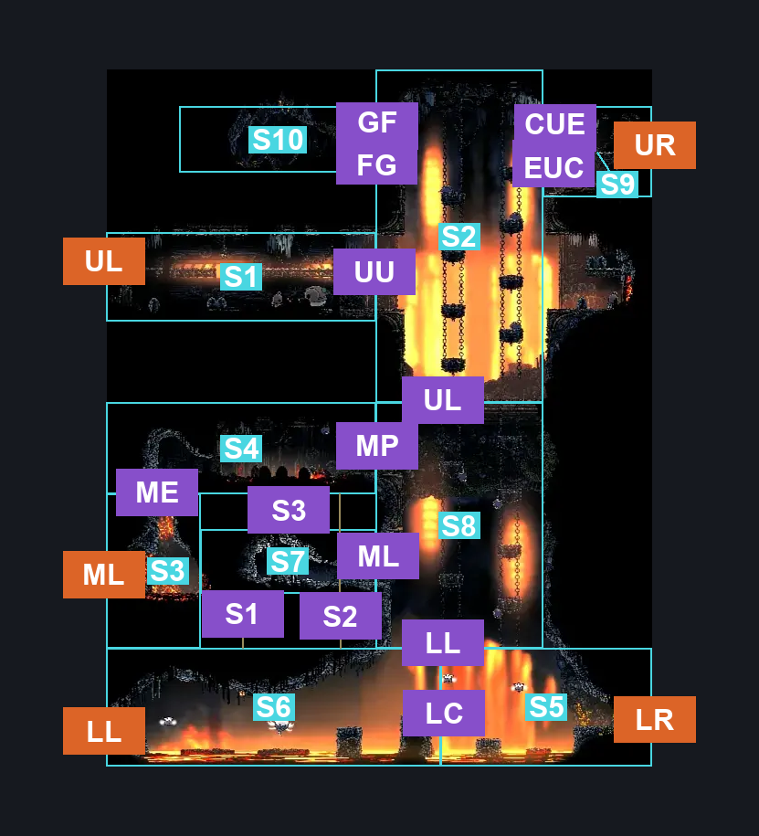
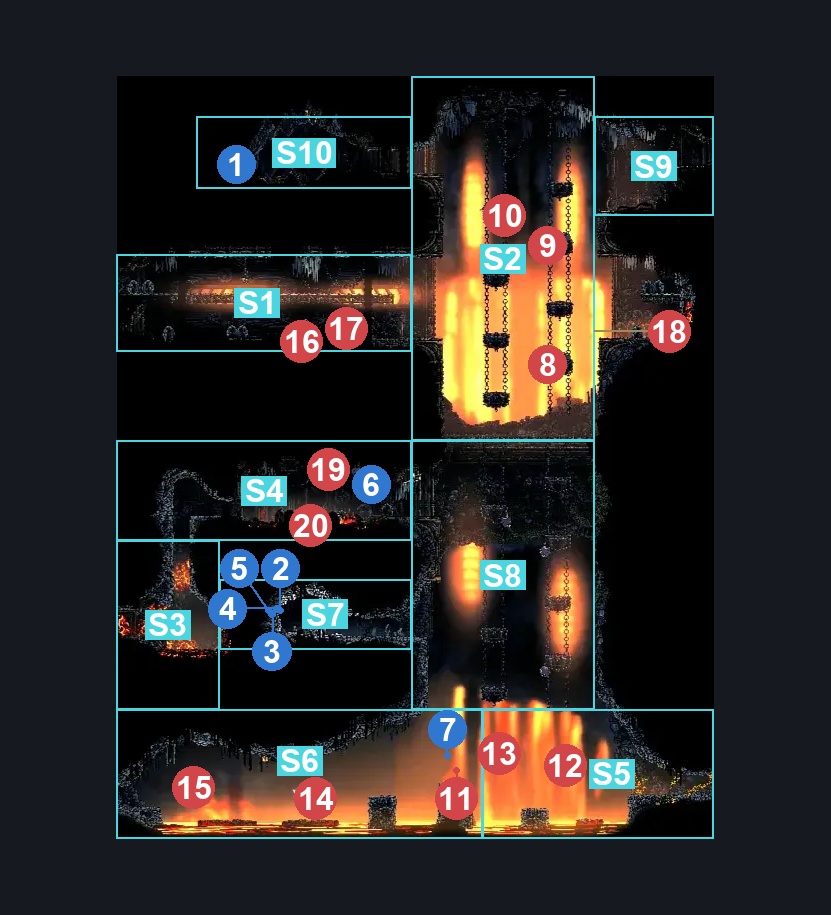
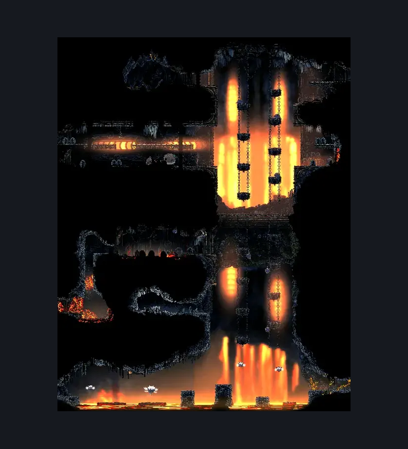

# Deep Docks Chains Center (Dock_02b)

**Game ID:** Dock_02b

**Contributors:** herounit,Rebel, Gallos

## Subrooms

| No. | Subroom | Annotated |
| --- | --- | --- |
| S1 | upper left hallway | ✓ |
| S2 | upper chain platforms | ✓ |
| S3 | middle left exit area | ✓ |
| S4 | middle switch platform | ✓ |
| S5 | lower right area | ✓ |
| S6 | lower left area | ✓ |
| S7 | middle side room | ✓ |
| S8 | lower chain platforms | ✓ |
| S9 | upper right exit | ✓ |
| S10 | Flintslate | ✓ |

## Room Transitions

| Alias | Name | From subroom | Destination | Destination alias | Requirements | TODO | Verification | Annotated | Notes |
| --- | --- | --- | --- | --- | --- | --- | --- | --- | --- |
| UL | left1 | upper left hallway | [Deep Docks Chains West (Dock_02)](deep-docks-chains-west.md) | UR | none |  | Verified | ✓ |  |
| ML | left2 | middle left exit area | [Deep Docks Chains West (Dock_02)](deep-docks-chains-west.md) | MR | none |  | Verified | ✓ |  |
| LL | left3 | lower left area | [Deep Docks Chains West (Dock_02)](deep-docks-chains-west.md) | LR | none |  | Verified | ✓ |  |
| UR | right1 | upper right exit | [Deep Docks Chains Upper East (Dock_03)](deep-docks-chains-upper-east.md) | L | none |  | Verified | ✓ |  |
| LR | right2 | lower right area | [Deep Docks Chains Lower East (Dock_03c)](deep-docks-chains-lower-east.md) | L | activate shortcut blast rock IN Deep docks chains lower east |  | Verified | ✓ |  |

## Subroom Connections

| Alias | Name | Source | Destination | Requirements | TODO | Verification | Annotated | Notes |
| --- | --- | --- | --- | --- | --- | --- | --- | --- |
| UU | horizontal | upper left hallway | upper chain platforms | none |  | Verified | ✓ |  |
| UU | horizontal | upper chain platforms | upper left hallway | none |  | Verified | ✓ |  |
| FG | Flintslate Get | upper chain platforms | Flintslate | (easy pogo off lavalug AND (easy pogo off Smelt Shoveller OR easy [shaman,beast,reaper] pogo) AND ((run AND (dash left OR drifter's)) OR sharpdart x 2 OR clawline left)) OR ((Ledge Grab left OR Cling Grip left) AND (ledge grab right OR cling grip right OR proficient movement OR easy [heal,thread storm,rune rage, silkspear, cross stitch, pale nails] stall x 2)) OR (flea brew AND easy flea brew stall) OR easy Scuttlebrace OR Silk Soar OR Faydown Cloak OR (cling grip right AND (dash left OR clawline left OR sharpdart OR flea brew OR drifter's OR easy [wanderer,architect] needle strike OR easy [heal,plasmium, voltvessels,thread storm,rune rage,silkspear] stall)) OR easy voltvessels stall OR easy pogo off Deep diver OR (easy beast pogo AND (drifter's OR easy heal stall)) OR easy beast needle strike OR medium plasmium stall |  | Verified | ✓ | lever not activated |
| FG | Flintslate Get | Flintslate | upper chain platforms | none |  | Verified | ✓ |  |
| GF | upper to flinslate | upper chain platforms | Flintslate | activate ceiling switch AND (easy pogo off Deep diver OR Ledge Grab left OR Cling Grip left OR easy Scuttlebrace OR Silk Soar OR Faydown Cloak OR (have crest beast AND medium heal stall AND (easy beast pogo OR easy plasmium stall x 2)) OR (cling grip right AND (dash left OR clawline left OR sharpdart OR flea brew OR easy beast pogo OR run OR easy [wanderer,architect] needle strike OR easy [heal,plasmium, voltvessels,thread storm,rune rage,silkspear] stall))) |  | Verified | ✓ | lever activated |
| GF | upper to flinslate | Flintslate | upper chain platforms | none |  | Verified | ✓ |  |
| EUC | upper to right | upper chain platforms | upper right exit | (easy pogo off lavalug AND (easy pogo off Smelt Shoveller OR easy [shaman,beast,reaper] pogo) AND ((dash right AND clawline left) OR (dash left AND clawline right) OR drifter's OR sharpdart x 2 OR clawline both OR run OR (sharpdart AND (clawline either OR dash either)))) OR easy voltvessels stall OR cling grip right OR (flea brew AND easy flea brew stall) OR easy beast pogo OR Silk soar OR faydown OR easy scuttlebrace OR easy pogo off Deep diver OR ledge grab right OR (Proficient movement AND (easy [wanderer, architect] needle strike OR dash right OR run OR clawline right OR sharpdart )) OR medium plasmium stall |  | Verified | ✓ | lever not activated |
| EUC | upper to right | upper right exit | upper chain platforms | none |  | Verified | ✓ |  |
| CUE | Upper Chain <> Right Exit | upper chain platforms | upper right exit | activate ceiling switch AND (easy pogo off Deep diver OR ((Ledge Grab left OR Cling Grip left) AND (dash right OR ledge grab right OR clawline right OR sharpdart OR easy [flea brew, plasmium, voltvessels] stall OR easy beast pogo OR easy architect needle strike OR drifter's)) OR easy Scuttlebrace OR Silk Soar OR Faydown Cloak OR (have crest beast AND medium heal stall AND (easy beast pogo OR easy plasmium stall x 2)) OR cling grip right) |  | Verified | ✓ | lever activated |
| CUE | Upper Chain <> Right Exit | upper right exit | upper chain platforms | none |  | Verified | ✓ |  |
| ME | middle exit to switch platform | middle left exit area | middle switch platform | cling grip left OR ( silk soar AND magma bell ) OR (cling grip right AND (ledge grab left OR  faydown)) OR easy scuttlebrace |  | Verified | ✓ |  |
| ME | middle exit to switch platform | middle switch platform | middle left exit area | none |  | Verified | ✓ |  |
| MP | middle platform to lower chains | middle switch platform | lower chain platforms | Activate Ceiling Switch |  | Verified | ✓ |  |
| MP | middle platform to lower chains | lower chain platforms | middle switch platform | Activate Ceiling Switch |  | Verified | ✓ |  |
| ML | lower chain to side | lower chain platforms | middle side room | activate ceiling switch |  | Verified | ✓ |  |
| ML | lower chain to side | middle side room | lower chain platforms | activate ceiling switch |  | Verified | ✓ |  |
| LC | lower crossing | lower right area | lower left area | run OR dash left OR drifter's cloak OR faydown cloak OR cling grip left  OR silk soar OR clawline left OR sharp dart OR easy beast pogo OR ((Ledge Grab left AND (easy shaman crest pogo OR easy reaper pogo OR (Proficient Movement AND Architect Attack Left) OR Easy [Architect, wanderer] needle strike))) OR easy scuttlebrace OR easy pogo off caranid |  | Verified | ✓ |  |
| LC | lower crossing | lower left area | lower right area | none |  | Verified | ✓ |  |
| S1 | side room to lower left | middle side room | lower left area | silk soar OR (easy pogo off [vicious caranid, caranid] AND (cling grip left OR easy scuttlebrace)) |  | Verified | ✓ |  |
| S1 | side room to lower left | lower left area | middle side room | none |  | Verified | ✓ |  |
| S2 | lower to switch | lower left area | middle switch platform | silk soar OR (easy pogo off caranid AND (cling grip left OR easy scuttlebrace) AND faydown) OR (easy pogo off vicious caranid AND (cling grip left OR easy scuttlebrace)) |  | Verified | ✓ |  |
| S2 | lower to switch | middle switch platform | lower left area | none |  | Verified | ✓ |  |
| S3 | switch to side room | middle switch platform | middle side room | dash left OR easy [hunter,beast,shaman,architect] pogo OR easy wanderer needle strike OR easy [flea brew, heal, thread storm, voltvessels, plasmium, cross stitch, rune rage, pale nails, silkspear, flintslate] stall OR cling grip left OR ledge grab left OR sharpdart OR clawline left OR activate ceiling switch |  | Verified | ✓ |  |
| S3 | switch to side room | middle side room | middle switch platform | ((cling grip left OR easy scuttlebrace) AND faydown) OR (activate ceiling switch AND (ledge grab right OR proficient movement OR faydown OR easy beast needle strike)) |  | Verified | ✓ |  |
| UL | upper to lower | upper chain platforms | lower chain platforms | Activate Ceiling Switch |  | Verified | ✓ |  |
| UL | upper to lower | lower chain platforms | upper chain platforms | activate ceiling switch AND ( silk soar OR cling grip right OR easy Scuttlebrace OR (cling grip left AND (faydown OR (have crest shaman AND easy pogo off lavalug) OR clawline left OR sharpdart OR (run AND dash left) OR (drifter's AND (dash left OR easy [heal,flea brew] stall))))) |  | Verified | ✓ |  |
| LL | lower to lower chain | lower right area | lower chain platforms | activate ceiling switch AND ( silk soar OR (easy pogo off caranid AND easy damage boost off caranid AND (easy [heal,plasmium, voltvessels,thread storm,rune rage,silkspear] stall x 2 OR cling grip either OR ledge grab either OR easy scuttlebrace OR faydown OR drifter's OR proficient movement)) OR easy pogo off Vicious Caranid) |  | Verified | ✓ |  |
| LL | lower to lower chain | lower chain platforms | lower right area | activate ceiling switch |  | Verified | ✓ |  |

## Check Locations

| No. | Check | Subroom | Requirements | TODO | Verification | Location Type | Annotated | Notes |
| --- | --- | --- | --- | --- | --- | --- | --- | --- |
| 1 | flintslate | Flintslate | none |  | Verified | collectible | ✓ |  |
| 2 | shell shard cache deep docks 6 | middle side room | none |  | Verified | resource | ✓ |  |
| 3 | shell shard cache deep docks 7 | middle side room | none |  | Verified | resource | ✓ |  |
| 4 | shell shard cache deep docks 8 | middle side room | none |  | Verified | resource | ✓ |  |
| 5 | shell shard cache deep docks 9 | middle side room | none |  | Verified | resource | ✓ |  |
| 6 | ceiling switch | middle switch platform | none |  | Verified | switch | ✓ | lowers middle chain platforms |
| 7 | Dock Guard Thrower encounter 1 | lower left area | none |  | Verified | event | ✓ | defeatedDockForemen=false |
| 8 | Lavalug 1 | upper chain platforms | normal world spawn |  | Verified | enemy | ✓ | ceiling switch false OR else they get sent to lower chain |
| 9 | Lavalug 2 | upper chain platforms | normal world spawn |  | Verified | enemy | ✓ | ceiling switch false OR else they get sent to lower chain |
| 10 | Lavalug 3 | upper chain platforms | normal world spawn |  | Verified | enemy | ✓ | ceiling switch false OR else they get sent to lower chain |
| 11 | Dock Guard Thrower Enc1 1 | lower left area | none |  | Verified | enemy | ✓ | Spawn conditions: defeatedDockForemen=false, gotPastDockSpearThrower=false |
| 12 | Caranid 1 | lower right area | defeat forebrothers boss fight IN deep docks forebrothers |  | Verified | enemy | ✓ | Spawn conditions: defeatedDockForemen=true |
| 13 | Caranid 2 | lower right area | defeat forebrothers boss fight IN deep docks forebrothers |  | Verified | enemy | ✓ | Spawn conditions: defeatedDockForemen=true |
| 14 | Vicious Caranid 1 | lower left area | defeat forebrothers boss fight IN deep docks forebrothers |  | Verified | enemy | ✓ | Spawn conditions: defeatedDockForemen=true |
| 15 | Caranid 3 | lower left area | defeat forebrothers boss fight IN deep docks forebrothers |  | Verified | enemy | ✓ | Spawn conditions: defeatedDockForemen=true |
| 16 | Smelt Shoveller 1 | upper left hallway | normal world spawn |  | Verified | enemy | ✓ |  |
| 17 | Deep Diver 1 | upper left hallway | normal world spawn |  | Verified | enemy | ✓ |  |
| 18 | Smelt Shoveller 2 | upper chain platforms | normal world spawn |  | Verified | enemy | ✓ |  |
| 19 | Lavalug 4 | middle switch platform | normal world spawn |  | Verified | enemy | ✓ |  |
| 20 | Lavalug 5 | middle switch platform | normal world spawn |  | Verified | enemy | ✓ |  |

## Notes

the floor/lower half of this area is closed off initially

the switch to lower the middle chain section makes some of this logic difficult to reason about - but if you can reach the middle switch platform, there is no reason you can't reach all the stuff that unlocking the chains provides - might need to revise this for switch randomization

## Room Images

### Connections

### Checks

### Scene

