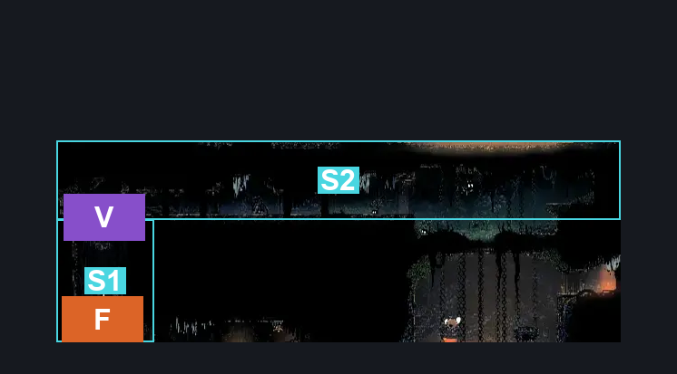
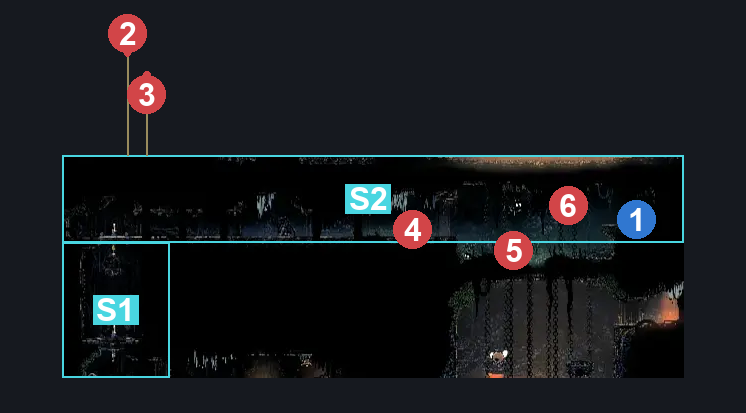
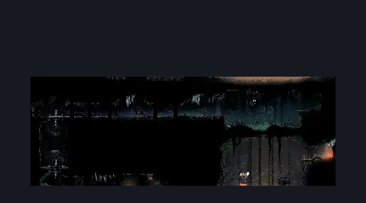

# Deep Docks Chains Flea Rescue (Dock_03d)

**Game ID:** Dock_03d

**Contributors:** herounit and Rebel

## Subrooms

| No. | Subroom | Annotated |
| --- | --- | --- |
| S1 | shaft | ✓ |
| S2 | flea room | ✓ |

## Room Transitions

| Alias | Name | From subroom | Destination | Destination alias | Requirements | TODO | Verification | Annotated | Notes |
| --- | --- | --- | --- | --- | --- | --- | --- | --- | --- |
| F | bot1 | shaft | [Deep Docks Chains Lower East (Dock_03c)](deep-docks-chains-lower-east.md) | LC | open airlock down |  | Verified | ✓ |  |

## Subroom Connections

| Alias | Name | Source | Destination | Requirements | TODO | Verification | Annotated | Notes |
| --- | --- | --- | --- | --- | --- | --- | --- | --- |
| V | shaft to flea | shaft | flea room | hit switch up AND (ledge grab either OR cling grip either OR faydown OR silksoar OR easy shaman pogo OR (easy scuttlebrace AND dash either) OR medium beast needle strike OR easy [voltvessels,plasmium] stall OR (easy [heal,flea brew] stall AND easy beast pogo)) |  | Verified | ✓ |  |
| V | shaft to flea | flea room | shaft | hit switch either |  | Verified | ✓ |  |

## Check Locations

| No. | Check | Subroom | Requirements | TODO | Verification | Location Type | Annotated | Notes |
| --- | --- | --- | --- | --- | --- | --- | --- | --- |
| 1 | Flea | flea room | none |  | Verified | collectible | ✓ | easiest flea ever |
| 2 | Flintflame Flyer 1 | flea room | invalid |  | Verified | enemy | ✓ | Spawn conditions: docksBomberAmbush=false |
| 3 | Flintstone Flyer 1 | flea room | invalid |  | Verified | enemy | ✓ | Spawn conditions: docksBomberAmbush=false |
| 4 | Fertid 1 | flea room | none |  | Verified | enemy | ✓ |  |
| 5 | Fertid 2 | flea room | none |  | Verified | enemy | ✓ |  |
| 6 | Flapping Fertid 1 | flea room | none |  | Verified | enemy | ✓ |  |

## Room Images

### Connections

### Checks

### Scene

