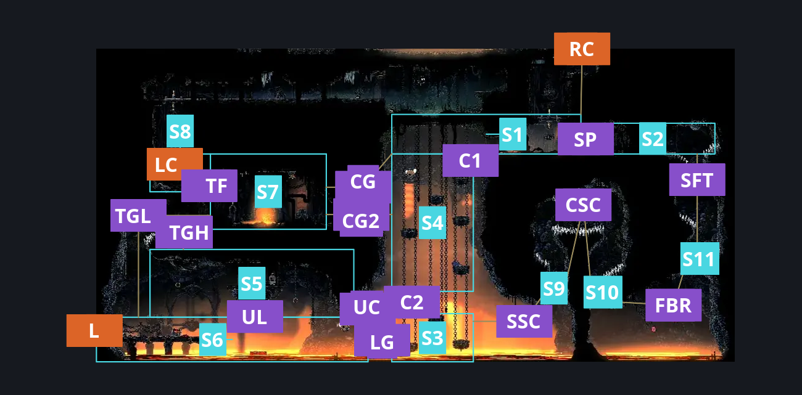
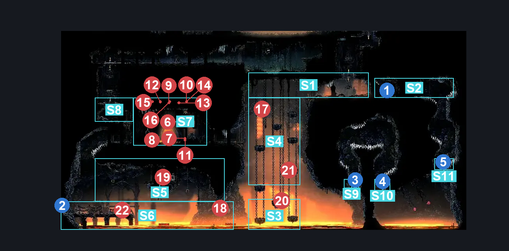
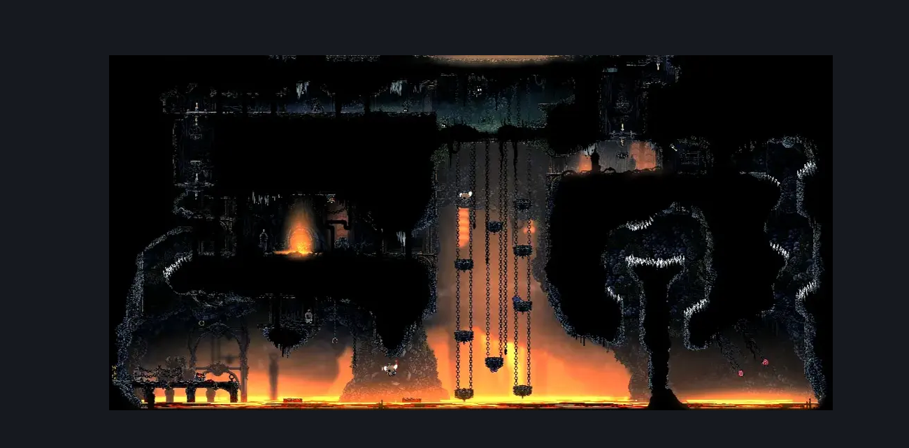

# Deep Docks Chains Lower East (Dock_03c)

**Game ID:** Dock_03c

**Contributors:** herounit and Rebel

## Subrooms

| No. | Subroom | Annotated |
| --- | --- | --- |
| S1 | upper chains | ✓ |
| S2 | spool fragment | ✓ |
| S3 | lower chains | ✓ |
| S4 | middle chains | ✓ |
| S5 | upper lava platform | ✓ |
| S6 | lower lava platform | ✓ |
| S7 | gauntlet | ✓ |
| S8 | upper left of gauntlet | ✓ |
| S9 | Spool Rock 1 | ✓ |
| S10 | Spool Rock 2 | ✓ |
| S11 | Spool Rock 3 | ✓ |

## Room Transitions

| Alias | Name | From subroom | Destination | Destination alias | Requirements | TODO | Verification | Annotated | Notes |
| --- | --- | --- | --- | --- | --- | --- | --- | --- | --- |
| RC | top2 | upper chains | [Deep Docks Chains Upper East (Dock_03)](deep-docks-chains-upper-east.md) | F | nothing. |  | Verified | ✓ |  |
| LC | top1 | upper left of gauntlet | [Deep Docks Chains Flea Rescue (Dock_03d)](deep-docks-chains-flea-rescue.md) | F | open airlock Up |  | Verified | ✓ |  |
| L | left2 | lower lava platform | [Deep Docks Chains Center (Dock_02b)](deep-docks-chains-center.md) | LR | Activate Shortcut Blast Rock |  | Verified | ✓ |  |

## Subroom Connections

| Alias | Name | Source | Destination | Requirements | TODO | Verification | Annotated | Notes |
| --- | --- | --- | --- | --- | --- | --- | --- | --- |
| SP | open spool door | spool fragment | upper chains | open airlock either |  | Verified | ✓ | one-way |
| SP | open spool door | upper chains | spool fragment | Invalid |  | Verified | ✓ |  |
| C1 | upper to middle chains | upper chains | middle chains | none (falling) |  | Verified | ✓ |  |
| C1 | upper to middle chains | middle chains | upper chains | (have crest shaman AND medium  pogo off flintflame flyer) OR (cling grip left AND (cling grip right OR medium  pogo off flintflame flyer)) OR silk soar OR (faydown AND (cling grip either OR ledge grab left OR easy [voltvessels,plasmium, flea brew] stall OR (have crest beast AND medium heal stall))) OR easy scuttlebrace OR (hard  pogo off flintflame flyer AND ((drifter's AND hard damage boost off flintflame flyer) OR ledge grab both)) |  | Verified | ✓ |  |
| C2 | lower to middle chains | lower chains | middle chains | silk soar OR easy Scuttlebrace OR faydown OR ((easy shaman pogo OR cling grip left OR ledge grab left OR easy [flea brew,plasmium, voltvessels] stall OR easy beast needle strike) AND (ledge grab right OR cling grip right OR easy pogo off lavalug OR easy hazard respawn)) OR easy pogo off flintflame flyer OR (have crest beast AND hard heal stall AND easy plasmium stall x 2) |  | Verified | ✓ |  |
| C2 | lower to middle chains | middle chains | lower chains | none (falling) |  | Verified | ✓ |  |
| UC | upper clawline area | lower chains | upper lava platform | clawline left OR (clawline right AND faydown AND (sharpdart OR  drifter's)) OR (faydown AND drifter's AND easy pogo off flintflame flyer) |  | Verified | ✓ |  |
| UC | upper clawline area | upper lava platform | lower chains | clawline OR Sharpdart OR drifter's cloak OR (Medium Flintslate Stall AND Medium Hunter Pogo) OR Medium Voltvessels Stall OR Medium Beast Pogo OR Medium Architect Pogo OR (Flea Brew AND (Easy Architect Charge OR Easy Beast Charge OR Easy Hunter Pogo)) OR (Medium Flea Brew Stall AND Flea Brew) |  | Verified | ✓ |  |
| LG | cross lava gap | lower chains | lower lava platform | (clawline left OR ( drifter's cloak AND (faydown cloak OR Medium Beast Charge OR Hard Architect Charge OR (Dash AND Easy Beast Pogo) ) ) OR (Sharpdart x 2 AND (Drifter's CLoak OR Easy Flea Brew Stall OR Easy Voltvessels Stall)) OR (Sharpdart x 3 AND Medium Flintslate Stall)) OR (medium shaman pogo AND easy pogo off flintflame flyer AND drifter's) OR (proficient movement AND faydown cloak AND run AND easy scuttlebrace) |  | Verified | ✓ | seems just out of reach of drifter's cloak and dash |
| LG | cross lava gap | lower lava platform | lower chains | clawline right OR ( drifter's cloak AND faydown cloak ) |  | Verified | ✓ |  |
| UL | upper lava platform to lower lava platform | upper lava platform | lower lava platform | none (falling) |  | Verified | ✓ |  |
| UL | upper lava platform to lower lava platform | lower lava platform | upper lava platform | (faydown AND Clawline right) OR Silk Soar OR clawline left |  | Verified | ✓ |  |
| TGL | To Gauntlet Lower | lower lava platform | gauntlet | Silk Soar OR (spike pogo AND ((have crest shaman AND easy pogo off smelt shoveller AND cling grip left) OR (faydown AND (drifter's OR (clawline right AND (cling grip left OR easy scuttlebrace))) AND easy pogo off flintflame flyer) OR (easy shaman pogo AND (faydown OR easy pogo off flintflame flyer) AND clawline left AND (cling grip either OR easy scuttlebrace)))) |  | Verified | ✓ |  |
| TGL | To Gauntlet Lower | gauntlet | lower lava platform | Nothing. (Fall) |  | Verified | ✓ |  |
| TGH | To Gauntlet Higher | upper lava platform | gauntlet | (Clawline left AND (Cling Grip left OR easy Scuttlebrace)) OR (((Sharpdart x 2 AND Cling Grip left AND (Faydown Cloak OR Medium Flea Brew Stall)) AND (Spike Pogo OR Ledge Grab right))) |  | Verified | ✓ |  |
| TGH | To Gauntlet Higher | gauntlet | upper lava platform | Invalid |  | Verified | ✓ |  |
| CG | gauntlet to top | gauntlet | upper chains | clear chains gauntlet AND (faydown OR easy pogo off flintflame flyer OR cling grip right OR ((clawline right OR sharpdart OR drifters) AND ledge grab right) OR easy scuttlebrace OR ((drifters OR flea brew) AND easy [voltvessels,plasmium] stall X 2)) |  | Verified | ✓ |  |
| CG | gauntlet to top | upper chains | gauntlet | clear chains gauntlet |  | Verified | ✓ |  |
| CG2 | gautler to middle | gauntlet | middle chains | clear chains gauntlet |  | Verified | ✓ |  |
| CG2 | gautler to middle | middle chains | gauntlet | clear chains gauntlet AND ((have crest shaman AND medium  pogo off flintflame flyer) OR cling grip left OR silk soar OR (faydown AND (cling grip right OR ledge grab left OR easy [voltvessels,plasmium, flea brew] stall OR (have crest beast AND medium heal stall))) OR easy scuttlebrace OR (hard  pogo off flintflame flyer AND ((drifter's AND hard damage boost off flintflame flyer) OR ledge grab both))) |  | Verified | ✓ |  |
| TF | To Flea | gauntlet | upper left of gauntlet | clear chains gauntlet AND (Silk Soar OR Cling Grip left OR Faydown Cloak OR easy Scuttlebrace OR easy  [beast,shaman,reaper, architect] pogo OR (ledge grab left AND easy [hunter,wanderer] pogo)) |  | Verified | ✓ |  |
| TF | To Flea | upper left of gauntlet | gauntlet | clear chains gauntlet |  | Verified | ✓ |  |
| SSC | Start Spool Collection | lower chains | Spool Rock 1 | Cling Grip right AND (((Clawline right OR run  OR Sharpdart) AND (Drifter's Cloak OR Faydown Cloak)) OR (((Flea Brew AND Medium Flea Brew Stall) OR Medium Voltvessels Stall) AND Drifter's Cloak) OR (Drifter's Cloak AND Faydown Cloak)) |  | Verified | ✓ | functionally one way |
| SSC | Start Spool Collection | Spool Rock 1 | lower chains | Invalid |  | Verified | ✓ |  |
| CSC | Continue Spool Collection | Spool Rock 1 | Spool Rock 2 | Cling Grip right AND (((easy [beast,shaman, reaper, architect] pogo OR cling grip left OR easy scuttlebrace) AND spike pogo) OR (faydown AND (spike pogo OR ((drifter's OR dash right) AND cling grip left))) OR  ((cling grip left) AND (clawline right OR sharpdart OR (drifters AND dash right)))) |  | Verified | ✓ | functionally one way |
| CSC | Continue Spool Collection | Spool Rock 2 | Spool Rock 1 | Invalid |  | Verified | ✓ |  |
| FBR | Final Blast Rock | Spool Rock 2 | Spool Rock 3 | Cling grip right AND (clawline right OR sharpdart x 2 OR (faydown AND (easy Flea Brew Stall OR Medium [plasmium,Voltvessels] Stall OR drifters)) OR (cling grip left AND (easy beast pogo OR Easy Flea Brew Stall OR Medium [plasmium,Voltvessels] Stall OR faydown OR drifter's)) OR (easy shaman pogo AND easy scuttlebrace)) |  | Verified | ✓ | functionally one way |
| FBR | Final Blast Rock | Spool Rock 3 | Spool Rock 2 | Invalid |  | Verified | ✓ |  |
| SFT | spool fragment time | Spool Rock 3 | spool fragment | Cling grip right AND (spike pogo OR faydown OR clawline right OR cling grip left) |  | Verified | ✓ | functionally one way |
| SFT | spool fragment time | spool fragment | Spool Rock 3 | Invalid |  | Verified | ✓ |  |

## Check Locations

| No. | Check | Subroom | Requirements | TODO | Verification | Location Type | Annotated | Notes |
| --- | --- | --- | --- | --- | --- | --- | --- | --- |
| 1 | silk spool deep docks 1 | spool fragment | Activate First Spool Blast Rock AND Activate Second Spool Blast Rock AND Activate Third Spool Blast Rock |  | Verified | collectible | ✓ |  |
| 2 | Shortcut Blast Rock | lower lava platform | nada |  | Verified | blockade | ✓ |  |
| 3 | First Spool Blast Rock | Spool Rock 1 | Break Blast Rock Up |  | Verified | blockade | ✓ |  |
| 4 | Second Spool Blast Rock | Spool Rock 2 | Break Blast Rock Down AND Activate First Spool Blast Rock |  | Verified | blockade | ✓ |  |
| 5 | Third Spool Blast Rock | Spool Rock 3 | Break Blast Rock Up AND Activate First Spool Blast Rock AND Activate Second Spool Blast Rock |  | Verified | blockade | ✓ |  |
| 6 | Chains Gauntlet | gauntlet | Combat Requirements |  | Verified | gauntlet | ✓ |  |
| 7 | Smelt Shoveller 1 | gauntlet | Combat Requirements |  | Verified | enemy | ✓ |  |
| 8 | Smokerock Sifter 1 | gauntlet | Combat Requirements |  | Verified | enemy | ✓ |  |
| 9 | Flintstone Flyer 1 | gauntlet | Combat Requirements |  | Verified | enemy | ✓ |  |
| 10 | Flintflame Flyer 1 | gauntlet | Combat Requirements |  | Verified | enemy | ✓ |  |
| 11 | Smokerock Sifter 2 | gauntlet | Combat Requirements |  | Verified | enemy | ✓ |  |
| 12 | Deep Diver 1 | gauntlet | Combat Requirements |  | Verified | enemy | ✓ |  |
| 13 | Flintstone Flyer 2 | gauntlet | Combat Requirements |  | Verified | enemy | ✓ |  |
| 14 | Flintflame Flyer 2 | gauntlet | Combat Requirements |  | Verified | enemy | ✓ |  |
| 15 | Flintflame Flyer 3 | gauntlet | Combat Requirements |  | Verified | enemy | ✓ |  |
| 16 | Flintflame Flyer 4 | gauntlet | Combat Requirements |  | Verified | enemy | ✓ |  |
| 17 | Flintflame Flyer 5 | middle chains | Normal World Spawn |  | Verified | enemy | ✓ |  |
| 18 | Flintflame Flyer 6 | lower lava platform | Normal World Spawn |  | Verified | enemy | ✓ |  |
| 19 | Smelt Shoveller 2 | upper lava platform | Normal World Spawn |  | Verified | enemy | ✓ |  |
| 20 | Lavalug 1 | lower chains | Normal World Spawn |  | Verified | enemy | ✓ |  |
| 21 | Lavalug 2 | middle chains | Normal World Spawn |  | Verified | enemy | ✓ |  |
| 22 | Smelt Shoveller 3 | lower lava platform | Normal World Spawn |  | Verified | enemy | ✓ |  |

## Room Images

### Connections

### Checks

### Scene

