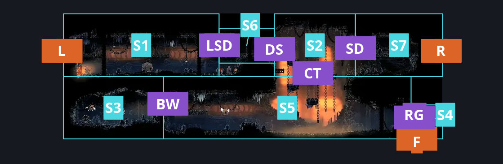
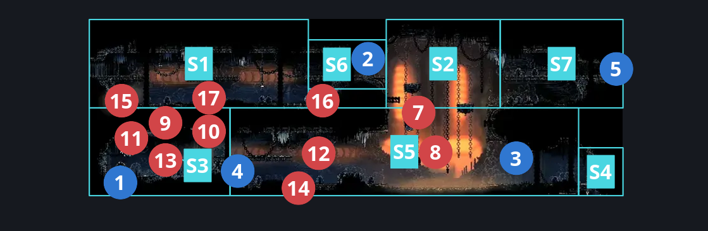
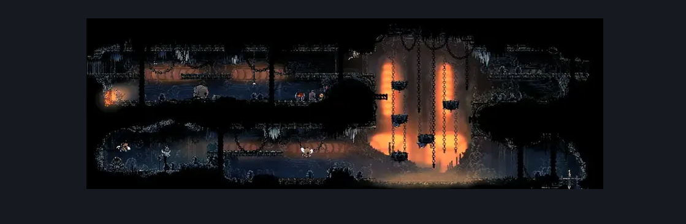

# Deep Docks Chains Upper East (Dock_03)

**Game ID:** Dock_03

**Contributors:** herounit,Rebel, Gallos

## Subrooms

| No. | Subroom | Annotated |
| --- | --- | --- |
| S1 | upper left hallway | ✓ |
| S2 | chain platforms | ✓ |
| S3 | lower left chest room | ✓ |
| S4 | behind ring gate | ✓ |
| S5 | Lower Chain Platforms | ✓ |
| S6 | Door Switch | ✓ |
| S7 | upper right hallway | ✓ |

## Room Transitions

| Alias | Name | From subroom | Destination | Destination alias | Requirements | TODO | Verification | Annotated | Notes |
| --- | --- | --- | --- | --- | --- | --- | --- | --- | --- |
| L | left1 | upper left hallway | [Deep Docks Chains Center (Dock_02b)](deep-docks-chains-center.md) | UR | none |  | Verified | ✓ |  |
| F | bot1 | behind ring gate | [Deep Docks Chains Lower East (Dock_03c)](deep-docks-chains-lower-east.md) | RC | Open Airlock Down |  | Verified | ✓ |  |
| R | right1 | upper right hallway | [Far Fields Deep Docks Backdoor (Dock_03b)](../far-fields/far-fields-deep-docks-backdoor.md) | L | activate Deep Docks Backdoor |  | Verified | ✓ |  |

## Subroom Connections

| Alias | Name | Source | Destination | Requirements | TODO | Verification | Annotated | Notes |
| --- | --- | --- | --- | --- | --- | --- | --- | --- |
| DS | open door switch | Door Switch | chain platforms | Activate Deep Docks - Upper East lever |  | Verified | ✓ |  |
| DS | open door switch | chain platforms | Door Switch | Activate Deep Docks - Upper East lever AND ( ledge grab left OR cling grip either OR clawline left OR sharpdart OR faydown OR silksoar OR easy scuttlebrace) |  | Verified | ✓ |  |
| BW | break wall | Lower Chain Platforms | lower left chest room | clear Deep Docks- Craftmetal Breakable Wall AND (easy pogo off [flintflame flyer,smokerock sifter] OR run OR ledge grab left OR cling grip left OR clawline left OR sharpdart OR silk soar OR faydown) |  | Verified | ✓ |  |
| BW | break wall | lower left chest room | Lower Chain Platforms | clear Deep Docks- Craftmetal Breakable Wall |  | Verified | ✓ |  |
| RG | open ring gate | Lower Chain Platforms | behind ring gate | clear Deep Docks - Clawline Ring East |  | Verified | ✓ |  |
| RG | open ring gate | behind ring gate | Lower Chain Platforms | clear Deep Docks - Clawline Ring East |  | Verified | ✓ |  |
| LSD | Left Side <> Door | upper left hallway | Door Switch | ledge grab left OR cling grip left OR easy pogo off [smelt shoveller, deep diver] OR ((ledge grab right OR cling grip right) AND (dash left OR run OR clawline left OR sharpdart OR drifters OR easy beast pogo)) OR faydown OR easy [reaper,shaman] pogo OR silk soar OR (medium scuttlebrace AND easy shaman pogo) |  | Verified | ✓ |  |
| LSD | Left Side <> Door | Door Switch | upper left hallway | ledge grab right OR cling grip right OR faydown OR silk soar OR easy [reaper,shaman] pogo OR easy pogo off [smelt shoveller, deep diver] OR ((ledge grab left OR cling grip left) AND (clawline right OR sharpdart)) OR (medium scuttlebrace AND easy shaman pogo) |  | Verified | ✓ |  |
| CT | Chain Travel | Lower Chain Platforms | chain platforms | (ledge grab right AND (Clawline right OR Sharpdart OR dash right OR drifters)) OR Cling Grip either OR easy Scuttlebrace OR Silk Soar OR Faydown OR (ledge grab left AND ((clawline right AND (clawline left OR easy shaman pogo)) OR sharpdart x 2)) OR easy pogo off Flintflame flyer |  | Verified | ✓ |  |
| CT | Chain Travel | chain platforms | Lower Chain Platforms | Nothing. (Fall) |  | Verified | ✓ |  |
| SD | chain to righ | chain platforms | upper right hallway | cling grip right OR ledge grab right OR faydown OR silk soar OR easy shaman pogo OR easy pogo off Deep diver OR clawline right x 2 OR (sharpdart AND drifters) |  | Verified | ✓ |  |
| SD | chain to righ | upper right hallway | chain platforms | none |  | Verified | ✓ |  |

## Check Locations

| No. | Check | Subroom | Requirements | TODO | Verification | Location Type | Annotated | Notes |
| --- | --- | --- | --- | --- | --- | --- | --- | --- |
| 1 | craftmetal deep docks | lower left chest room | none |  | Verified | collectible | ✓ | its freeeeee, right? :) |
| 2 | Deep Docks - Upper East lever | Door Switch | Flip Switch Right |  | Verified | switch | ✓ |  |
| 3 | Deep Docks - Clawline Ring East | Lower Chain Platforms | Clawline either |  | Verified | switch | ✓ |  |
| 4 | Deep Docks- Craftmetal Breakable Wall | Lower Chain Platforms | Break Wall Left |  | Verified | blockade | ✓ |  |
| 5 | Deep Docks Side Chain Room Door | upper right hallway | Break Wall Right OR clear Far Fields Side Chain Room Door IN Far Fields Deep Docks Backdoor |  | Verified | blockade | ✓ | wall can be opened from both sides |
| 6 | Deep Docks Backdoor | chain platforms | clear Deep Docks Side Chain Room Door OR clear Far Fields Side Chain Room Door IN Far Fields Deep Docks Backdoor |  | Verified | logic-point |  | Same check. |
| 7 | Lavalug 1 | Lower Chain Platforms | none |  | Verified | enemy | ✓ |  |
| 8 | Lavalug 2 | Lower Chain Platforms | none |  | Verified | enemy | ✓ |  |
| 9 | Flintflame Flyer 1 | lower left chest room | none |  | Verified | enemy | ✓ | Spawn conditions: docksBomberAmbush=false |
| 10 | Flintstone Flyer 1 | lower left chest room | none |  | Verified | enemy | ✓ | Spawn conditions: docksBomberAmbush=false |
| 11 | Flintflame Flyer 2 | lower left chest room | none |  | Verified | enemy | ✓ | Spawn conditions: docksBomberAmbush=true |
| 12 | Flintflame Flyer 3 | Lower Chain Platforms | none |  | Verified | enemy | ✓ |  |
| 13 | Flintstone Flyer 2 | lower left chest room | none |  | Verified | enemy | ✓ | Spawn conditions: docksBomberAmbush=true |
| 14 | Smokerock Sifter 1 | Lower Chain Platforms | none |  | Verified | enemy | ✓ |  |
| 15 | Smelt Shoveller 1 | upper left hallway | none |  | Verified | enemy | ✓ |  |
| 16 | Smelt Shoveller 2 | upper left hallway | none |  | Verified | enemy | ✓ |  |
| 17 | Deep Diver 1 | upper left hallway | none |  | Verified | enemy | ✓ |  |

## Notes

the floor/lower half of this area is closed off initially

## Room Images

### Connections

### Checks

### Scene

