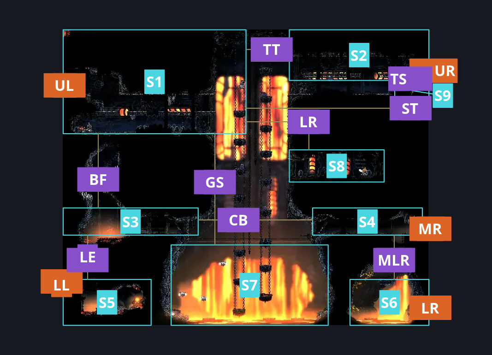
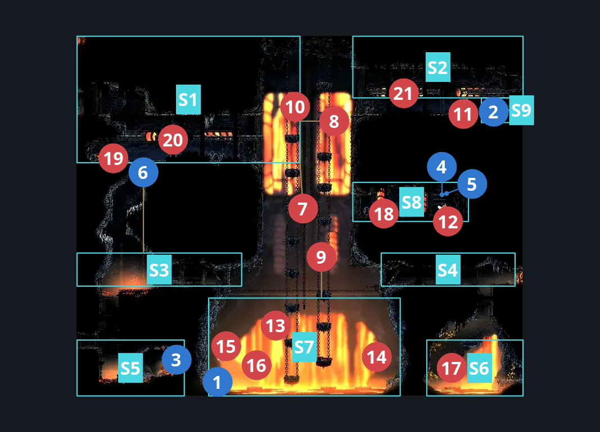
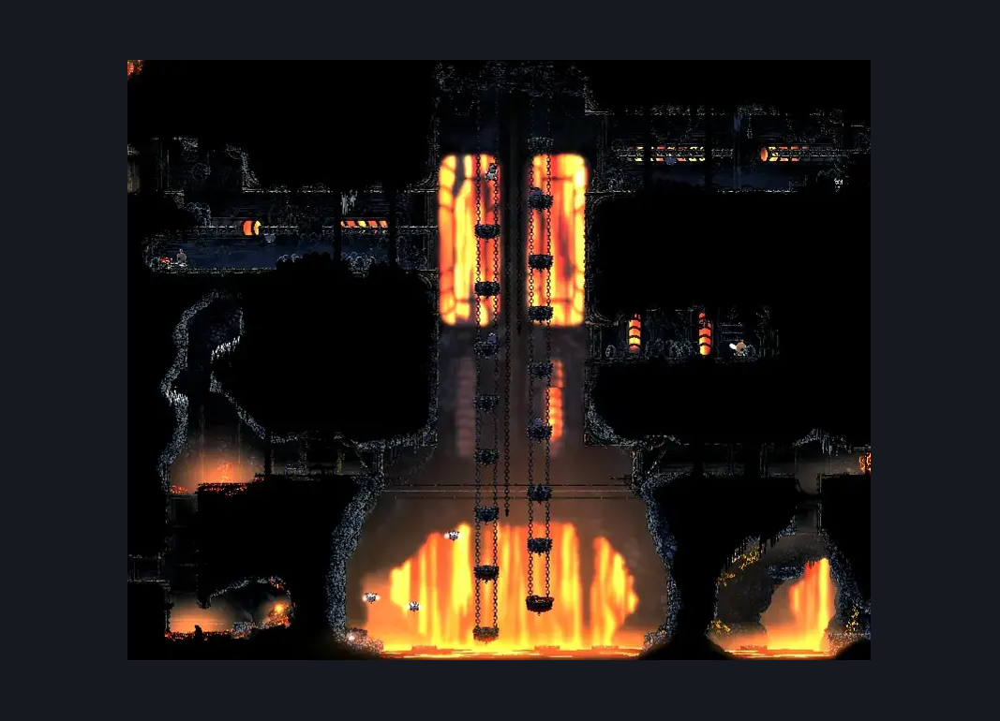

# Deep Docks Chains West (Dock_02)

**Game ID:** Dock_02

**Contributors:** herounit,Rebel, Gallos

## Subrooms

| No. | Subroom | Annotated |
| --- | --- | --- |
| S1 | top left | ✓ |
| S2 | top right | ✓ |
| S3 | middle crossing Left | ✓ |
| S4 | middle Crossing Right | ✓ |
| S5 | lower left exit | ✓ |
| S6 | lower right exit | ✓ |
| S7 | Shard Bundle | ✓ |
| S8 | Top rosaries | ✓ |
| S9 | Shard cache | ✓ |

## Room Transitions

| Alias | Name | From subroom | Destination | Destination alias | Requirements | TODO | Verification | Annotated | Notes |
| --- | --- | --- | --- | --- | --- | --- | --- | --- | --- |
| UL | left1 | top left | [Deep Docks Forge (Room_Forge)](deep-docks-forge.md) | R | activate Deep Docks Forge Door IN deep docks forge |  | Verified | ✓ |  |
| LL | left2 | lower left exit | [Deep Docks Forebrothers (Dock_09)](deep-docks-forebrothers.md) | R | none |  | Verified | ✓ |  |
| UR | right1 | top right | [Deep Docks Chains Center (Dock_02b)](deep-docks-chains-center.md) | UL | none |  | Verified | ✓ |  |
| MR | right2 | middle Crossing Right | [Deep Docks Chains Center (Dock_02b)](deep-docks-chains-center.md) | ML | none |  | Verified | ✓ |  |
| LR | right3 | lower right exit | [Deep Docks Chains Center (Dock_02b)](deep-docks-chains-center.md) | LL | none |  | Verified | ✓ |  |

## Subroom Connections

| Alias | Name | Source | Destination | Requirements | TODO | Verification | Annotated | Notes |
| --- | --- | --- | --- | --- | --- | --- | --- | --- |
| BF | break floor | middle crossing Left | top left | (( silk soar AND magma bell AND (Proficient Movement OR Drifter's Cloak)) OR (cling grip left AND (((clawline left OR sharpdart OR run) AND cling grip right) OR faydown)) OR (run AND faydown AND medium scuttlebrace AND spike pogo)) AND Activate spike hall breakable floor |  | Verified | ✓ |  |
| BF | break floor | top left | middle crossing Left | Activate spike hall breakable floor |  | Verified | ✓ |  |
| LE | lower left exit | lower left exit | middle crossing Left | cling grip either OR easy Scuttlebrace OR (Silk Soar AND Magma Bell) |  | Verified | ✓ |  |
| LE | lower left exit | middle crossing Left | lower left exit | Nothing. (Fall) |  | Verified | ✓ | you can miss the fall and trap yourself itemless lmao |
| GS | Get Shards | top left | Shard Bundle | Nothing. (Fall) |  | Verified | ✓ |  |
| GS | Get Shards | Shard Bundle | top left | Ledge Grab left OR Cling Grip either OR Faydown Cloak OR Silk Soar OR easy scuttlebrace |  | Verified | ✓ | OR f4 |
| CB | Cross Bridge | middle crossing Left | middle Crossing Right | Open Airlock Right |  | Verified | ✓ |  |
| CB | Cross Bridge | middle Crossing Right | middle crossing Left | Open Airlock Left |  | Verified | ✓ |  |
| MLR | Middle Right <> Lower Right | middle Crossing Right | lower right exit | Nothing. (Fall) |  | Verified | ✓ |  |
| MLR | Middle Right <> Lower Right | lower right exit | middle Crossing Right | ((Dash right OR Clawline right OR Sharpdart OR cling grip right OR Easy [wanderer,witch, reaper, shaman] Pogo) AND Cling Grip left AND (dash left OR run OR clawline left OR sharpdart )) OR (Faydown Cloak AND Medium Scuttlebrace) OR ((Proficient Movement OR dash left OR easy [beast, hunter,architect] pogo OR easy [flea brew, parry, rune rage,thread storm, pale nails,plasmium, voltvessels,air heal, flintslate] stall OR sharpdart OR clawline left) AND Silk Soar) OR easy pogo off vicious caranid OR (faydown AND easy shaman pogo AND ledge grab left AND cling grip right) OR (cling grip left AND (Easy [Architect, Wanderer, Beast] Charge OR Easy [Architect, Hunter,Beast] Pogo OR faydown OR easy naked pogo OR Easy [Flintslate,  Voltvessels, Flea Brew, plasmium] Stall OR Flea Brew OR drifter's )) |  | Verified | ✓ |  |
| TT | top left <> top right | top left | top right | easy naked pogo OR easy [reaper,beast,shaman] pogo OR ledge grab either OR cling grip either OR faydown OR easy pogo off [lavalug,smokerock sifter,flintstone flyer] OR silksoar |  | Verified | ✓ |  |
| TT | top left <> top right | top right | top left | none |  | Verified | ✓ |  |
| TS | shard <> top right | top right | Shard cache | none |  | Verified | ✓ |  |
| TS | shard <> top right | Shard cache | top right | easy naked pogo OR easy [reaper,beast,shaman] pogo OR ledge grab either OR cling grip either OR faydown OR easy pogo off [lavalug,smokerock sifter,flintstone flyer] OR silksoar |  | Verified | ✓ |  |
| ST | shard <> top left | Shard cache | top left | none |  | Verified | ✓ |  |
| ST | shard <> top left | top left | Shard cache | none |  | Verified | ✓ |  |
| LR | rosaries <> top left | top left | Top rosaries | none |  | Verified | ✓ |  |
| LR | rosaries <> top left | Top rosaries | top left | cling grip either OR easy scuttlebrace OR ledge grab right OR silksoar |  | Verified | ✓ |  |

## Check Locations

| No. | Check | Subroom | Requirements | TODO | Verification | Location Type | Annotated | Notes |
| --- | --- | --- | --- | --- | --- | --- | --- | --- |
| 1 | shard bundle deep docks 1 | Shard Bundle | none |  | Verified | collectible | ✓ |  |
| 2 | Deep Docks - Smokerock Sifter's beloved shell shard | Shard cache | none |  | Verified | resource | ✓ |  |
| 3 | flintstone journal collection point | lower left exit | none |  | Verified | lore | ✓ |  |
| 4 | Deep Docks - That bomb thrower's rosary stash | Top rosaries | none |  | Verified | resource | ✓ |  |
| 5 | Deep Docks - That bomb thrower's bombs budget | Top rosaries | none |  | Verified | resource | ✓ |  |
| 6 | spike hall breakable floor | middle crossing Left | Break Wall Up |  | Verified | blockade | ✓ |  |
| 7 | Lavalug 1 | top left | none |  | Verified | enemy | ✓ |  |
| 8 | Lavalug 2 | top left | none |  | Verified | enemy | ✓ |  |
| 9 | Lavalug 3 | Shard Bundle | none |  | Verified | enemy | ✓ |  |
| 10 | Flintstone Flyer 1 | top left | none |  | Verified | enemy | ✓ |  |
| 11 | Smokerock Sifter 1 | top right | none |  | Verified | enemy | ✓ |  |
| 12 | Flintflame Flyer 1 | Top rosaries | none |  | Verified | enemy | ✓ |  |
| 13 | Caranid 1 | Shard Bundle | none |  | Verified | enemy | ✓ |  |
| 14 | Vicious Caranid 1 | Shard Bundle | defeat forebrothers boss fight IN deep docks forebrothers |  | Verified | enemy | ✓ |  |
| 15 | Caranid 2 | Shard Bundle | none |  | Verified | enemy | ✓ |  |
| 16 | Caranid 3 | Shard Bundle | none |  | Verified | enemy | ✓ |  |
| 17 | Vicious Caranid 2 | lower right exit | defeat forebrothers boss fight IN deep docks forebrothers |  | Verified | enemy | ✓ |  |
| 18 | Smokerock Sifter 2 | Top rosaries | invalid |  | Verified | enemy | ✓ |  |
| 19 | Smelt Shoveller 1 | top left | none |  | Verified | enemy | ✓ |  |
| 20 | Lavalug 4 | top left | none |  | Verified | enemy | ✓ |  |
| 21 | Lavalug 5 | top right | none |  | Verified | enemy | ✓ |  |

## Room Images

### Connections

### Checks

### Scene

