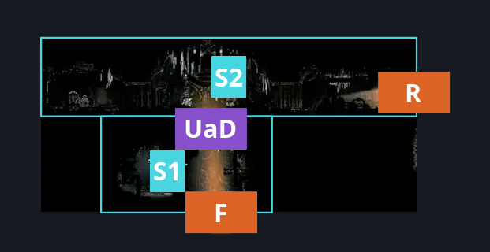
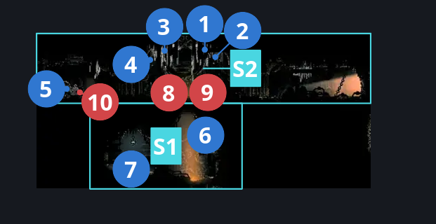
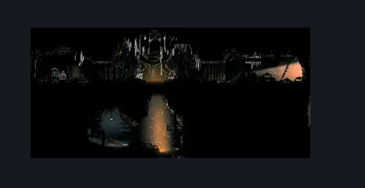

# Deep Docks Church (Dock_06_Church)

**Game ID:** Dock_06_Church

**Contributors:** herounit,Rebel, Gallos

## Subrooms

| No. | Subroom | Annotated |
| --- | --- | --- |
| S1 | Bottom | ✓ |
| S2 | Top | ✓ |

## Room Transitions

| Alias | Name | From subroom | Destination | Destination alias | Requirements | TODO | Verification | Annotated | Notes |
| --- | --- | --- | --- | --- | --- | --- | --- | --- | --- |
| R | right1 | Top | [Deep Docks Lower West Shaft (Dock_04)](deep-docks-lower-west-shaft.md) | L | none |  | Verified | ✓ |  |
| F | bot1 | Bottom | [Abyss Escape (Abyss_09)](../the-abyss/abyss-escape.md) | C | none |  | Verified | ✓ | FROM THE ABYSS ESCAPE |

## Subroom Connections

| Alias | Name | Source | Destination | Requirements | TODO | Verification | Annotated | Notes |
| --- | --- | --- | --- | --- | --- | --- | --- | --- |
| UaD | Up and Down | Top | Bottom | Activate Deep Docks - Church gate switch |  | Verified | ✓ |  |
| UaD | Up and Down | Bottom | Top | Activate Deep Docks - Church gate switch AND (Silk Soar OR Cling Grip either OR easy scuttlebrace OR (faydown cloak AND easy shaman pogo AND ledge grab either)) |  | Verified | ✓ |  |

## Check Locations

| No. | Check | Subroom | Requirements | TODO | Verification | Location Type | Annotated | Notes |
| --- | --- | --- | --- | --- | --- | --- | --- | --- |
| 1 | Deep Docks - Church donations | Top | none |  | Verified | collectible | ✓ |  |
| 2 | Deep Docks - Priest's rosaries | Top | none |  | Verified | collectible | ✓ |  |
| 3 | Deep Docks - Church jewelry | Top | Act 1 OR Act 2 |  | Verified | collectible | ✓ |  |
| 4 | Deep Docks - Priest's wage | Top | Act 1 OR Act 2 |  | Verified | collectible | ✓ |  |
| 5 | Deep Docks - Church's protected chest | Top | Act 1 OR Act 2 |  | Verified | collectible | ✓ |  |
| 6 | Deep Docks - Church gate switch | Bottom | Flip Switch Up |  | Verified | switch | ✓ |  |
| 7 | Deep Docks - Church Bench | Bottom | none |  | Verified | bench | ✓ |  |
| 8 | Flintstone Flyer 1 | Top | ACT 1 OR ACT 2 |  | Verified | enemy | ✓ | Spawn conditions: hasSuperJump=false |
| 9 | Smelt Shoveller 1 | Top | ACT 1 OR ACT 2 |  | Verified | enemy | ✓ | Spawn conditions: hasSuperJump=false |
| 10 | Smelt Shoveller 2 | Top | ACT 1 OR ACT 2 |  | Verified | enemy | ✓ |  |

## Notes

might need to revise the subrooms later

## Room Images

### Connections

### Checks

### Scene

