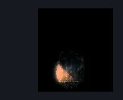

# Deep Docks Diving Bell Interior (Room_Diving_Bell)

**Game ID:** Room_Diving_Bell

**Contributors:** Pyxl, Gallos

## Subrooms

No subrooms defined.

## Room Transitions

| Alias | Name | From subroom | Destination | Destination alias | Requirements | TODO | Verification | Annotated | Notes |
| --- | --- | --- | --- | --- | --- | --- | --- | --- | --- |
| L | left1 |  | [Deep Docks Diving Bell Room (Dock_12)](deep-docks-diving-bell-room.md) | D | None |  | Verified | ✓ |  |
| D | door_cinematicEnd |  | [Abyss Diving Bell Fixed (Room_Diving_Bell_Abyss_Fixed)](../the-abyss/abyss-diving-bell-fixed.md) | B | ACT 3 AND after THE Ballow in Diving Bell Control Room |  | Verified | ✓ |  |

## Subroom Connections

No subroom connections defined.

## Check Locations

| No. | Check | Subroom | Requirements | TODO | Verification | Location Type | Annotated | Notes |
| --- | --- | --- | --- | --- | --- | --- | --- | --- |
| 1 | Diving Bell Bench |  | Nothing. |  | Verified | bench |  | is this a valid bench for rando? |

## Room Images

### Connections

### Checks

### Scene

