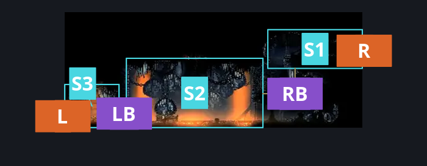
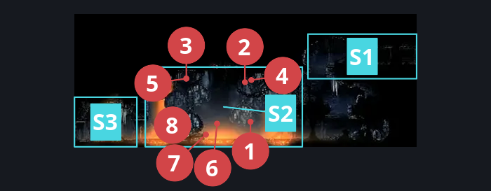
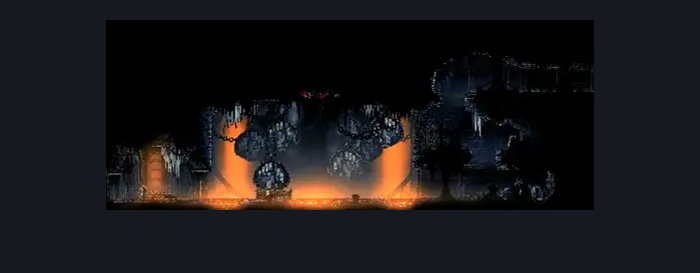

# Deep Docks Forebrothers (Dock_09)

**Game ID:** Dock_09

**Contributors:** herounit,Rebel, Gallos

## Subrooms

| No. | Subroom | Annotated |
| --- | --- | --- |
| S1 | right area | ✓ |
| S2 | boss area | ✓ |
| S3 | left area | ✓ |

## Room Transitions

| Alias | Name | From subroom | Destination | Destination alias | Requirements | TODO | Verification | Annotated | Notes |
| --- | --- | --- | --- | --- | --- | --- | --- | --- | --- |
| R | right1 | right area | [Deep Docks Chains West (Dock_02)](deep-docks-chains-west.md) | LL | none |  | Verified | ✓ |  |
| L | left1 | left area | [Deep Docks Lower East Shaft (Dock_15)](deep-docks-lower-east-shaft.md) | UR | none |  | Verified | ✓ |  |

## Subroom Connections

| Alias | Name | Source | Destination | Requirements | TODO | Verification | Annotated | Notes |
| --- | --- | --- | --- | --- | --- | --- | --- | --- |
| RB | right boss entrance | right area | boss area | none (starts fight) |  | Verified | ✓ |  |
| RB | right boss entrance | boss area | right area | defeat forebrothers boss fight AND (Cling Grip either OR Faydown Cloak OR Silk Soar OR (easy scuttlebrace AND (easy shaman pogo OR hard flea brew stall OR (easy beast crest heal stall AND easy [flea brew,parry,thread storm,flintslate,rune rage,pale nails] stall)))) |  | Verified | ✓ |  |
| LB | left boss entrance | left area | boss area | defeat forebrothers boss fight |  | Verified | ✓ |  |
| LB | left boss entrance | boss area | left area | defeat forebrothers boss fight |  | Verified | ✓ |  |

## Check Locations

| No. | Check | Subroom | Requirements | TODO | Verification | Location Type | Annotated | Notes |
| --- | --- | --- | --- | --- | --- | --- | --- | --- |
| 1 | forebrothers boss fight | boss area | Combat Requirements |  | Verified | boss | ✓ |  |
| 2 | Dock Guard Thrower 1 | boss area | none |  | Verified | enemy | ✓ | last to spawn |
| 3 | Flintstone Flyer 1 | boss area | none |  | Verified | enemy | ✓ | second to spawn |
| 4 | Smokerock Sifter 1 | boss area | none |  | Verified | enemy | ✓ | third to spawn |
| 5 | Flintstone Flyer 2 | boss area | none |  | Verified | enemy | ✓ | fourth to spawn |
| 6 | Flintstone Flyer 3 | boss area | none |  | Verified | enemy | ✓ | disappears upon engaging boss fight |
| 7 | Smelt Shoveller 1 | boss area | none |  | Verified | enemy | ✓ | disappears upon engaging boss fight |
| 8 | Dock Guard Slasher 1 | boss area | none |  | Verified | enemy | ✓ | first to spawn |

## Room Images

### Connections

### Checks

### Scene

