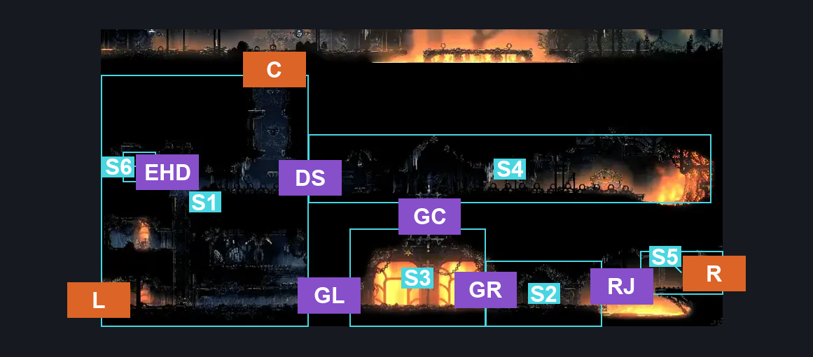
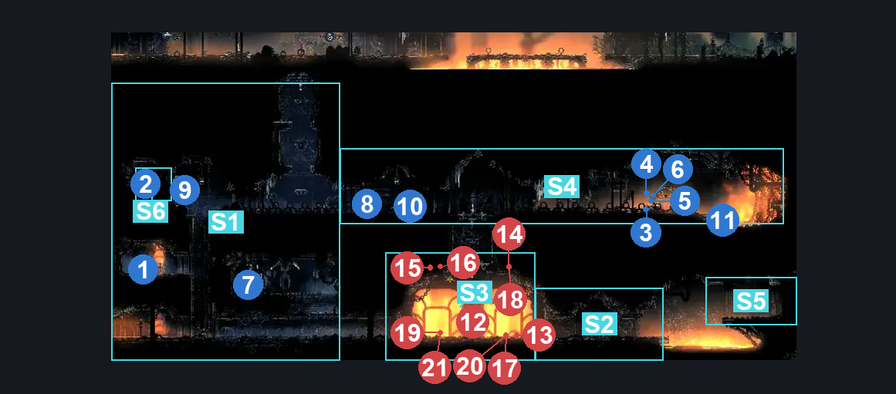
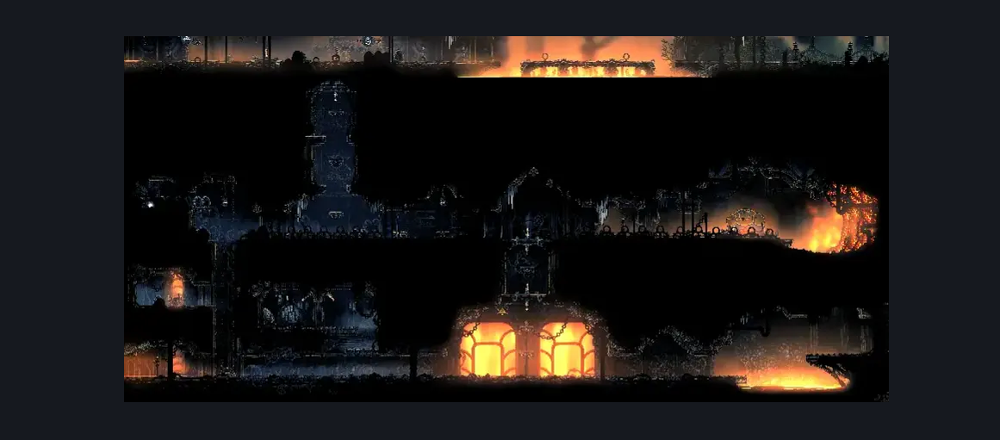

# Deep Docks Forge (Room_Forge)

**Game ID:** Room_Forge

**Contributors:** herounit and Rebel

## Subrooms

| No. | Subroom | Annotated |
| --- | --- | --- |
| S1 | left entrance | ✓ |
| S2 | right area | ✓ |
| S3 | gauntlet | ✓ |
| S4 | forge daughter | ✓ |
| S5 | right exit platform | ✓ |
| S6 | hidden left room | ✓ |

## Room Transitions

| Alias | Name | From subroom | Destination | Destination alias | Requirements | TODO | Verification | Annotated | Notes |
| --- | --- | --- | --- | --- | --- | --- | --- | --- | --- |
| C | top1 | left entrance | [Deep Docks Lace Intro (Bone_East_12)](deep-docks-lace-intro.md) | F | Open Airlock Up |  | Verified | ✓ |  |
| L | left1 | left entrance | [Deep Docks Lower West Shaft (Dock_04)](deep-docks-lower-west-shaft.md) | UR | none |  | Verified | ✓ |  |
| R | right1 | right exit platform | [Deep Docks Chains West (Dock_02)](deep-docks-chains-west.md) | UL | Own Simple Key Deep Docks |  | Verified | ✓ |  |

## Subroom Connections

| Alias | Name | Source | Destination | Requirements | TODO | Verification | Annotated | Notes |
| --- | --- | --- | --- | --- | --- | --- | --- | --- |
| DS | door switch | left entrance | forge daughter | activate gate switch forge |  | Verified | ✓ |  |
| DS | door switch | forge daughter | left entrance | activate gate switch forge |  | Verified | ✓ |  |
| GL | gauntlet left | left entrance | gauntlet | none |  | Verified | ✓ |  |
| GL | gauntlet left | gauntlet | left entrance | clear Forge Battle |  | Verified | ✓ |  |
| GR | gauntlet right | right area | gauntlet | none |  | Verified | ✓ |  |
| GR | gauntlet right | gauntlet | right area | clear Forge Battle |  | Verified | ✓ |  |
| GC | gauntlet upper | forge daughter | gauntlet | open airlock either |  | Verified | ✓ |  |
| GC | gauntlet upper | gauntlet | forge daughter | Clear Forge Battle AND ( open airlock up AND (ledge grab either OR faydown OR cling grip either OR easy shaman pogo OR easy scuttlebrace OR medium heal stall OR easy beast needle strike OR easy [flea brew, plasmium, voltvessels] stall )) |  | Verified | ✓ |  |
| RJ | running jump | right area | right exit platform | Sprint OR Faydown Cloak OR Clawline right OR Sharpdart OR easy Scuttlebrace OR Drifter's Cloak OR Easy Beast Pogo OR (((Dash right OR (Medium Hunter Pogo AND Cling Grip left) OR Medium [Voltvessels, plasmium] Stall OR Easy Architect Charge OR (Flea Brew AND Easy Flea Brew Stall)) AND (Ledge Grab right OR Cling Grip right))) OR (Flea Brew AND Medium Flea Brew Stall AND Medium Heal Stall) OR (Easy Architect Pogo AND Cling Grip left) OR  (dash right AND (proficient movement OR cling grip left)) |  | Verified | ✓ |  |
| RJ | running jump | right exit platform | right area | run OR Drifter's Cloak OR  Dash left OR Faydown Cloak OR Clawline left OR Sharpdart OR Easy [Beast, Hunter, Architect] Pogo OR Easy [Voltvessels, Flintslate, plasmium] Stall OR Flea Brew OR Medium Heal Stall |  | Verified | ✓ |  |
| EHD | Hidden Room | left entrance | hidden left room | Ledge Grab left OR Cling Grip left OR easy Scuttlebrace OR Faydown Cloak OR Silk Soar OR Easy Beast Charge  OR easy [hunter,wanderer, reaper,beast,architect, witch,shaman] pogo OR easy naked pogo OR easy [voltvessels,plasmium] stall |  | Verified | ✓ | background pogo :D |
| EHD | Hidden Room | hidden left room | left entrance | Nothing. (Fall) |  | Verified | ✓ |  |

## Check Locations

| No. | Check | Subroom | Requirements | TODO | Verification | Location Type | Annotated | Notes |
| --- | --- | --- | --- | --- | --- | --- | --- | --- |
| 1 | Deep Docks - Forge daughter's bone scraps | left entrance | clear Forge Wall |  | Verified | collectible | ✓ |  |
| 2 | Deep Docks - Fossilized bones found by Ballow | hidden left room | none |  | Verified | collectible | ✓ | shard bundle |
| 3 | silkshot (forge daughter) | forge daughter | own Ruined Tool AND Spend 1 Craftmetals |  | Verified | collectible | ✓ | forge daughter shop |
| 4 | sting shard | forge daughter | Spend 1 Craftmetals |  | Verified | collectible | ✓ | forge daughter shop |
| 5 | magma bell | forge daughter | Spend 1 Craftmetals |  | Verified | collectible | ✓ | forge daughter shop |
| 6 | crafting kit forge daughter | forge daughter | none |  | Verified | collectible | ✓ | forge daughter shop |
| 7 | readable lore tablet forge | left entrance | open airlock left |  | Verified | lore | ✓ |  |
| 8 | gate switch forge | forge daughter | none |  | Verified | switch | ✓ |  |
| 9 | Forge Wall | left entrance | Break Wall Left |  | Verified | blockade | ✓ |  |
| 10 | Forge bench | forge daughter | Nothing. |  | Verified | bench | ✓ |  |
| 11 | Ballow Move to Control Room | forge daughter | Act 3 |  | Verified | event | ✓ |  |
| 12 | Forge Battle | gauntlet | Combat Requirements |  | Verified | gauntlet | ✓ |  |
| 13 | Smokerock Sifter 1 | gauntlet | Combat Requirements |  | Verified | enemy | ✓ |  |
| 14 | Flintstone Flyer 1 | gauntlet | Combat Requirements |  | Verified | enemy | ✓ |  |
| 15 | Flintstone Flyer 2 | gauntlet | Combat Requirements |  | Verified | enemy | ✓ |  |
| 16 | Flintstone Flyer 3 | gauntlet | Combat Requirements |  | Verified | enemy | ✓ |  |
| 17 | Smokerock Sifter 2 | gauntlet | Combat Requirements |  | Verified | enemy | ✓ |  |
| 18 | Flintstone Flyer 4 | gauntlet | Combat Requirements |  | Verified | enemy | ✓ |  |
| 19 | Smelt Shoveller 1 | gauntlet | Combat Requirements |  | Verified | enemy | ✓ |  |
| 20 | Smokerock Sifter 3 | gauntlet | Combat Requirements |  | Verified | enemy | ✓ |  |
| 21 | Smelt Shoveller 2 | gauntlet | Combat Requirements |  | Verified | enemy | ✓ |  |

## Room Images

### Connections

### Checks

### Scene

