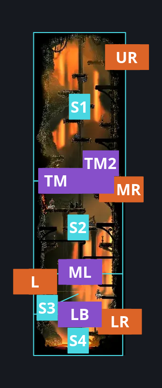
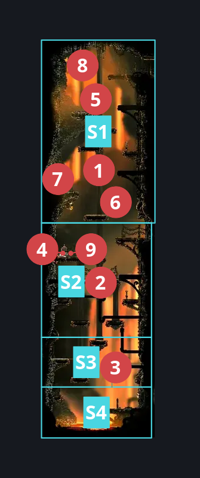
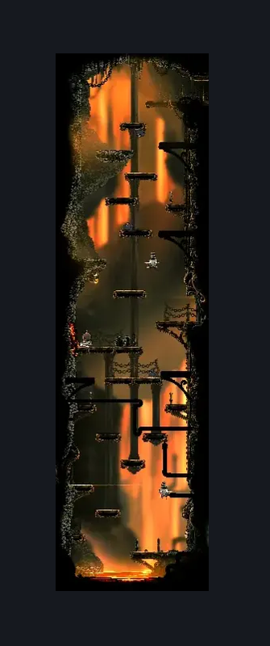

# Deep Docks Lower West Shaft (Dock_04)

**Game ID:** Dock_04

**Contributors:** herounit,Rebel, Gallos

## Subrooms

| No. | Subroom | Annotated |
| --- | --- | --- |
| S1 | Top | ✓ |
| S2 | Middle | ✓ |
| S3 | Low | ✓ |
| S4 | Bottom | ✓ |

## Room Transitions

| Alias | Name | From subroom | Destination | Destination alias | Requirements | TODO | Verification | Annotated | Notes |
| --- | --- | --- | --- | --- | --- | --- | --- | --- | --- |
| L | left1 | Low | [Deep Docks Church (Dock_06_Church)](deep-docks-church.md) | R | none |  | Verified | ✓ |  |
| MR | right2 | Middle | [Deep Docks Spool East (Bone_East_13)](deep-docks-spool-east.md) | L | none |  | Verified | ✓ |  |
| UR | right1 | Top | [Deep Docks Forge (Room_Forge)](deep-docks-forge.md) | L | none |  | Verified | ✓ |  |
| LR | right3 | Bottom | [Deep Docks Sauna (Dock_10)](deep-docks-sauna.md) | L | Activate Sauna Door Lock IN Deep Docks Sauna |  | Verified | ✓ |  |

## Subroom Connections

| Alias | Name | Source | Destination | Requirements | TODO | Verification | Annotated | Notes |
| --- | --- | --- | --- | --- | --- | --- | --- | --- |
| LB | Low <> Bottom | Low | Bottom | Nothing. (Fall) |  | Verified | ✓ |  |
| LB | Low <> Bottom | Bottom | Low | Ledge Grab left OR Cling Grip left OR easy Scuttlebrace OR Faydown Cloak OR Sprint OR Silk Soar OR easy pogo off flintstone flyer OR easy beast pogo OR (flea brew AND  (easy [plasmium, voltvessels] stall OR dash left)) OR clawline left OR sharpdart |  | Verified | ✓ |  |
| ML | Middle <> Low | Middle | Low | Nothing. (Fall) |  | Verified | ✓ |  |
| ML | Middle <> Low | Low | Middle | Ledge Grab left OR Cling Grip left OR easy Scuttlebrace OR Faydown  OR Silk Soar OR (easy damage boost off lavalug AND easy pogo off lavalug) OR easy pogo off flintstone flyer OR easy [voltvessels,plasmium,flea brew] stall OR ((cling grip right OR ledge grab right) AND (easy [reaper,beast] pogo OR easy pogo off smelt shoveller)) OR (cling grip right AND (clawline left OR sharpdart OR dash left OR drifter's OR easy [wanderer,architect] needle strike)) OR easy shaman pogo |  | Verified | ✓ |  |
| TM | Top <> Middle | Top | Middle | Nothing. (Fall) |  | Verified | ✓ |  |
| TM | Top <> Middle | Middle | Top | (ACT 1 OR ACT 2) AND (Ledge Grab both OR Cling Grip either OR easy Scuttlebrace OR Faydown Cloak OR Silk Soar OR easy shaman pogo OR ((easy beast crest heal stall OR easy beast needle strike) AND easy beast pogo) OR (((flea brew AND easy flea brew stall) OR easy [voltvessels,plasmium] stall x 3) AND (easy [hunter,architect,reaper ,beast, wanderer] pogo OR easy damage boost off lavalug )) OR medium plasmium stall x 4 OR easy pogo off flintstone flyer OR ((easy beast crest heal stall OR ledge grab left) AND  easy damage boost off lavalug AND easy pogo off lavalug)) |  | Verified | ✓ |  |
| TM2 | Top <> Middle ACT 3 | Middle | Top | ACT 3 AND (faydown OR silk soar OR (cling grip left AND (clawline right OR sharpdart OR dash right)) OR (easy pogo off flintstone flyer AND (Ledge Grab both OR easy Scuttlebrace  OR easy shaman pogo OR ((easy beast crest heal stall OR easy beast needle strike) AND easy beast pogo) OR (((flea brew AND easy flea brew stall) OR easy [voltvessels,plasmium] stall x 3) AND (easy [hunter,architect,reaper ,beast, wanderer] pogo OR easy damage boost off lavalug )) OR medium plasmium stall x 4 OR ((easy beast crest heal stall OR ledge grab left) AND  easy damage boost off lavalug AND easy pogo off lavalug)))) |  | Verified | ✓ |  |
| TM2 | Top <> Middle ACT 3 | Top | Middle | none |  | Verified | ✓ |  |

## Check Locations

| No. | Check | Subroom | Requirements | TODO | Verification | Location Type | Annotated | Notes |
| --- | --- | --- | --- | --- | --- | --- | --- | --- |
| 1 | Lavalug 1 | Top | Normal World Spawn |  | Verified | enemy | ✓ |  |
| 2 | Lavalug 2 | Middle | Normal World Spawn |  | Verified | enemy | ✓ |  |
| 3 | Flintstone Flyer 1 | Bottom | Normal World Spawn |  | Verified | enemy | ✓ |  |
| 4 | Smelt Shoveller 1 | Middle | Normal World Spawn |  | Verified | enemy | ✓ |  |
| 5 | Lavalug 3 | Top | Normal World Spawn |  | Verified | enemy | ✓ |  |
| 6 | Flintstone Flyer 2 | Top | Normal World Spawn |  | Verified | enemy | ✓ |  |
| 7 | Void Mass 1 | Top | Black Thread World Spawn |  | Verified | enemy | ✓ |  |
| 8 | Flintstone Flyer 3 | Top | Black Thread World Spawn |  | Verified | enemy | ✓ |  |
| 9 | Smelt Shoveller 2 | Middle | Black Thread World Spawn |  | Verified | enemy | ✓ |  |

## Room Images

### Connections

### Checks

### Scene

