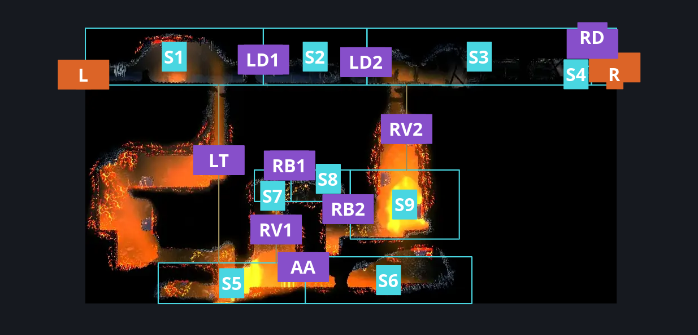
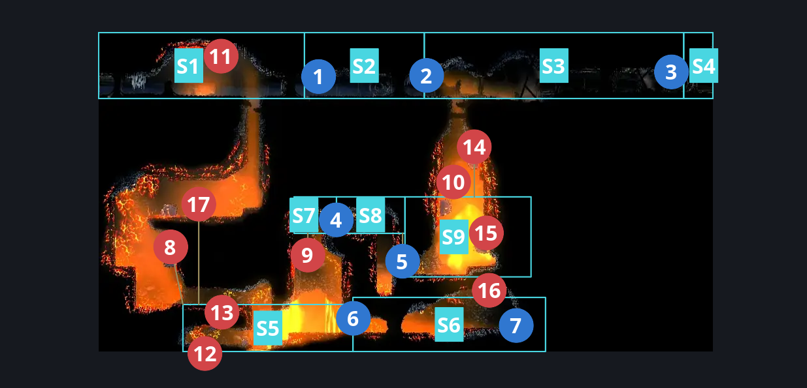
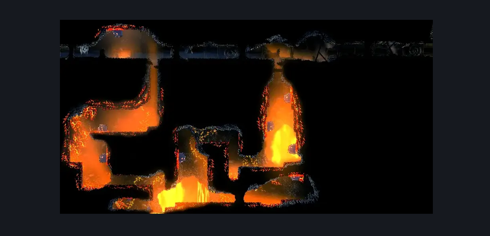

# Deep Docks Magma Slug Tunnels (Dock_11)

**Game ID:** Dock_11

**Contributors:** herounit,Rebel, Gallos

## Subrooms

| No. | Subroom | Annotated |
| --- | --- | --- |
| S1 | upper far left | ✓ |
| S2 | upper mid left | ✓ |
| S3 | upper mid right | ✓ |
| S4 | upper far right | ✓ |
| S5 | worst spot in the game | ✓ |
| S6 | check alcove | ✓ |
| S7 | right tunnel 1 | ✓ |
| S8 | right tunnel 2 | ✓ |
| S9 | right tunnel 3 | ✓ |

- **upper far right:** space between right door and transition

## Room Transitions

| Alias | Name | From subroom | Destination | Destination alias | Requirements | TODO | Verification | Annotated | Notes |
| --- | --- | --- | --- | --- | --- | --- | --- | --- | --- |
| L | left1 | upper far left | [Deep Docks Lower East Shaft (Dock_15)](deep-docks-lower-east-shaft.md) | LR | none |  | Verified | ✓ |  |
| R | right1 | upper far right | [Deep Docks Diving Bell Room (Dock_12)](deep-docks-diving-bell-room.md) | L | none |  | Verified | ✓ |  |

## Subroom Connections

| Alias | Name | Source | Destination | Requirements | TODO | Verification | Annotated | Notes |
| --- | --- | --- | --- | --- | --- | --- | --- | --- |
| LT | left tunnel | upper far left | worst spot in the game | spike pogo OR easy naked pogo |  | Verified | ✓ |  |
| LT | left tunnel | worst spot in the game | upper far left | cling grip both OR medium scuttlebrace OR ( faydown AND magma bell AND silk soar ) |  | Verified | ✓ | scuttlebrace difficulty for  slugs/timing/damage/etc. |
| RV1 | right vertical 1 | right tunnel 1 | worst spot in the game | none (falling) |  | Verified | ✓ |  |
| RV1 | right vertical 1 | worst spot in the game | right tunnel 1 | (cling grip left AND (cling grip right OR easy [hunter,wanderer,beast, reaper,architect,witch, shaman] pogo OR easy naked pogo OR faydown)) OR (medium  scuttlebrace AND (sharpdart x 2 OR ((clawline left OR sharpdart) AND (clawline right OR ledge grab right)))) OR ( magma bell AND silk soar ) OR (cling grip right AND (medium damage boost off lavalarga OR medium pogo off lavalarga)) |  | Verified | ✓ | scuttlebrace difficulty for  slugs/timing/damage/etc. |
| AA | access alcove | worst spot in the game | check alcove | clear Deep Docks - check alcove blast rock blockade |  | Verified | ✓ |  |
| AA | access alcove | check alcove | worst spot in the game | clear Deep Docks - check alcove blast rock blockade |  | Verified | ✓ |  |
| RB1 | right blast 1 | right tunnel 1 | right tunnel 2 | clear Deep Docks - right tunnel blast rock blockade 1 |  | Verified | ✓ |  |
| RB1 | right blast 1 | right tunnel 2 | right tunnel 1 | clear Deep Docks - right tunnel blast rock blockade 1 |  | Verified | ✓ |  |
| RB2 | right blast 2 | right tunnel 2 | right tunnel 3 | clear Deep Docks - right tunnel blast rock blockade 2 AND (cling grip either  OR (faydown AND ledge grab right) OR easy scuttlebrace OR easy hazard respawn ) |  | Verified | ✓ | blast rock requires dropping down above spikes to hit it - free after blast rock is cleared |
| RB2 | right blast 2 | right tunnel 3 | right tunnel 2 | clear Deep Docks - right tunnel blast rock blockade 2 AND (cling grip either OR easy scuttlebrace OR (faydown AND ledge grab left)) |  | Verified | ✓ |  |
| RV2 | right vertical 2 | right tunnel 3 | upper mid right | cling grip right OR (cling grip left AND faydown) OR (magma bell AND silk soar) OR (easy shaman pogo AND medium pogo off Lavalarga AND easy scuttlebrace) |  | Verified | ✓ | scuttlebrace difficulty for  slugs/timing/damage/etc. |
| RV2 | right vertical 2 | upper mid right | right tunnel 3 | none (falling) |  | Verified | ✓ |  |
| LD1 | left doorway 1 | upper far left | upper mid left | activate Deep Docks - Magma slug left door switch |  | Verified | ✓ |  |
| LD1 | left doorway 1 | upper mid left | upper far left | activate Deep Docks - Magma slug left door switch |  | Verified | ✓ |  |
| LD2 | left doorway 2 | upper mid right | upper mid left | activate Deep Docks - Magma slug middle door switch |  | Verified | ✓ |  |
| LD2 | left doorway 2 | upper mid left | upper mid right | activate Deep Docks - Magma slug  middle door switch |  | Verified | ✓ |  |
| RD | right doorway | upper mid right | upper far right | activate Deep Docks - Magma slug right door switch |  | Verified | ✓ |  |
| RD | right doorway | upper far right | upper mid right | activate Deep Docks - Magma slug right door switch |  | Verified | ✓ |  |

## Check Locations

| No. | Check | Subroom | Requirements | TODO | Verification | Location Type | Annotated | Notes |
| --- | --- | --- | --- | --- | --- | --- | --- | --- |
| 1 | Deep Docks - Magma slug left door switch | upper mid left | flip switch up |  | Verified | switch | ✓ |  |
| 2 | Deep Docks - Magma slug middle door switch | upper mid right | flip switch up |  | Verified | switch | ✓ |  |
| 3 | Deep Docks - Magma slug  right door switch | upper mid right | flip switch up |  | Verified | switch | ✓ | unlocks the right exit |
| 4 | Deep Docks - right tunnel blast rock blockade 1 | right tunnel 1 | break blast rock right |  | Verified | blockade | ✓ |  |
| 5 | Deep Docks - right tunnel blast rock blockade 2 | right tunnel 2 | break blast rock right |  | Verified | blockade | ✓ |  |
| 6 | Deep Docks - check alcove blast rock blockade | worst spot in the game | break blast rock right |  | Verified | blockade | ✓ |  |
| 7 | beast shard deep docks | check alcove | none |  | Verified | collectible | ✓ |  |
| 8 | Lavalarga 1 | worst spot in the game | none |  | Verified | enemy | ✓ |  |
| 9 | Lavalarga 2 | right tunnel 1 | none |  | Verified | enemy | ✓ |  |
| 10 | Lavalarga 3 | right tunnel 3 | none |  | Verified | enemy | ✓ |  |
| 11 | Lavalarga 4 | upper far left | none |  | Verified | enemy | ✓ |  |
| 12 | Lavalug 1 | worst spot in the game | none |  | Verified | enemy | ✓ |  |
| 13 | Lavalug 2 | worst spot in the game | none |  | Verified | enemy | ✓ |  |
| 14 | Lavalarga 5 | right tunnel 3 | none |  | Verified | enemy | ✓ |  |
| 15 | Lavalarga 6 | right tunnel 3 | none |  | Verified | enemy | ✓ |  |
| 16 | Lavalarga 7 | check alcove | none |  | Verified | enemy | ✓ |  |
| 17 | Lavalarga 8 | worst spot in the game | none |  | Verified | enemy | ✓ |  |

## Room Images

### Connections

### Checks

### Scene

