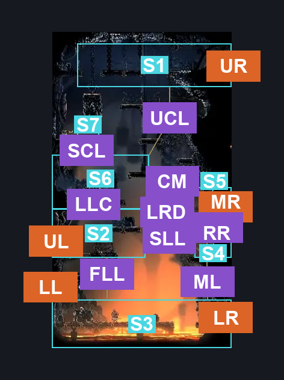
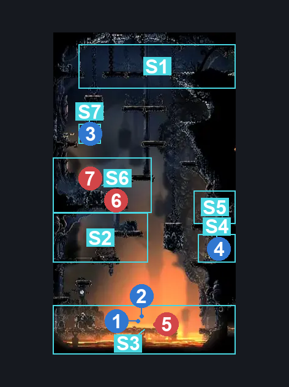
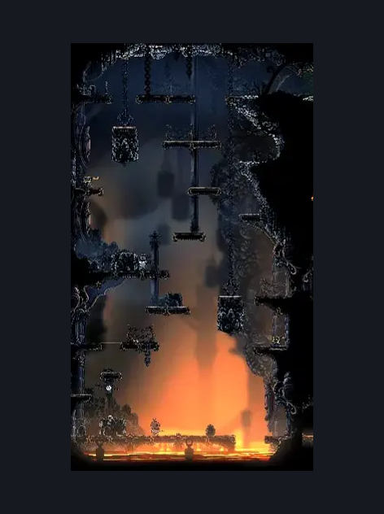

# Deep Docks Map Shop (Bone_East_01)

**Game ID:** Bone_East_01

**Contributors:** herounit, Rebel, Gallos

## Subrooms

| No. | Subroom | Annotated |
| --- | --- | --- |
| S1 | upper area | ✓ |
| S2 | lower left door | ✓ |
| S3 | Floor | ✓ |
| S4 | Lower Right Switch | ✓ |
| S5 | Lower Right Door | ✓ |
| S6 | Center Left | ✓ |
| S7 | Upper Switch | ✓ |

## Room Transitions

| Alias | Name | From subroom | Destination | Destination alias | Requirements | TODO | Verification | Annotated | Notes |
| --- | --- | --- | --- | --- | --- | --- | --- | --- | --- |
| UL | left1 | lower left door | [Deep Docks Bench Shaft (Dock_01)](deep-docks-bench-shaft.md) | LR | none |  | Verified | ✓ |  |
| LL | left2 | Floor | [Deep Docks Bellway (Bellway_02)](deep-docks-bellway.md) | R | none |  | Verified | ✓ |  |
| UR | right1 | upper area | [Deep Docks Spire Lower (Bone_East_03)](deep-docks-spire-lower.md) | L | none |  | Verified | ✓ |  |
| MR | right2 | Lower Right Door | [Deep Docks Map Shop Side Room (Dock_05)](deep-docks-map-shop-side-room.md) | L | none |  | Verified | ✓ |  |
| LR | right3 | Floor | [Deep Docks Lace Intro (Bone_East_12)](deep-docks-lace-intro.md) | L | none |  | Verified | ✓ |  |

## Subroom Connections

| Alias | Name | Source | Destination | Requirements | TODO | Verification | Annotated | Notes |
| --- | --- | --- | --- | --- | --- | --- | --- | --- |
| FLL | Floor <> Lower Left | Floor | lower left door | Ledge Grab either OR Cling Grip either OR easy Scuttlebrace OR Faydown Cloak OR Silk Soar OR easy [flea brew,plasmium, voltvessels] stall OR (have crest beast AND easy heal stall) OR easy beast needle strike OR easy shaman pogo |  | Verified | ✓ |  |
| FLL | Floor <> Lower Left | lower left door | Floor | Nothing. (Fall) |  | Verified | ✓ |  |
| LLC | Lower Left <> Center | lower left door | Center Left | ((Ledge Grab right OR cling grip right OR (easy shaman pogo AND easy scuttlebrace) OR (have crest beast AND hard heal stall AND easy plasmium stall)) AND (easy pogo off Flintstone Flyer OR ledge grab left OR cling grip left OR (have crest beast AND hard heal stall AND easy plasmium stall) OR (activate switch to lower lower platform AND (clawline left OR sharpdart OR run OR easy beast needle strike OR (easy beast pogo AND (easy [heal,flea brew] stall OR flea brew)) OR easy plasmium stall x 3 OR (easy scuttlebrace AND (easy shaman pogo OR easy [flea brew, rune rage] stall)))))) OR Faydown Cloak OR Silk Soar OR (have crest beast AND hard heal stall x 2 AND easy plasmium stall x 2) |  | Verified | ✓ |  |
| LLC | Lower Left <> Center | Center Left | lower left door | Nothing. (Fall) |  | Verified | ✓ |  |
| LRD | Center <> Lower Right Door | lower left door | Lower Right Door | (easy shaman pogo AND easy scuttlebrace) OR faydown OR (Dash right AND (ledge grab right OR cling grip right)) OR ((ledge grab right OR cling grip right OR  (have crest beast AND hard heal stall AND easy plasmium stall)) AND (run OR Clawline right OR Sharpdart OR Drifter's Cloak OR easy beast pogo OR (easy flea brew stall AND flea brew))) OR Silk Soar OR Activate switch to lower lower platform |  | Verified | ✓ |  |
| LRD | Center <> Lower Right Door | Lower Right Door | lower left door | run OR Dash left OR Clawline left OR Sharpdart OR Faydown Cloak OR Drifter's Cloak OR Silk Soar OR Easy Voltvessels Stall OR (Easy Flea Brew Stall AND Flea Brew) OR ((Hard Flintslate Stall OR Easy Hunter Pogo) AND (Ledge Grab left OR Cling Grip left)) OR easy [architect,Beast] Pogo OR Activate switch to lower lower platform |  | Verified | ✓ |  |
| SLL | Switch <> Lower Left | lower left door | Lower Right Switch | Dash right OR run OR Sharpdart OR Clawline right OR Faydown Cloak OR Drifter's Cloak OR easy Scuttlebrace OR easy beast pogo OR ledge grab right OR cling grip right OR easy beast pogo |  | Verified | ✓ |  |
| SLL | Switch <> Lower Left | Lower Right Switch | lower left door | Silk Soar OR clawline left OR sharpdart OR (easy shaman pogo AND easy scuttlebrace) OR easy beast pogo OR faydown OR ((Easy Architect needle strike OR Easy plasmium Stall) AND (Ledge Grab left OR Cling Grip left))  OR (Activate switch to lower lower platform AND (Cling Grip left OR Ledge Grab left OR easy scuttlebrace)) |  | Verified | ✓ |  |
| SCL | Upper Switch <> Center Left | Center Left | Upper Switch | Ledge Grab OR Cling Grip OR Faydown Cloak OR Silk Soar |  | Verified | ✓ |  |
| SCL | Upper Switch <> Center Left | Upper Switch | Center Left | Nothing. (Fall) |  | Verified | ✓ |  |
| UCL | Upper <> Center Left | Center Left | upper area | (cling grip right AND ((easy heal stall AND have crest beast) OR easy flea brew stall)) OR easy pogo off Flintstone Flyer OR Faydown Cloak OR Silk Soar OR (Activate switch to upper lower platform  AND (Ledge Grab right OR Cling Grip right OR Easy Beast Charge OR Easy Shaman Pogo OR easy plasmium stall x 3 OR (flea brew AND (ledge grab left OR cling grip left)) OR hard voltvessels stall OR (easy beast pogo AND easy heal stall))) |  | Verified | ✓ |  |
| UCL | Upper <> Center Left | upper area | Center Left | Nothing. (Fall) |  | Verified | ✓ |  |
| RR | right to right | Lower Right Door | Lower Right Switch | none |  | Verified | ✓ |  |
| RR | right to right | Lower Right Switch | Lower Right Door | (Activate switch to lower lower platform AND (Cling Grip left OR Ledge Grab left OR easy scuttlebrace)) |  | Verified | ✓ |  |
| CM | center to right | Center Left | Lower Right Door | none |  | Verified | ✓ |  |
| ML | middle right to floor | Lower Right Door | Floor | none |  | Verified | ✓ |  |

## Check Locations

| No. | Check | Subroom | Requirements | TODO | Verification | Location Type | Annotated | Notes |
| --- | --- | --- | --- | --- | --- | --- | --- | --- |
| 1 | map purchase deep docks | Floor | none |  | Verified | collectible | ✓ | shakra shop |
| 2 | pin purchase vendor pins | Floor | none |  | Verified | collectible | ✓ | shakra shop |
| 3 | switch to upper lower platform | Upper Switch | Flip Switch Left |  | Verified | switch | ✓ | NOT CURRENTLY RANDOMIZED |
| 4 | switch to lower lower platform | Lower Right Switch | Flip Switch Right |  | Verified | switch | ✓ | NOT CURRENTLY RANDOMIZED (doesn't currently really block anything since you can just jump above and fall down) |
| 5 | Smelt Shoveller 1 | Floor | Normal World Spawn |  | Verified | enemy | ✓ |  |
| 6 | Flintstone Flyer 1 | Center Left | Normal World Spawn |  | Verified | enemy | ✓ |  |
| 7 | Flintstone Flyer 2 | Center Left | Black Thread World Spawn |  | Verified | enemy | ✓ |  |

## Room Images

### Connections

### Checks

### Scene

