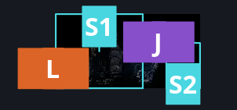
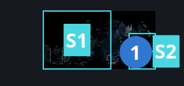
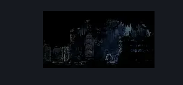

# Deep Docks Silkeater Room (Dock_14)

**Game ID:** Dock_14

**Contributors:** herounit,Rebel, Gallos

## Subrooms

| No. | Subroom | Annotated |
| --- | --- | --- |
| S1 | Entry | ✓ |
| S2 | Da Eater | ✓ |

## Room Transitions

| Alias | Name | From subroom | Destination | Destination alias | Requirements | TODO | Verification | Annotated | Notes |
| --- | --- | --- | --- | --- | --- | --- | --- | --- | --- |
| L | left1 | Entry | [Deep Docks Lower East Shaft (Dock_15)](deep-docks-lower-east-shaft.md) | MR | none |  | Verified | ✓ |  |

## Subroom Connections

| Alias | Name | Source | Destination | Requirements | TODO | Verification | Annotated | Notes |
| --- | --- | --- | --- | --- | --- | --- | --- | --- |
| J | Jump | Entry | Da Eater | Ledge Grab right OR Cling Grip right OR easy Scuttlebrace OR Faydown Cloak OR Silk Soar OR easy [hunter,wanderer, beast,reaper,architect, witch,shaman] pogo OR easy naked pogo OR  (cling grip left AND (clawline right OR sharpdart)) |  | Verified | ✓ |  |
| J | Jump | Da Eater | Entry | Ledge Grab left OR Cling Grip either OR easy Scuttlebrace OR Faydown Cloak OR Silk Soar |  | Verified | ✓ | f4 |

## Check Locations

| No. | Check | Subroom | Requirements | TODO | Verification | Location Type | Annotated | Notes |
| --- | --- | --- | --- | --- | --- | --- | --- | --- |
| 1 | silkeater deep socks | Da Eater | none |  | Verified | collectible | ✓ |  |

## Room Images

### Connections

### Checks

### Scene

