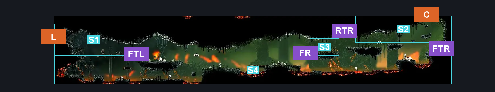
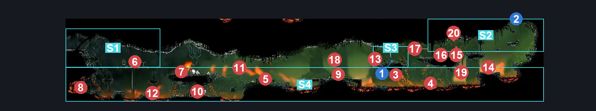
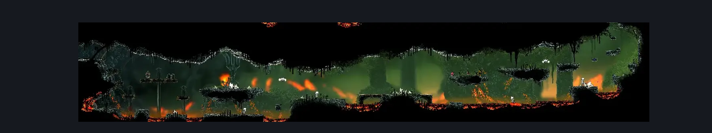

# Deep Docks Spire Lower (Bone_East_03)

**Game ID:** Bone_East_03

**Contributors:** herounit, Rebel, Gallos

## Subrooms

| No. | Subroom | Annotated |
| --- | --- | --- |
| S1 | Top Left Entrance Path | ✓ |
| S2 | Top Right Entrance Path | ✓ |
| S3 | Rosary | ✓ |
| S4 | Floor | ✓ |

## Room Transitions

| Alias | Name | From subroom | Destination | Destination alias | Requirements | TODO | Verification | Annotated | Notes |
| --- | --- | --- | --- | --- | --- | --- | --- | --- | --- |
| C | top1 | Top Right Entrance Path | [Is this still Deep Docks? East (Bone_East_04)](is-this-still-deep-docks-east.md) | F | Activate Deep Docks Lower Spire Blast Rock |  | Verified | ✓ |  |
| L | left1 | Top Left Entrance Path | [Deep Docks Map Shop (Bone_East_01)](deep-docks-map-shop.md) | UR | none |  | Verified | ✓ |  |

## Subroom Connections

| Alias | Name | Source | Destination | Requirements | TODO | Verification | Annotated | Notes |
| --- | --- | --- | --- | --- | --- | --- | --- | --- |
| FTL | Floor <> Top Left | Top Left Entrance Path | Floor | Nothing. (Fall) |  | Verified | ✓ |  |
| FTL | Floor <> Top Left | Floor | Top Left Entrance Path | Clawline left x 2 OR Sharpdart x 2 OR Ledge Grab either OR Cling Grip either OR easy Scuttlebrace OR Faydown OR Drifter's Cloak OR  run OR Silk Soar OR easy pogo off smelt shoveller OR (easy pogo off Caranid AND easy [reaper,beast, shaman, architect] pogo) OR easy beast charge |  | Verified | ✓ |  |
| FTR | Floor <> Top Right | Floor | Top Right Entrance Path | Ledge Grab right OR Cling Grip right OR easy Scuttlebrace OR Faydown  OR (Silk Soar AND Magma Bell) OR Easy Shaman Pogo OR Easy Pogo off [shardillard,Hardbone Hopper,caranid] OR Easy Drill Crystal Pogo OR (have crest beast AND easy heal stall) OR easy [voltvessels, plasmium] stall |  | Verified | ✓ |  |
| FTR | Floor <> Top Right | Top Right Entrance Path | Floor | Nothing. (Fall) |  | Verified | ✓ |  |
| FR | Floor <> Rosary | Floor | Rosary | ((Sprint OR Clawline right OR Sharpdart OR Easy Architect Charge OR Flea Brew OR Easy Flea Brew Stall OR easy plasmium stall OR easy architect charge) AND (Ledge Grab right OR Cling Grip right))  OR (medium Voltvessels Stall AND Cling Grip right) OR (Silk Soar AND Magma Bell) OR (easy pogo off skull brute AND (clawline right OR sharpdart OR dash right) AND (easy reaper pogo OR ledge grab right OR cling grip right)) OR faydown OR (easy pogo off skull brute AND easy shaman pogo) OR medium pogo off shardillard OR medium damage boost off shardillard |  | Verified | ✓ | damage boost off falling rock |
| FR | Floor <> Rosary | Rosary | Floor | Nothing. (Fall) |  | Verified | ✓ |  |
| RTR | Rosary <> Top Right | Rosary | Top Right Entrance Path | Nothing. |  | Verified | ✓ |  |
| RTR | Rosary <> Top Right | Top Right Entrance Path | Rosary | Nothing. |  | Verified | ✓ |  |

## Check Locations

| No. | Check | Subroom | Requirements | TODO | Verification | Location Type | Annotated | Notes |
| --- | --- | --- | --- | --- | --- | --- | --- | --- |
| 1 | Deep Docks Lower Spire Rosary Cache | Rosary | Nothing. |  | Verified | collectible | ✓ |  |
| 2 | Deep Docks Lower Spire Blast Rock | Top Right Entrance Path | Break Blast Rock Up |  | Verified | blockade | ✓ |  |
| 3 | Shardillard 1 | Floor | Attack Up |  | Verified | enemy | ✓ | Spawn conditions: visitedCoral=true |
| 4 | Hardbone Hopper 1 | Floor | nada |  | Verified | enemy | ✓ |  |
| 5 | Hardbone Hopper 2 | Floor | zilch |  | Verified | enemy | ✓ |  |
| 6 | Smelt Shoveller 1 | Top Left Entrance Path | free |  | Verified | enemy | ✓ |  |
| 7 | Skull Scuttler 1 | Floor | nothing |  | Verified | enemy | ✓ |  |
| 8 | Smelt Shoveller 2 | Floor | Normal World Spawn |  | Verified | enemy | ✓ |  |
| 9 | Skull Brute 1 | Floor | Normal World Spawn |  | Verified | enemy | ✓ |  |
| 10 | Hardbone Hopper 3 | Floor | Normal World Spawn |  | Verified | enemy | ✓ |  |
| 11 | Caranid 1 | Floor | Normal World Spawn |  | Verified | enemy | ✓ |  |
| 12 | Skull Scuttler 2 | Floor | Normal World Spawn |  | Verified | enemy | ✓ |  |
| 13 | Skarr Scout 1 | Rosary | Normal World Spawn |  | Verified | enemy | ✓ |  |
| 14 | Hardbone Hopper 4 | Floor | Normal World Spawn |  | Verified | enemy | ✓ |  |
| 15 | Caranid 2 | Top Right Entrance Path | Normal World Spawn |  | Verified | enemy | ✓ |  |
| 16 | Skarr Scout 2 | Top Right Entrance Path | Normal World Spawn |  | Verified | enemy | ✓ |  |
| 17 | Caranid 3 | Top Right Entrance Path | Normal World Spawn |  | Verified | enemy | ✓ |  |
| 18 | Vicious Caranid 1 | Floor | Black Thread World Spawn |  | Verified | enemy | ✓ |  |
| 19 | Beastfly 1 | Floor | Black Thread World Spawn |  | Verified | enemy | ✓ |  |
| 20 | Void Mass 1 | Top Right Entrance Path | Black Thread World Spawn |  | Verified | enemy | ✓ |  |

## Room Images

### Connections

### Checks

### Scene

