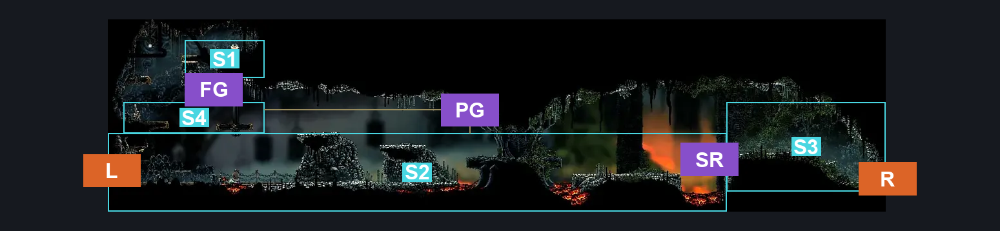
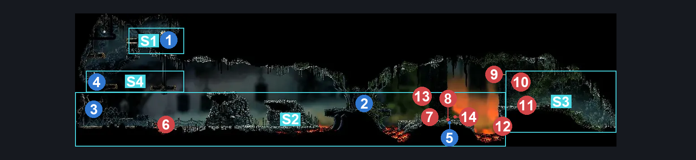
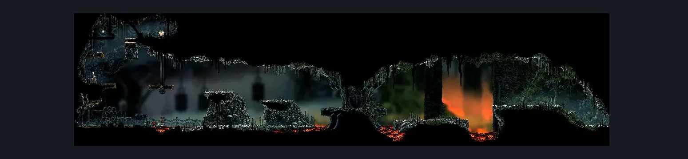

# Deep Docks Upper Spire (Bone_East_05)

**Game ID:** Bone_East_05

**Contributors:** herounit and Rebel

## Subrooms

| No. | Subroom | Annotated |
| --- | --- | --- |
| S1 | left flea platform | ✓ |
| S2 | spire | ✓ |
| S3 | right exit platform | ✓ |
| S4 | Flea Access Lever | ✓ |

## Room Transitions

| Alias | Name | From subroom | Destination | Destination alias | Requirements | TODO | Verification | Annotated | Notes |
| --- | --- | --- | --- | --- | --- | --- | --- | --- | --- |
| L | left1 | spire | [Deep Docks Bench Shaft (Dock_01)](deep-docks-bench-shaft.md) | UR | Activate Deep Docks Upper Spire Gate Lever |  | Verified | ✓ |  |
| R | right1 | right exit platform | [Is this still Deep Docks West (Bone_East_04b)](is-this-still-deep-docks-west.md) | L | none |  | Verified | ✓ |  |

## Subroom Connections

| Alias | Name | Source | Destination | Requirements | TODO | Verification | Annotated | Notes |
| --- | --- | --- | --- | --- | --- | --- | --- | --- |
| SR | spire right | spire | right exit platform | Cling Grip right OR Sprint Right OR Faydown Cloak OR Clawline Right OR Easy Scuttlebrace OR  (Silk Soar AND (Magma Bell OR Proficient Movement OR dash right OR easy [hunter, architect, shaman] pogo )) OR  ((Dash Right OR Drifter's Cloak OR Flea Brew OR Hard [Shaman] Pogo OR Easy [Voltvessels, Flintslate, Plasmium] Stall OR Easy Drill Crystal Pogo ) AND Ledge Grab right ) OR Easy Architect Charge OR Easy Beast Pogo OR (Flea Brew AND Easy Flea Brew Stall) OR Sharpdart OR  (Proficient Movement AND [Architect] Attack Right AND ( Easy Heal Stall OR Easy [Voltvessels, Flea Brew, Flintslate] Stall) AND Ledge Grab right) OR Hard [Plasmium] Stall OR medium damage boost off Skarr Scout |  | Verified | ✓ |  |
| SR | spire right | right exit platform | spire | Nothing. |  | Verified | ✓ |  |
| PG | platform gaps | spire | Flea Access Lever | run OR Dash Left OR Drifter's Cloak OR Faydown Cloak OR Clawline Left x 4 OR Silk Soar OR easy Scuttlebrace OR Easy architect Charge OR Easy Beast Pogo OR Flea Brew OR Medium Voltvessels Stall OR Sharpdart x 4 |  | Verified | ✓ |  |
| PG | platform gaps | Flea Access Lever | spire | Nothing. (fall) |  | Verified | ✓ |  |
| FG | Flea Get | Flea Access Lever | left flea platform | Silk Soar  OR (Faydown Cloak AND (Ledge Grab Left OR Cling Grip Either OR easy scuttlebrace)) OR (Activate Deep Docks Upper Spire Flea Lever AND (Easy Scuttlebrace OR faydown OR ((run OR dash both OR Easy [Architect, Beast] Charge OR clawline both OR sharpdart x 2 OR medium [plasmium, voltvessels] stall OR (flea brew AND easy flea brew stall)) AND (Ledge Grab Left OR cling grip left)) OR (drifters AND (ledge grab both OR cling grip both OR (cling grip right AND ledge grab left) OR (cling grip left AND ledge grab both))) OR (medium rune rage stall AND cling grip both) OR (dash left AND ledge grab left AND (own Tool: Throwing Ring OR own Tool: Threefold Pin OR own Tool: Straight Pin OR own Tool: Cogwork Wheel OR Silkspear)))) |  | Verified | ✓ |  |
| FG | Flea Get | left flea platform | Flea Access Lever | Nothing. (Fall) |  | Verified | ✓ |  |

## Check Locations

| No. | Check | Subroom | Requirements | TODO | Verification | Location Type | Annotated | Notes |
| --- | --- | --- | --- | --- | --- | --- | --- | --- |
| 1 | Deep Docks Upper Spire - Flea | left flea platform | Nothing. |  | Verified | collectible | ✓ |  |
| 2 | Swift Step | spire | Nothing. |  | Verified | collectible | ✓ |  |
| 3 | Deep Docks Upper Spire Gate Lever | spire | Flip Switch Left |  | Verified | switch | ✓ |  |
| 4 | Deep Docks Upper Spire Flea Lever | Flea Access Lever | Flip Switch Left |  | Verified | switch | ✓ |  |
| 5 | Garmond and Zaza Act 3 Meeting Deep Docks | spire | Act 3 |  | Verified | event | ✓ |  |
| 6 | Smelt Shoveller 1 | spire | Normal World Spawn |  | Verified | enemy | ✓ |  |
| 7 | Skarr Stalker 1 | spire | Normal World Spawn |  | Verified | enemy | ✓ | Spawn conditions: hasBrolly=true |
| 8 | Skarr Scout 1 | spire | Normal World Spawn |  | Verified | enemy | ✓ | Spawn conditions: hasBrolly=true |
| 9 | Caranid 1 | right exit platform | Normal World Spawn |  | Verified | enemy | ✓ | Spawn conditions: hasBrolly=true |
| 10 | Caranid 2 | right exit platform | Normal World Spawn |  | Verified | enemy | ✓ | Spawn conditions: hasBrolly=true |
| 11 | Skarr Scout 2 | right exit platform | Normal World Spawn |  | Verified | enemy | ✓ | Spawn conditions: hasBrolly=true |
| 12 | Void Mass 1 | spire | Black Thread World Spawn |  | Verified | enemy | ✓ |  |
| 13 | Spear Skarr 1 | spire | Black Thread World Spawn |  | Verified | enemy | ✓ |  |
| 14 | Skarr Stalker 2 | spire | Black Thread World Spawn |  | Verified | enemy | ✓ |  |

## Room Images

### Connections

### Checks

### Scene

