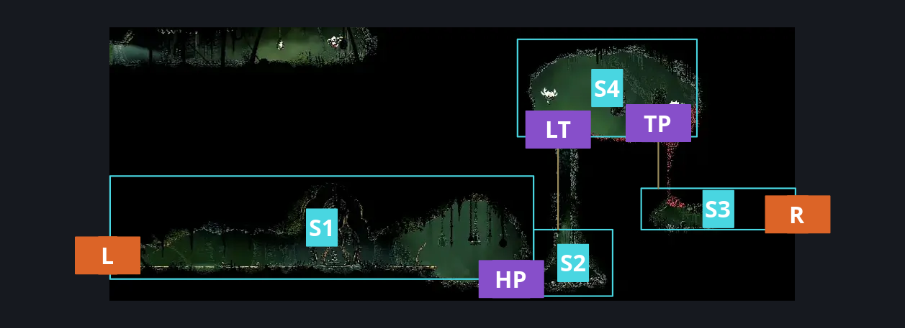
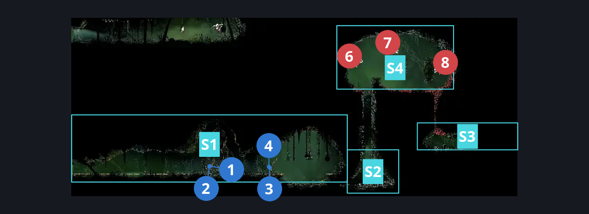
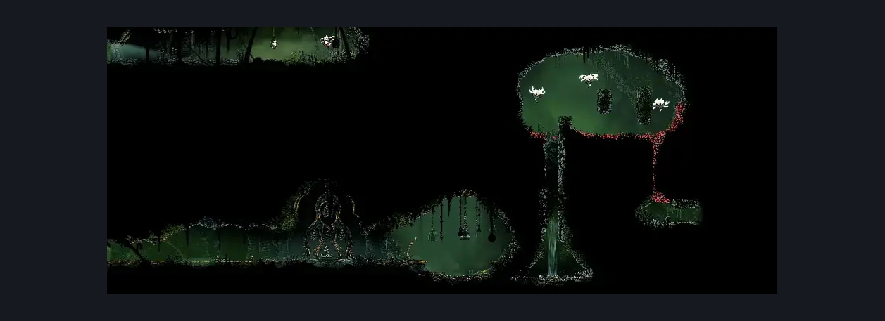

# Far Fields Bellway (Bellway_03)

**Game ID:** Bellway_03

**Contributors:** herounit, Cry

## Subrooms

| No. | Subroom | Annotated |
| --- | --- | --- |
| S1 | bellway | ✓ |
| S2 | hidden area | ✓ |
| S3 | right exit area | ✓ |
| S4 | thorn path | ✓ |

## Room Transitions

| Alias | Name | From subroom | Destination | Destination alias | Requirements | TODO | Verification | Annotated | Notes |
| --- | --- | --- | --- | --- | --- | --- | --- | --- | --- |
| R | right1 | right exit area | [Far Fields Pinstress Attic (Bone_East_09b)](far-fields-pinstress-attic.md) | L | none |  | Verified | ✓ |  |
| L | left1 | bellway | [Far Fields Wind Shaft (Bone_East_07)](far-fields-wind-shaft.md) | R2 | none |  | Verified | ✓ |  |
| BB | door_fastTravelExit | bellway | [Bellway Menu](../fast-travel/bellway-menu.md) | FF | unlock Far Fields - Bellway |  | Verified |  |  |

## Subroom Connections

| Alias | Name | Source | Destination | Requirements | TODO | Verification | Annotated | Notes |
| --- | --- | --- | --- | --- | --- | --- | --- | --- |
| HP | hidden pathway | bellway | hidden area | unlock Far Fields - Bellway Toll Lock |  | Verified | ✓ |  |
| HP | hidden pathway | hidden area | bellway | unlock Far Fields - Bellway Toll Lock |  | Verified | ✓ |  |
| LT | thorn path left | hidden area | thorn path | ( silk soar AND ( ledge grab right OR cling grip right OR easy scuttlebrace ) )  OR ( faydown cloak AND (scuttlebrace OR cling grip either ) ) OR ( break blast rock down AND drifter's cloak AND ( cling grip right OR easy scuttlebrace OR (cling grip left AND ( easy pogo off Vicious Caranid OR ledge grab right )) ) ) |  | Verified | ✓ |  |
| TP | thorn path right | right exit area | thorn path | silk soar OR drifter's cloak |  | Verified | ✓ |  |
| LT | thorn path left | thorn path | hidden area | none |  | Verified | ✓ |  |
| TP | thorn path right | thorn path | right exit area | none (fall) |  | Verified | ✓ |  |

## Check Locations

| No. | Check | Subroom | Requirements | TODO | Verification | Location Type | Annotated | Notes |
| --- | --- | --- | --- | --- | --- | --- | --- | --- |
| 1 | Far Fields - Bellway Bench | bellway | unlock Far Fields - Bellway Bench Lock |  | Verified | bench | ✓ | formerly bench |
| 2 | Far Fields - Bellway Bench Lock | bellway | get 30 rosaries |  | Verified | lock | ✓ | formerly bench rosary lock |
| 3 | Far Fields - Bellway Toll Lock | bellway | get 40 rosaries |  | Verified | lock | ✓ | formerly bellway rosary lock |
| 4 | Far Fields - Bellway | bellway | unlock Far Fields - Bellway Toll Lock |  | Verified | travel | ✓ | formerly bellway far fields |
| 5 | Craw Summons | bellway | craw summons ready |  | Verified | collectible |  |  |
| 6 | Vicious Caranid 1 | thorn path | none |  | Verified | enemy | ✓ | shell shards |
| 7 | Vicious Caranid 2 | thorn path | Normal World Spawn |  | Verified | enemy | ✓ | shell shards |
| 8 | Vicious Caranid 3 | thorn path | none |  | Verified | enemy | ✓ | shell shards |

## Room Images

### Connections

### Checks

### Scene

