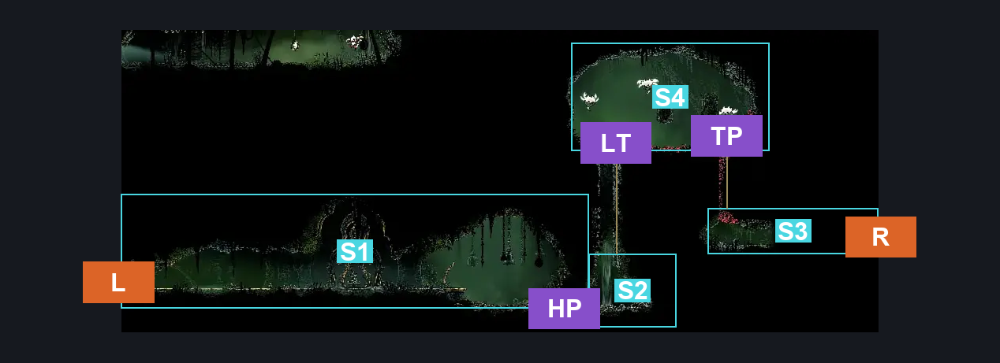
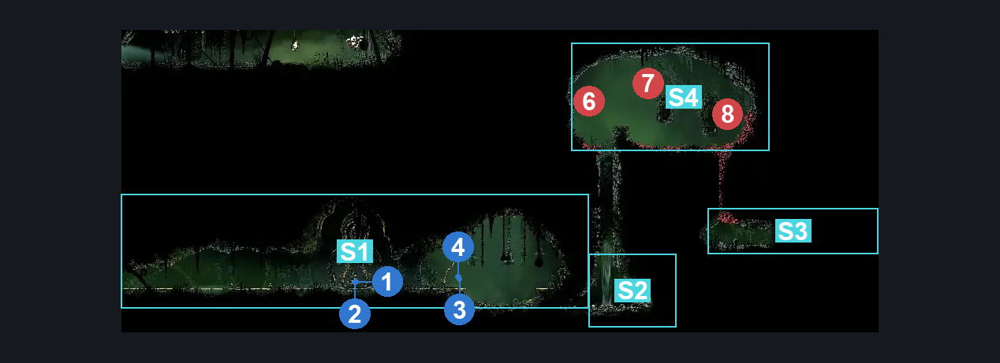
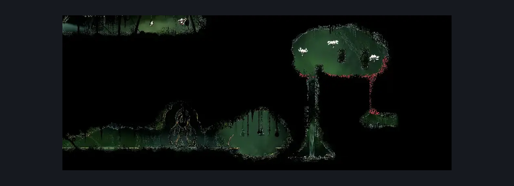

# Far Fields Bellway (Bellway_03)

**Game ID:** Bellway_03

**Contributors:** herounit

## Subrooms

| No. | Subroom | Annotated |
| --- | --- | --- |
| S1 | bellway | ✓ |
| S2 | hidden area | ✓ |
| S3 | right exit area | ✓ |
| S4 | thorn path | ✓ |

## Room Transitions

| Alias | Name | From subroom | Destination | Destination alias | Requirements | TODO | Verification | Annotated | Notes |
| --- | --- | --- | --- | --- | --- | --- | --- | --- | --- |
| R | right1 | right exit area | [Far Fields Pinstress Attic (Bone_East_09b)](far-fields-pinstress-attic.md) | L | none |  | Verified | ✓ |  |
| L | left1 | bellway | [Far Fields Wind Shaft (Bone_East_07)](far-fields-wind-shaft.md) | R2 | none |  | Verified | ✓ |  |
| BB | door_fastTravelExit | bellway | [Bellway Menu](../fast-travel/bellway-menu.md) | FF | unlock bellway far fields |  | Verified |  |  |

## Subroom Connections

| Alias | Name | Source | Destination | Requirements | TODO | Verification | Annotated | Notes |
| --- | --- | --- | --- | --- | --- | --- | --- | --- |
| HP | hidden pathway | bellway | hidden area | unlock bellway rosary lock |  | Verified | ✓ |  |
| HP | hidden pathway | hidden area | bellway | unlock bellway rosary lock |  | Verified | ✓ |  |
| LT | thorn path left | hidden area | thorn path | ( silk soar AND ( ledge grab OR cling grip OR scuttlebrace ) )  OR ( faydown cloak AND (scuttlebrace OR cling grip ) ) OR ( break blast rock down AND drifter's cloak AND ( cling grip OR scuttlebrace ) ) |  | Verified | ✓ |  |
| TP | thorn path right | right exit area | thorn path | silk soar OR drifter's cloak |  | Verified | ✓ |  |
| LT | thorn path left | thorn path | hidden area | none |  | Verified | ✓ |  |
| TP | thorn path right | thorn path | right exit area | none (fall) |  | Verified | ✓ |  |

## Check Locations

| No. | Check | Subroom | Requirements | TODO | Verification | Location Type | Annotated | Notes |
| --- | --- | --- | --- | --- | --- | --- | --- | --- |
| 1 | bench | bellway | unlock bench rosary lock |  | Verified | bench | ✓ |  |
| 2 | bench rosary lock | bellway | none |  | Verified | lock | ✓ |  |
| 3 | bellway rosary lock | bellway | none |  | Verified | lock | ✓ |  |
| 4 | bellway far fields | bellway | unlock bellway rosary lock |  | Verified | travel | ✓ |  |
| 5 | Craw Summons | bellway | craw summons ready |  | Verified | collectible |  |  |
| 6 | vicious caranid 1 | thorn path | none |  | Verified | enemy | ✓ | shell shards |
| 7 | vicious caranid 2 | thorn path | none |  | Verified | enemy | ✓ | shell shards |
| 8 | vicious caranid 3 | thorn path | none |  | Verified | enemy | ✓ | shell shards |

## Room Images

### Connections

### Checks

### Scene

