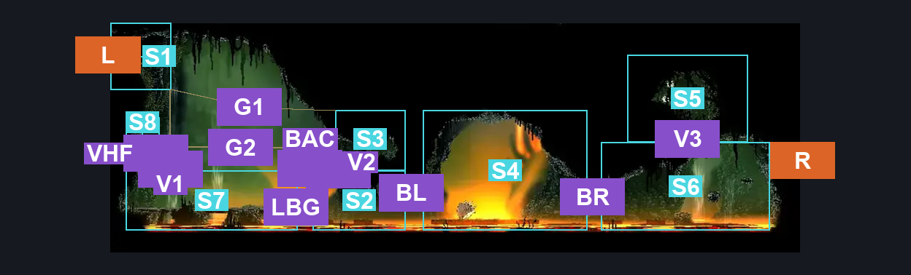
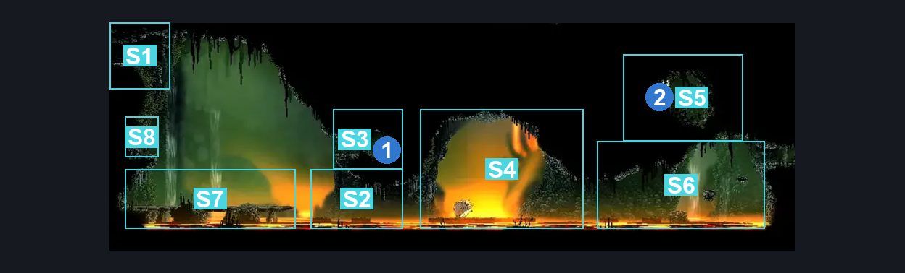
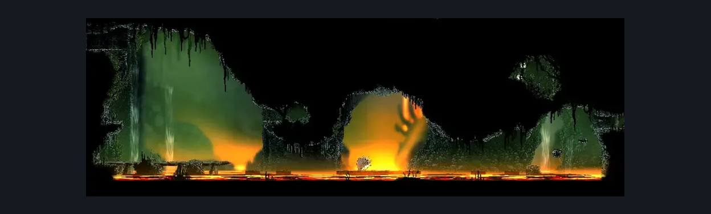

# Far Fields Chorus (Bone_East_08)

**Game ID:** Bone_East_08

**Contributors:** herounit

## Subrooms

| No. | Subroom | Annotated |
| --- | --- | --- |
| S1 | left exit area | ✓ |
| S2 | lower left side | ✓ |
| S3 | upper left alcove | ✓ |
| S4 | boss arena | ✓ |
| S5 | upper right alcove | ✓ |
| S6 | lower right side | ✓ |
| S7 | bone bridge | ✓ |
| S8 | drifter ledge | ✓ |

## Room Transitions

| Alias | Name | From subroom | Destination | Destination alias | Requirements | TODO | Verification | Annotated | Notes |
| --- | --- | --- | --- | --- | --- | --- | --- | --- | --- |
| L | left1 | left exit area | [Far Fields Wind Shaft (Bone_East_07)](far-fields-wind-shaft.md) | R3 | none |  | Verified | ✓ |  |
| R | right1 | lower right side | [Far Fields Pinstress Room (Bone_East_09)](far-fields-pinstress-room.md) | LL | none |  | Verified | ✓ |  |

## Subroom Connections

| Alias | Name | Source | Destination | Requirements | TODO | Verification | Annotated | Notes |
| --- | --- | --- | --- | --- | --- | --- | --- | --- |
| V1 | vertical 1 | bone bridge | left exit area | silk soar OR drifter's cloak |  | Verified | ✓ |  |
| V1 | vertical 1 | left exit area | bone bridge | none (falling) |  | Verified | ✓ |  |
| G1 | gap 1 | left exit area | upper left alcove | drifter's cloak  OR clawline right OR (easy hunter pogo AND sharpdart x 2) OR (easy beast pogo AND (sharpdart x 1 OR dash right OR run)) OR (easy architect pogo AND (run AND easy voltvessels stall x 3)) |  | Verified | ✓ | one way only - or was it |
| G1 | gap 1 | upper left alcove | left exit area | proficient movement  AND faydown cloak  AND cling grip left AND ((sharp dart AND (dash left OR flea brew)) OR clawline left) |  | Verified | ✓ | behold, two-way (this sucked) |
| V2 | vertical 2 | lower left side | upper left alcove | silk soar OR drifter's cloak |  | Verified | ✓ |  |
| V2 | vertical 2 | upper left alcove | lower left side | none (falling) |  | Verified | ✓ |  |
| BL | boss left entrance | lower left side | boss arena | none |  | Verified | ✓ | no boss defeat passthrough requirement |
| BL | boss left entrance | boss arena | lower left side | none |  | Verified | ✓ |  |
| BR | boss right entrance | lower right side | boss arena | none |  | Verified | ✓ | no boss defeat passthrough requirement |
| BR | boss right entrance | boss arena | lower right side | none |  | Verified | ✓ |  |
| V3 | vertical 3 | lower right side | upper right alcove | drifter's cloak OR ( (silk soar OR faydown cloak OR (proficient movement AND run AND dash left) ) AND (easy scuttlebrace OR cling grip left)) |  | Verified | ✓ |  |
| V3 | vertical 3 | upper right alcove | lower right side | none (falling) |  | Verified | ✓ |  |
| LBG | lower bridge gap | bone bridge | lower left side | none (jump) |  | Verified | ✓ |  |
| LBG | lower bridge gap | lower left side | bone bridge | none (jump) |  | Verified | ✓ |  |
| BAC | bridge alcove vault | bone bridge | upper left alcove | (faydown cloak AND medium [rune rage, cross stitch, heal, thread storm, flea brew] stall AND (cling grip right OR ledge grab right)) OR (proficient movement AND (cling grip right OR ledge grab right) AND faydown cloak) |  | Verified | ✓ |  |
| BAC | bridge alcove vault | upper left alcove | bone bridge | none (falling) |  | Verified | ✓ |  |
| G2 | gap 2 | drifter ledge | upper left alcove | clawline right x 3  OR (cling grip left AND (easy beast pogo AND sharpdart x 2)) OR (run AND sharpdart x 2 AND (dash right OR faydown cloak)) |  | Verified | ✓ | redundant inverse connection |
| VHF | vertical half | bone bridge | drifter ledge | silk soar  OR drifter's cloak  OR (faydown cloak AND ((proficient movement AND (cling grip left OR ledge grab left))  OR ((cling grip left OR ledge grab left) AND medium [flea brew, rune rage, thread storm, heal] stall))) |  | Verified | ✓ |  |
| VHF | vertical half | drifter ledge | bone bridge | none (falling) |  | Verified | ✓ |  |

## Check Locations

| No. | Check | Subroom | Requirements | TODO | Verification | Location Type | Annotated | Notes |
| --- | --- | --- | --- | --- | --- | --- | --- | --- |
| 1 | Far Fields Chorus - Choir's Final Rites Beads | upper left alcove | none |  | Verified | collectible | ✓ | formerly rosary cache far fields 2 |
| 2 | Far Fields Chorus - silk | upper right alcove | none |  | Verified | resource | ✓ | silk webs |
| 3 | Far Fields Chorus - Horn Fragment | boss arena | defeat savage beastfly 2 boss fight |  | Verified | collectible |  |  |
| 4 | fourth chorus boss fight | boss arena | Combat Requirements AND complete THE flexible spines wish granted |  | Verified | boss |  |  |
| 5 | savage beastfly 2 boss fight | boss arena | Combat Requirements AND complete THE savage beastfly wish promised |  | Verified | boss |  |  |

## Room Images

### Connections

### Checks

### Scene

