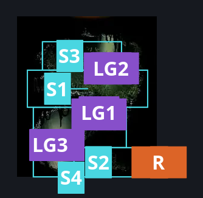
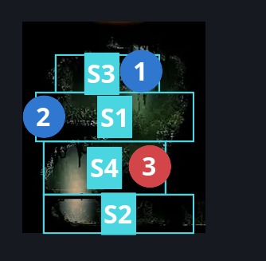
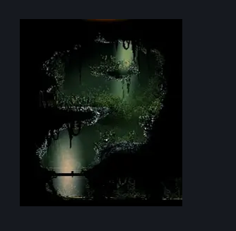

# Far Fields Deep Docks Backdoor (Dock_03b)

**Game ID:** Dock_03b

**Contributors:** herounit

## Subrooms

| No. | Subroom | Annotated |
| --- | --- | --- |
| S1 | Fields Border | ✓ |
| S2 | Fields Docks Passage | ✓ |
| S3 | Warder's Rest | ✓ |
| S4 | Fields Docks Rise | ✓ |

- **Fields Border :** formerly upper area
- **Fields Docks Passage:** formerly lower area
- **Warder's Rest:** formerly platform

## Room Transitions

| Alias | Name | From subroom | Destination | Destination alias | Requirements | TODO | Verification | Annotated | Notes |
| --- | --- | --- | --- | --- | --- | --- | --- | --- | --- |
| L | left1 | Fields Border | [Deep Docks Chains Upper East (Dock_03)](../deep-docks/deep-docks-chains-upper-east.md) | R | Activate Deep Docks Side Chain Room Door IN Deep Docks Chains East OR Activate Far Fields Side Chain Room Door |  | Verified |  | is this true? map doesn't seem to agree -you can open it from both lol. - confirmed, can be breached from either side |
| R | right1 | Fields Docks Passage | [Far Fields Wind Shaft (Bone_East_07)](far-fields-wind-shaft.md) | L3 | none |  | Verified | ✓ |  |

## Subroom Connections

| Alias | Name | Source | Destination | Requirements | TODO | Verification | Annotated | Notes |
| --- | --- | --- | --- | --- | --- | --- | --- | --- |
| LG1 | ledge grab 1 | Fields Docks Rise | Fields Border | ledge grab right OR cling grip right OR silk soar  OR faydown cloak  OR easy shaman pogo OR easy scuttlebrace OR (easy beast pogo AND medium [flea brew, rune rage, thread storm, air bind] stall x 2) |  | Verified | ✓ |  |
| LG1 | ledge grab 1 | Fields Border | Fields Docks Rise | none (falling) |  | Verified | ✓ |  |
| LG2 | ledge grab 2 | Fields Border | Warder's Rest | ledge grab left OR silk soar  OR faydown cloak OR cling grip either OR easy scuttlebrace |  | Verified | ✓ |  |
| LG2 | ledge grab 2 | Warder's Rest | Fields Border | none (falling) |  | Verified | ✓ |  |
| LG3 | ledge grab 3 | Fields Docks Rise | Fields Docks Passage | none (falling) |  | Verified | ✓ |  |
| LG3 | ledge grab 3 | Fields Docks Passage | Fields Docks Rise | ledge grab either OR cling grip either OR silk soar  OR faydown cloak  OR easy shaman pogo OR easy scuttlebrace OR (easy beast pogo AND medium [flea brew, rune rage, thread storm, air bind] stall) |  | Verified | ✓ |  |

## Check Locations

| No. | Check | Subroom | Requirements | TODO | Verification | Location Type | Annotated | Notes |
| --- | --- | --- | --- | --- | --- | --- | --- | --- |
| 1 | warding bell | Warder's Rest | none |  | Verified | collectible | ✓ |  |
| 2 | Far Fields Side Chain Room Door | Fields Border | Break Wall Left |  | Verified | blockade | ✓ | wall can be opened from both sides |
| 3 | Fertid 1 | Fields Docks Rise | none |  | Verified | enemy | ✓ |  |

## Room Images

### Connections

### Checks

### Scene

