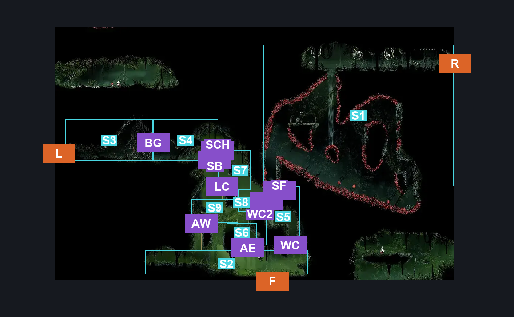
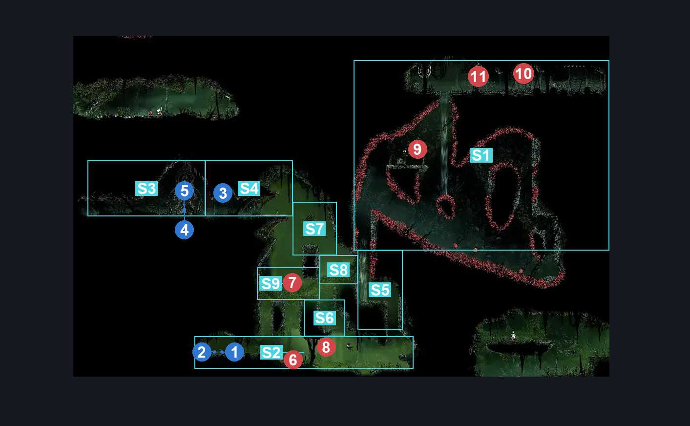
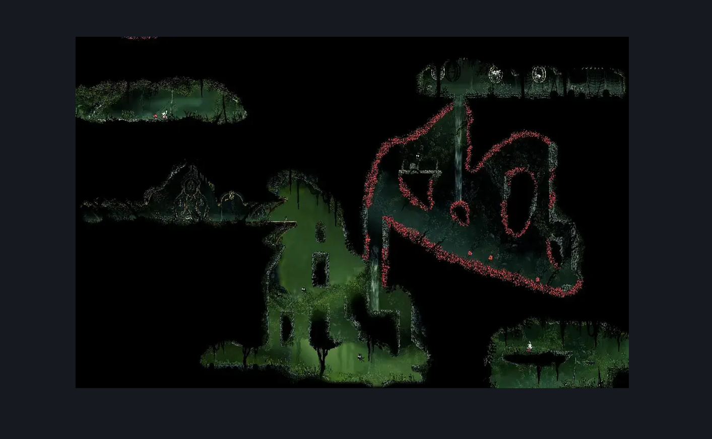

# Far Fields Deep Docks Loopback (Bone_East_15)

**Game ID:** Bone_East_15

**Contributors:** herounit

## Subrooms

| No. | Subroom | Annotated |
| --- | --- | --- |
| S1 | Thorn Gust Cavern | ✓ |
| S2 | Loop Back Surface | ✓ |
| S3 | Dock Fields Bell Crossing Shrine | ✓ |
| S4 | Dock Fields Bell Entrance | ✓ |
| S5 | Windstream Passage | ✓ |
| S6 | Crossing Climb Nook | ✓ |
| S7 | Upper Crossing Climb | ✓ |
| S8 | Windstream Hangoff | ✓ |
| S9 | Cross Climb Link | ✓ |

- **Thorn Gust Cavern:** formerly spike exit
- **Loop Back Surface:** formerly ground
- **Dock Fields Bell Crossing Shrine:** formerly bell bench
- **Dock Fields Bell Entrance:** formerly before gate

## Room Transitions

| Alias | Name | From subroom | Destination | Destination alias | Requirements | TODO | Verification | Annotated | Notes |
| --- | --- | --- | --- | --- | --- | --- | --- | --- | --- |
| L | left1 | Dock Fields Bell Crossing Shrine | [Is this still Deep Docks? East (Bone_East_04)](../deep-docks/is-this-still-deep-docks-east.md) | LR | none |  | Verified | ✓ |  |
| F | bot1 | Loop Back Surface | [Far Fields Entrance East (Bone_East_02)](far-fields-entrance-east.md) | C | none |  | Verified | ✓ |  |
| R | right1 | Thorn Gust Cavern | [Far Fields Fort Upper Passage (Bone_East_17)](far-fields-fort-upper-passage.md) | L | none |  | Verified | ✓ |  |

## Subroom Connections

| Alias | Name | Source | Destination | Requirements | TODO | Verification | Annotated | Notes |
| --- | --- | --- | --- | --- | --- | --- | --- | --- |
| SF | spike float | Windstream Passage | Thorn Gust Cavern | (cling grip right AND drifter's cloak ) OR (silk soar AND drifter's cloak ) |  | Verified | ✓ | exit silk soar early and land on platform |
| SF | spike float | Thorn Gust Cavern | Windstream Passage | none (falling) |  | Verified | ✓ | can barely ledge grab by falling to jump down |
| BG | bell bench gate | Dock Fields Bell Entrance | Dock Fields Bell Crossing Shrine | none (switch is on this side) |  | Verified | ✓ |  |
| BG | bell bench gate | Dock Fields Bell Crossing Shrine | Dock Fields Bell Entrance | activate Far Fields - Deep Docks Loopback - Bell Gate Switch |  | Verified | ✓ |  |
| SB | shrine bell soar | Loop Back Surface | Dock Fields Bell Entrance | silk soar |  | Verified | ✓ |  |
| SB | shrine bell soar | Dock Fields Bell Entrance | Loop Back Surface | none (falling) |  | Verified | ✓ |  |
| WC | Windstream Climb | Loop Back Surface | Windstream Passage | silk soar  OR cling grip left OR (cling grip right AND ((ponder the orb AND (flea brew OR easy shaman pogo)) OR faydown cloak)) OR easy scuttlebrace |  | Verified | ✓ |  |
| WC | Windstream Climb | Windstream Passage | Loop Back Surface | none (falling) |  | Verified | ✓ |  |
| AE | Ascent East | Loop Back Surface | Crossing Climb Nook | silk soar  OR (faydown cloak AND (ledge grab left OR easy pogo off Flapping Fertid)) OR (ledge grab left AND easy pogo off Flapping Fertid AND (clawline either OR easy naked pogo OR easy [hunter, shaman, wanderer, reaper, architect, witch, beast] pogo)) |  | Verified | ✓ |  |
| AE | Ascent East | Crossing Climb Nook | Loop Back Surface | none (falling) |  | Verified | ✓ |  |
| AW | Ascent West | Cross Climb Link | Loop Back Surface | none (falling) |  | Verified | ✓ |  |
| AW | Ascent West | Loop Back Surface | Cross Climb Link | cling grip either  OR silk soar OR (easy scuttlebrace AND (faydown cloak OR easy flea brew stall)) |  | Verified | ✓ |  |
| CLR | Climb Link Right | Cross Climb Link | Crossing Climb Nook | none (falling) |  | Verified |  |  |
| CLR | Climb Link Right | Crossing Climb Nook | Cross Climb Link | (faydown cloak AND ledge grab left)  OR cling grip either OR silk soar |  | Verified |  |  |
| CS | Crossing Soar | Crossing Climb Nook | Upper Crossing Climb | silk soar |  | Verified |  |  |
| RC | Right Cross Climb | Windstream Hangoff | Upper Crossing Climb | cling grip left OR (faydown cloak AND (ledge grab left OR easy shaman pogo OR easy [flea brew, thread storm, rune rage] stall OR easy beast needle strike OR (proficient movement AND (medium beast pogo OR hard cross stitch stall x 2)))) OR easy scuttlebrace |  | Verified |  |  |
| RC | Right Cross Climb | Upper Crossing Climb | Windstream Hangoff | none (falling) |  | Verified |  |  |
| LC | Left Cross Climb | Cross Climb Link | Upper Crossing Climb | silk soar OR cling grip right OR (faydown cloak AND easy scuttlebrace) |  | Verified | ✓ |  |
| LC | Left Cross Climb | Upper Crossing Climb | Cross Climb Link | none (falling) |  | Verified | ✓ |  |
| SCH | Shrine Crossing Hop | Upper Crossing Climb | Dock Fields Bell Entrance | none |  | Verified | ✓ |  |
| SCH | Shrine Crossing Hop | Dock Fields Bell Entrance | Upper Crossing Climb | none |  | Verified | ✓ |  |
| WC2 | Windstream Connector | Windstream Passage | Windstream Hangoff | faydown cloak OR drifter's cloak OR cling grip left OR (ledge grab left AND (easy shaman pogo OR easy flea brew stall)) |  | Verified | ✓ |  |
| WC2 | Windstream Connector | Windstream Hangoff | Windstream Passage | none (falling) |  | Verified | ✓ |  |
| CWJ | Climb Wind Junction | Cross Climb Link | Windstream Hangoff | ledge grab right  OR cling grip either  OR easy scuttlebrace  OR faydown cloak OR easy shaman pogo OR easy beast needle strike OR (easy beast pogo AND easy [flea brew, thread storm, rune rage] stall) |  | Verified |  |  |
| CWJ | Climb Wind Junction | Windstream Hangoff | Cross Climb Link | none (falling) |  | Verified |  |  |
| CS | Crossing Soar | Upper Crossing Climb | Crossing Climb Nook | none (falling) |  | Verified |  |  |

## Check Locations

| No. | Check | Subroom | Requirements | TODO | Verification | Location Type | Annotated | Notes |
| --- | --- | --- | --- | --- | --- | --- | --- | --- |
| 1 | rosary cache far fields 9 | Loop Back Surface | none |  | Verified | collectible | ✓ | MARKED AS ??? ON TRACKER |
| 2 | rosary cache far fields 10 | Loop Back Surface | none |  | Verified | collectible | ✓ | MARKED AS ??? ON TRACKER |
| 3 | Far Fields - Deep Docks Loopback - Bell Gate Switch | Dock Fields Bell Entrance | flip switch up |  | Verified | switch | ✓ | formerly gate switch |
| 4 | Far Fields - Dock Fields Shrine Bench Lock | Dock Fields Bell Crossing Shrine | get 30 rosaries |  | Verified | lock | ✓ | formerly bench rosary lock |
| 5 | Far Fields - Dock Fields Shrine Bench :) | Dock Fields Bell Crossing Shrine | unlock Far Fields - Dock Fields Shrine Bench Lock |  | Verified | bench | ✓ | formerly bench :) |
| 6 | Fertid 1 | Loop Back Surface | none |  | Verified | enemy | ✓ |  |
| 7 | Flapping Fertid 1 | Cross Climb Link | none |  | Verified | enemy | ✓ |  |
| 8 | Flapping Fertid 2 | Loop Back Surface | none |  | Verified | enemy | ✓ |  |
| 9 | Flapping Fertid 3 | Thorn Gust Cavern | none |  | Verified | enemy | ✓ |  |
| 10 | Beastfly 1 | Thorn Gust Cavern | none |  | Verified | enemy | ✓ |  |
| 11 | Vicious Caranid 1 | Thorn Gust Cavern | none |  | Verified | enemy | ✓ |  |

## Room Images

### Connections

### Checks

### Scene

