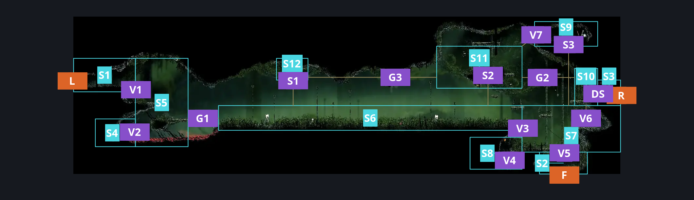
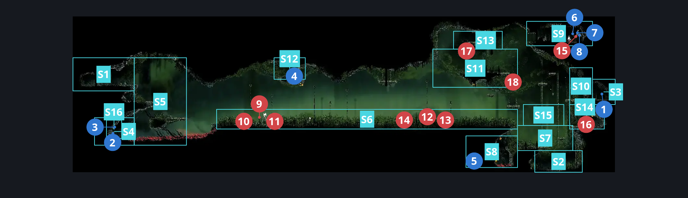
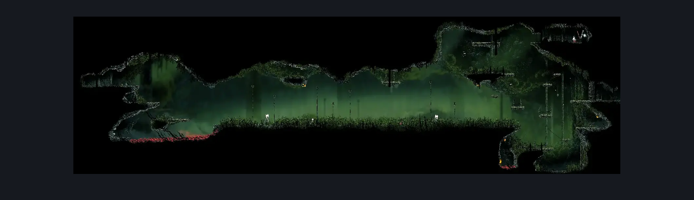

# Far Fields Deep Entrance (Bone_East_24)

**Game ID:** Bone_East_24

**Contributors:** herounit, Cry

## Subrooms

| No. | Subroom | Annotated |
| --- | --- | --- |
| S1 | left exit area | ✓ |
| S2 | bottom exit area | ✓ |
| S3 | right exit area | ✓ |
| S4 | lower left alcove | ✓ |
| S5 | middle left platform | ✓ |
| S6 | plains | ✓ |
| S7 | lower right area | ✓ |
| S8 | lower right alcove | ✓ |
| S9 | upper right alcove | ✓ |
| S10 | left of right exit gate | ✓ |
| S11 | plains upper right platform | ✓ |
| S12 | plains upper left platform | ✓ |
| S13 | plains upper right plat2 | ✓ |
| S14 | under gate nook | ✓ |
| S15 | bridging platform | ✓ |
| S16 | Shell Shard Crevace | ✓ |

## Room Transitions

| Alias | Name | From subroom | Destination | Destination alias | Requirements | TODO | Verification | Annotated | Notes |
| --- | --- | --- | --- | --- | --- | --- | --- | --- | --- |
| F | bot1 | bottom exit area | [Far Fields Deep Lower West (Bone_East_18)](far-fields-deep-lower-west.md) | C | none |  | Verified | ✓ |  |
| L | left1 | left exit area | [Far Fields Upper Shaft (Bone_East_11)](far-fields-upper-shaft.md) | UR | none |  | Verified | ✓ |  |
| R | right1 | right exit area | [Far Fields Deep Fort Bench (Bone_East_27)](far-fields-deep-fort-bench.md) | L | none |  | Verified | ✓ |  |

## Subroom Connections

| Alias | Name | Source | Destination | Requirements | TODO | Verification | Annotated | Notes |
| --- | --- | --- | --- | --- | --- | --- | --- | --- |
| V1 | vertical 1 | left exit area | middle left platform | none (falling) |  | Verified | ✓ |  |
| V1 | vertical 1 | middle left platform | left exit area | silk soar  OR faydown cloak  OR (ledge grab left AND proficient movement AND (easy shaman pogo OR (easy flea brew stall AND clawline left))) |  | Verified | ✓ |  |
| V2 | vertical 2 | middle left platform | lower left alcove | run  OR dash left  OR easy beast pogo  OR drifter's cloak  OR faydown cloak  OR clawline left  OR sharpdart  OR scuttlebrace OR (elite ball knowledge AND (easy [hunter, wanderer, shaman] pogo)) |  | Verified | ✓ |  |
| V2 | vertical 2 | lower left alcove | middle left platform | (faydown cloak  AND (flea brew  OR ledge grab right  OR easy voltvessels stall OR easy [beast, architect] needle strike  OR easy beast pogo  OR architect slash right OR run))  OR ( cling grip right  AND (run  OR dash right  OR drifter's cloak  OR faydown cloak  OR clawline right  OR sharpdart  OR flea brew  OR easy beast needle strike  OR easy [beast, architect] needle strike  OR architect slash right  OR (elite ball knowledge AND easy [hunter, shaman, wanderer] pogo))) |  | Verified | ✓ |  |
| G1 | gap 1 | middle left platform | plains | run OR dash right  OR drifter's cloak  OR faydown cloak  OR clawline right  OR sharpdart  OR easy scuttlebrace  OR easy [beast, architect, hunter] pogo OR easy naked pogo OR easy [beast, architect, witch] needle strike OR flea brew  OR (proficient movement AND (cling grip both OR (cling grip left AND (easy shaman pogo OR easy wanderer needle strike)))) OR (elite ball knowledge AND easy [hunter, wanderer, shaman] pogo) |  | Verified | ✓ |  |
| G1 | gap 1 | plains | middle left platform | run left  OR dash left  OR drifter's cloak  OR faydown cloak  OR clawline left  OR sharpdart  OR (ledge grab left AND (dash left OR easy architect needle strike))  OR (proficient movement AND cling grip both AND (easy architect needle strike OR (flea brew AND easy wanderer needle strike))) OR (proficient movement AND flea brew AND (easy architect needle strike OR architect slash left)) OR (elite ball knowledge AND easy [hunter, wanderer, shaman] pogo) |  | Verified | ✓ |  |
| V3 | vertical 3 | plains | lower right area | none (falling) |  | Verified |  |  |
| V3 | vertical 3 | lower right area | plains | silk soar  OR faydown OR ( ledge grab left AND ( run left OR clawline left ) ) |  | Verified |  |  |
| V4 | vertical 4 | lower right area | lower right alcove | break blast rock left AND ( spike pogo OR cling grip either OR faydown cloak OR scuttlebrace OR easy hazard respawn ) |  | Verified | ✓ | can just break it, reset from thorns and jump down again - won't work with 1 hp though :) |
| V4 | vertical 4 | lower right alcove | lower right area | cling grip either OR faydown cloak OR scuttlebrace |  | Verified | ✓ |  |
| V5 | vertical 5 | lower right area | bottom exit area | none (falling) |  | Verified | ✓ |  |
| V5 | vertical 5 | bottom exit area | lower right area | silk soar OR cling grip right OR easy scuttlebrace OR ( faydown cloak AND (ledge grab left OR cling grip left) ) |  | Verified | ✓ |  |
| DS | door switch | right exit area | left of right exit gate | activate right exit door switch |  | Verified | ✓ |  |
| DS | door switch | left of right exit gate | right exit area | activate right exit door switch |  | Verified | ✓ |  |
| V6 | vertical 6 | bridging platform | left of right exit gate | ((run OR clawline right OR easy architect needle strike OR (flea brew AND easy [flea brew, plasmium, voltvessels] stall)) AND (ledge grab right OR cling grip right)) OR silk soar  OR faydown cloak |  | Verified | ✓ |  |
| V6 | vertical 6 | left of right exit gate | bridging platform | none (falling) |  | Verified | ✓ |  |
| S1 | silk soar 1 | plains | plains upper left platform | silk soar OR ( faydown cloak AND clawline left) |  | Verified | ✓ | can hop up from the ground here or cross over from the plains upper right platform - requirements are the same |
| S1 | silk soar 1 | plains upper left platform | plains | none (falling) |  | Verified | ✓ |  |
| S2 | silk soar 2 | plains | plains upper right platform | silk soar  OR (faydown cloak AND clawline both x 3) |  | Verified | ✓ |  |
| S2 | silk soar 2 | plains upper right platform | plains | none (falling) |  | Verified | ✓ |  |
| S3 | silk soar 3 | lower right area | upper right alcove | silk soar |  | Verified | ✓ |  |
| S3 | silk soar 3 | upper right alcove | lower right area | none (falling) |  | Verified | ✓ |  |
| G2 | gap 2 | left of right exit gate | plains upper right platform | (faydown cloak AND ((run AND dash left) OR drifter's cloak OR clawline left OR sharpdart OR easy scuttlebrace OR easy pogo off Flapping Fertid)) OR (cling grip right AND ((run AND dash left) OR drifter's cloak OR clawline left OR sharpdart OR easy scuttlebrace OR easy pogo off Flapping Fertid)) |  | Verified | ✓ |  |
| G2 | gap 2 | plains upper right platform | left of right exit gate | run right OR dash right OR drifter's cloak OR faydown cloak OR clawline right OR scuttlebrace OR sharpdart |  | Verified | ✓ |  |
| G7 | gap 7 | plains upper right platform | plains upper right plat2 | (cling grip left AND faydown cloak AND (ledge grab right OR run OR dash right OR drifter's cloak OR sharpdart OR easy scuttlebrace ))  OR (proficient movement AND cling grip left AND ((clawline left x 1 AND clawline right x 1) OR faydown cloak OR (clawline left AND easy beast pogo) OR (run AND dash right) )) OR (faydown cloak AND easy pogo off flapping Fertid) OR silk soar |  | Verified | ✓ |  |
| G7 | gap 7 | plains upper right plat2 | plains upper right platform | none (falling) |  | Verified | ✓ |  |
| G3 | gap 3 | plains upper left platform | plains upper right platform | faydown cloak AND clawline right |  | Verified | ✓ |  |
| G3 | gap 3 | plains upper right platform | plains upper left platform | faydown cloak AND clawline left |  | Verified | ✓ |  |
| G5 | gap 5 | plains upper right plat2 | upper right alcove | run OR clawline right OR drifter's cloak OR sharpdart OR (faydown cloak AND (easy [hunter, architect, shaman, reaper, beast] pogo OR easy [wanderer, witch, architect, beast] needle strike)) OR (cling grip left AND (easy beast pogo OR easy beast needle strike)) |  | Verified | ✓ | redundant inverse connection |
| G4 | gap 4 | plains | bridging platform | run  OR clawline right  OR sharp dart OR faydown cloak  OR easy beast pogo  OR easy beast needle strike OR ((easy architect needle strike OR drifter's cloak OR flea brew) AND (ledge grab right OR cling grip right)) OR (flea brew AND easy [voltvessels, plasmium] stall) |  | Verified | ✓ |  |
| G4 | gap 4 | bridging platform | plains | run  OR ledge grab left OR cling grip left OR clawline left OR sharp dart OR faydown cloak  OR easy [beast, shaman, witch, architect, hunter, reaper]  pogo  OR easy naked pogo OR architect slash left OR easy [beast, wanderer, architect, witch] needle strike OR flea brew OR easy [voltvessels, plasmium, air bind, rune rage, thread storm, cross stitch, silkspear, flintslate] stall |  | Verified | ✓ |  |
| V8 | vertical 8 | lower right area | under gate nook | ledge grab right OR cling grip right OR faydown cloak OR silk soar OR easy scuttlebrace OR easy [beast, reaper] needle strike OR easy [beast, shaman] pogo OR clawline right OR sharp dart OR easy [flea brew, air bind, thread storm, rune rage, voltvessels, plasmium] stall |  | Verified | ✓ |  |
| V8 | vertical 8 | under gate nook | lower right area | none (falling) |  | Verified | ✓ |  |
| V9 | vertical 9 | plains | lower right area | none (falling) |  | Verified | ✓ |  |
| V9 | vertical 9 | lower right area | plains | silk soar OR (faydown cloak  AND (ledge grab left OR cling grip left)) |  | Verified | ✓ |  |
| UAD | upper right alcove drop | upper right alcove | plains upper right platform | none (falling) |  | Verified | ✓ | certain combinations of silk soar and additional items can reach the alcove from the platform; however, these are redundant listings as there is a silk soar only connection in a lower subroom |
| G6 | gap 6 | under gate nook | bridging platform | ((run OR clawline left OR sharp dart) AND (cling grip left OR ledge grab left OR easy beast needle strike OR easy shaman pogo OR medium plasmium stall)) OR (proficient movement AND drifter's cloak AND ledge grab left) OR faydown cloak |  | Verified | ✓ |  |
| G6 | gap 6 | bridging platform | under gate nook | run  OR clawline right  OR sharp dart  OR cling grip right  OR ledge grab right OR easy [beast, architect, reaper, wanderer, witch] needle strike  OR easy [shaman, architect, hunter, reaper] pogo  OR easy naked pogo OR drifter's cloak OR faydown cloak |  | Verified | ✓ |  |
| LC | lower shell crevace | Shell Shard Crevace | lower left alcove | none |  | Verified | ✓ |  |
| LC | lower shell crevace | lower left alcove | Shell Shard Crevace | none |  | Verified | ✓ |  |
| PSN | platform shard snipe | middle left platform | Shell Shard Crevace | (easy [curveclaw, longpin, threefold pin, straight pin, pimpillo] use AND easy damage boost) OR easy [throwing ring, conchcutter] use |  | Verified | ✓ | Tool Snipe connection. |

## Check Locations

| No. | Check | Subroom | Requirements | TODO | Verification | Location Type | Annotated | Notes |
| --- | --- | --- | --- | --- | --- | --- | --- | --- |
| 1 | right exit door switch | right exit area | flip switch down |  | Verified | switch | ✓ |  |
| 2 | Far Fields - Deep Entrance Skarr Gate Watch Spears | Shell Shard Crevace | none |  | Verified | collectible | ✓ | formely AP Minor Cache - Shell Shard Cache: Far Fields #4 |
| 3 | Far Fields - Deep Entrance Skarr Sentinel's Trap Shards | Shell Shard Crevace | none |  | Verified | collectible | ✓ | formerly AP Minor Cache - Shell Shard Cache: Far Fields #5 |
| 4 | Far Fields - Deep Entrance -Cage Materials | plains upper left platform | none |  | Verified | collectible | ✓ | formerly AP Minor Cache - Shell Shard Cache: Far Fields #6 |
| 5 | Far Fields - Deep Entrance - Curveclaw Reserve | lower right alcove | none |  | Verified | collectible | ✓ | formerly AP Minor Cache - Shell Shard Cache: Far Fields #7 |
| 6 | Far Fields - Deep Entrance -Queen's Gate Sentry Funds | upper right alcove | none |  | Verified | collectible | ✓ | formerly AP Minor Cache - Rosary Cache: Far Fields #20 |
| 7 | Far Fields - Deep Entrance - Rosary Bounty on Gurr | upper right alcove | none |  | Verified | collectible | ✓ | formerly Far Fields - Deep Entrance - Bounty Rosary Stash - "To be paid in full to the Hunter who fells Gurr" |
| 8 | Far Fields - Deep Entrance -Queen's Pearls of Hero | upper right alcove | none |  | Verified | collectible | ✓ | formerly far fields pale rosary necklace |
| 9 | Hardbone Elder 1ffde | plains | none |  | Verified | enemy | ✓ | shell shards |
| 10 | Hardbone Hopper 1ffde | plains | none |  | Verified | enemy | ✓ | shell shards |
| 11 | Hardbone Hopper 2ffde | plains | none |  | Verified | enemy | ✓ | shell shards |
| 12 | Hardbone Elder 2ffde | plains | none |  | Verified | enemy | ✓ | shell shards |
| 13 | Skarr Scout 1ffde | plains | none |  | Verified | enemy | ✓ | rosaries |
| 14 | Skarr Scout 2ffde | plains | none |  | Verified | enemy | ✓ | rosaries |
| 15 | Skarr Stalker 1ffde | upper right alcove | none |  | Verified | enemy | ✓ | rosaries |
| 16 | Fertid 1ffde | under gate nook | none |  | Verified | enemy | ✓ | shell shards |
| 17 | Flapping Fertid 1ffde | plains upper right platform | none |  | Verified | enemy | ✓ | shell shards |
| 18 | Flapping Fertid 2ffde | plains upper right platform | none |  | Verified | enemy | ✓ | shell shards |

## Room Images

### Connections

### Checks

### Scene

