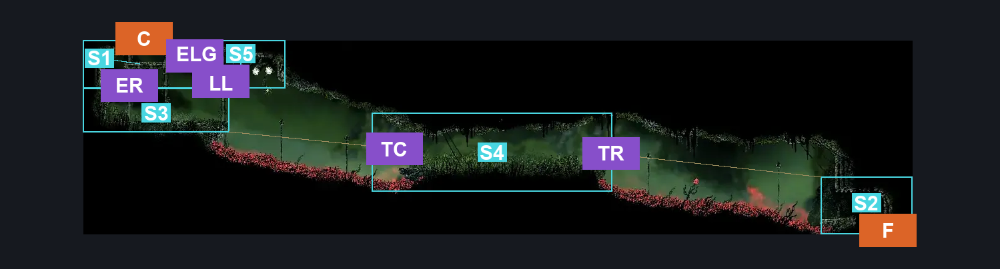
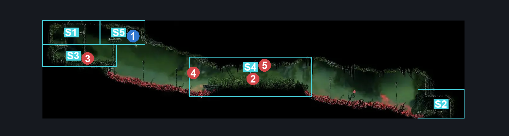
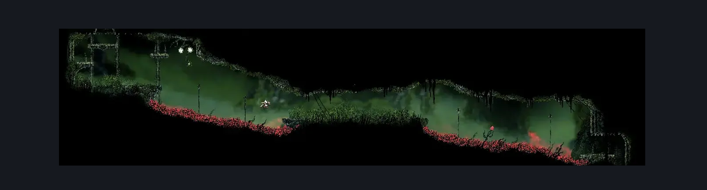

# Far Fields Deep Fort Passage (Bone_East_26)

**Game ID:** Bone_East_26

**Contributors:** herounit

## Subrooms

| No. | Subroom | Annotated |
| --- | --- | --- |
| S1 | ceiling exit platform | ✓ |
| S2 | floor exit area | ✓ |
| S3 | ceiling exit ledge | ✓ |
| S4 | thorn thicket plateau | ✓ |
| S5 | silk bud ledge | ✓ |

## Room Transitions

| Alias | Name | From subroom | Destination | Destination alias | Requirements | TODO | Verification | Annotated | Notes |
| --- | --- | --- | --- | --- | --- | --- | --- | --- | --- |
| C | top1 | ceiling exit platform | [Far Fields Deep Fort Bench (Bone_East_27)](far-fields-deep-fort-bench.md) | F | none |  | Verified | ✓ |  |
| F | bot1 | floor exit area | [Far Fields Deep Lower East (Bone_East_18b)](far-fields-deep-lower-east.md) | C | none |  | Verified | ✓ |  |

## Subroom Connections

| Alias | Name | Source | Destination | Requirements | TODO | Verification | Annotated | Notes |
| --- | --- | --- | --- | --- | --- | --- | --- | --- |
| TC | thorn crossing | thorn thicket plateau | ceiling exit ledge | (clawline left AND (silkhearts x 1 OR clawline x 3)) OR (sharp dart AND run AND dash left AND faydown cloak AND (ledge grab left OR cling grip left)) |  | Verified | ✓ |  |
| TC | thorn crossing | ceiling exit ledge | thorn thicket plateau | ( clawline right AND ( silkhearts x 2 OR ( silkhearts x 1 AND ( faydown OR dash OR drifters ) ) ) ) OR ( run AND dash right AND drifters AND faydown ) |  | Verified | ✓ |  |
| TR | thorn crossing left | floor exit area | thorn thicket plateau | (clawline left AND (silkhearts x 1 OR clawline x 3) AND (faydown cloak OR cling grip right OR silk soar))  OR (sharpdart x 3 AND run AND dash left AND faydown cloak AND (ledge grab left OR cling grip left)) OR (drifter's cloak AND (cling grip right OR silk soar) AND ((easy shaman pogo) OR (medium [wanderer, reaper] pogo AND dash left AND (cling grip left OR ledge grab left)))) |  | Verified | ✓ |  |
| TR | thorn crossing left | thorn thicket plateau | floor exit area | ( clawline right AND ( silkhearts x 2 OR (silkhearts x 1 AND (faydown OR dash right OR drifters ) ) ) ) OR ( run AND dash right AND drifters AND faydown ) |  | Verified | ✓ |  |
| ER | exit rise | ceiling exit platform | ceiling exit ledge | none (falling) |  | Verified | ✓ |  |
| ER | exit rise | ceiling exit ledge | ceiling exit platform | silk soar  OR faydown cloak  OR (ledge grab left AND (hard pogo off Fertid OR easy shaman pogo OR easy flea brew stall)) |  | Verified | ✓ |  |
| LL | ledge link | ceiling exit ledge | silk bud ledge | silk soar  OR (faydown cloak AND (ledge grab either OR cling grip either)) |  | Verified | ✓ |  |
| LL | ledge link | silk bud ledge | ceiling exit ledge | none (falling) |  | Verified | ✓ |  |
| ELG | exit ledge gap | ceiling exit platform | silk bud ledge | faydown cloak OR clawline right OR (dash right AND ((proficient movement AND cling grip left) OR run OR easy architect pogo)) OR easy beast pogo |  | Verified | ✓ |  |
| ELG | exit ledge gap | silk bud ledge | ceiling exit platform | faydown cloak  OR clawline left OR (dash left AND ((proficient movement AND cling grip right) OR run OR easy [beast, shaman] pogo OR easy architect needle strike)) OR (proficient movement AND run) OR easy beast needle strike |  | Verified | ✓ |  |

## Check Locations

| No. | Check | Subroom | Requirements | TODO | Verification | Location Type | Annotated | Notes |
| --- | --- | --- | --- | --- | --- | --- | --- | --- |
| 1 | silk buds | silk bud ledge | none |  | Verified | collectible | ✓ | farmable source of silk |
| 2 | Skarr Stalker 1 | thorn thicket plateau | none |  | Verified | enemy | ✓ |  |
| 3 | Fertid 1 | ceiling exit ledge | none |  | Verified | enemy | ✓ |  |
| 4 | Spear Skarr 1 | thorn thicket plateau | none |  | Verified | enemy | ✓ |  |
| 5 | Void Mass 1 | thorn thicket plateau | Black Thread World Spawn |  | Verified | enemy | ✓ |  |

## Room Images

### Connections

### Checks

### Scene

