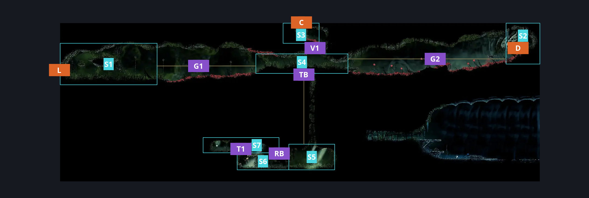
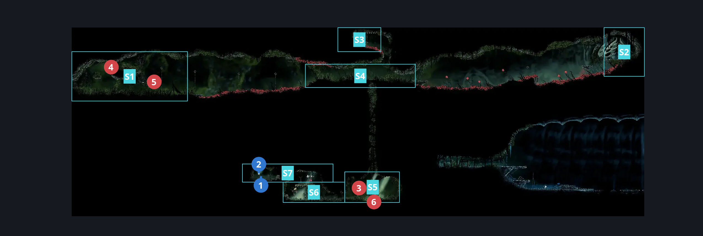
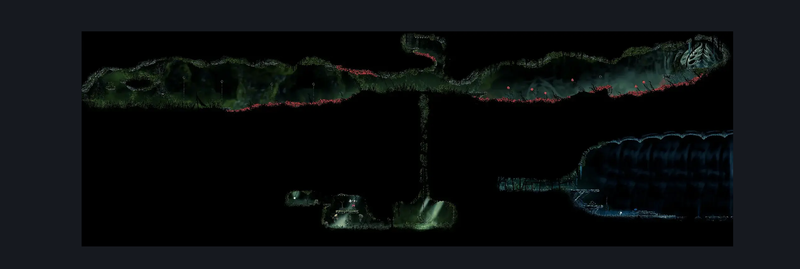

# Far Fields Deep Lower East (Bone_East_18b)

**Game ID:** Bone_East_18b

**Contributors:** herounit, Pyxl, Cry

## Subrooms

| No. | Subroom | Annotated |
| --- | --- | --- |
| S1 | left exit area | ✓ |
| S2 | right exit area | ✓ |
| S3 | ceiling exit area | ✓ |
| S4 | crossing | ✓ |
| S5 | trapper's arena | ✓ |
| S6 | trapper's den | ✓ |
| S7 | trapper's ledge | ✓ |

## Room Transitions

| Alias | Name | From subroom | Destination | Destination alias | Requirements | TODO | Verification | Annotated | Notes |
| --- | --- | --- | --- | --- | --- | --- | --- | --- | --- |
| D | door1 | right exit area | [Sprintmaster Cave (Sprintmaster_Cave)](sprintmaster-cave.md) | L | none |  | Verified | ✓ |  |
| C | top1 | ceiling exit area | [Far Fields Deep Fort Passage (Bone_East_26)](far-fields-deep-fort-passage.md) | F | none |  | Verified | ✓ |  |
| L | left1 | left exit area | [Far Fields Deep Lower West (Bone_East_18)](far-fields-deep-lower-west.md) | R | none |  | Verified | ✓ |  |

## Subroom Connections

| Alias | Name | Source | Destination | Requirements | TODO | Verification | Annotated | Notes |
| --- | --- | --- | --- | --- | --- | --- | --- | --- |
| TB | trapped bench | crossing | trapper's arena | complete THE the hidden hunter wish promised |  | Verified | ✓ |  |
| TB | trapped bench | trapper's arena | crossing | defeat gurr the outcast boss fight AND silk soar |  | Verified | ✓ |  |
| RB | right boss fight | trapper's arena | trapper's den | defeat gurr the outcast boss fight |  | Verified | ✓ |  |
| RB | right boss fight | trapper's den | trapper's arena | defeat gurr the outcast boss fight |  | Verified | ✓ |  |
| G1 | gap 1 | left exit area | crossing | (clawline right AND silkhearts x 1) OR (sharpdart x 4 AND run AND drifter's cloak AND (cling grip right OR dash right)) |  | Verified | ✓ | Currently un-noted due to lack of predicate, but  (Run AND Drifter's Cloak AND HARD Architect Needle Strike AND Pin Badge Use (proficient movement AND (cling grip right or ledge grab right)) |
| G1 | gap 1 | crossing | left exit area | (clawline left AND silkhearts x 1 AND ( run OR dash left OR drifters OR faydown )) OR (sharpdart x 2 AND drifter's cloak AND (run OR cling grip left OR ledge grab left)) |  | Verified | ✓ |  |
| G2 | gap 2 | crossing | right exit area | intended [hunter, wanderer, reaper, beast, architect, witch, shaman] pogo AND ((clawline right AND silkhearts x 1) OR (run AND dash right AND sharpdart x 3) OR (faydown cloak AND drifter's cloak)) |  | Verified | ✓ | need to pogo to let silk recharge with only 1 heart, but it isn't that bad |
| G2 | gap 2 | right exit area | crossing | intended [hunter, wanderer, reaper, beast, architect, witch, shaman] pogo  AND ((proficient movement  AND clawline left AND silkhearts x 1 ) OR ( clawline left AND silkhearts x 1 AND ( dash left OR faydown OR drifter's cloak)) OR (faydown cloak AND drifter's cloak AND dash left)) |  | Verified | ✓ | need enough silk to clawline twice to get the distance by itself |
| V1 | vertical 1 | crossing | ceiling exit area | ( faydown cloak AND ( cling grip right OR (easy scuttlebrace AND ((ledge grab left AND dash left) OR clawline left OR sharpdart))) )  OR ( silk soar AND ( clawline left OR drifter's cloak OR faydown cloak OR sharpdart OR ( ledge grab left AND dash left ) ) ) |  | Verified | ✓ |  |
| V1 | vertical 1 | ceiling exit area | crossing | run  OR dash right  OR clawline right OR drifter's cloak  OR faydown cloak  OR flea brew OR easy [beast, shaman, hunter, architect, reaper] pogo  OR easy naked pogo OR easy [beast, architect, wanderer, witch] needle strike OR sharpdart OR easy scuttlebrace OR easy [voltvessels, plasmium] stall |  | Verified | ✓ |  |
| T1 | trapper 1 | trapper's den | trapper's ledge | faydown OR cling grip either OR scuttlebrace OR silk soar OR (elite ball knowledge AND dash either AND ledge grab either AND easy flea brew stall) |  | Verified | ✓ |  |
| T1 | trapper 1 | trapper's ledge | trapper's den | none (falling) |  | Verified | ✓ |  |

## Check Locations

| No. | Check | Subroom | Requirements | TODO | Verification | Location Type | Annotated | Notes |
| --- | --- | --- | --- | --- | --- | --- | --- | --- |
| 1 | AP Minor Cache - Rosary Cache: Far Fields #19 | trapper's ledge | none |  | Verified | collectible | ✓ |  |
| 2 | Grass Doll | trapper's ledge | none |  | Verified | collectible | ✓ |  |
| 3 | gurr the outcast boss fight | trapper's arena | Combat Requirements AND complete THE the hidden hunter wish promised |  | Verified | boss | ✓ |  |
| 4 | Fertid 1 | left exit area | none |  | Verified | enemy | ✓ |  |
| 5 | Flapping Fertid 1 | left exit area | none |  | Verified | enemy | ✓ |  |
| 6 | Bone Hunter Trapper 1 | trapper's arena | Combat Requirements AND complete THE the hidden hunter wish promised |  | Verified | boss | ✓ |  |

## Room Images

### Connections

### Checks

### Scene

