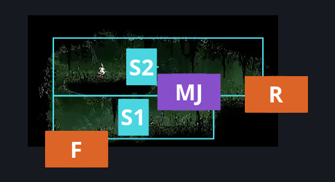
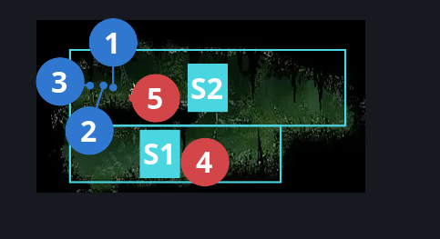
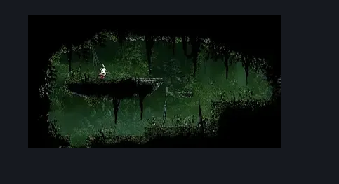

# Far Fields Fort Lower Passage (Bone_East_16)

**Game ID:** Bone_East_16

**Contributors:** herounit

## Subrooms

| No. | Subroom | Annotated |
| --- | --- | --- |
| S1 | the pit of despair | ✓ |
| S2 | the highest highs | ✓ |

## Room Transitions

| Alias | Name | From subroom | Destination | Destination alias | Requirements | TODO | Verification | Annotated | Notes |
| --- | --- | --- | --- | --- | --- | --- | --- | --- | --- |
| F | bot1 | the pit of despair | [Far Fields Entrance West (Bone_East_02b)](far-fields-entrance-west.md) | C | none |  | Verified | ✓ |  |
| R | right1 | the highest highs | [Far Fields Fort Flea Rescue (Bone_East_17b)](far-fields-fort-flea-rescue.md) | L | none (break wall) |  | Verified | ✓ | can be broken from either side |

## Subroom Connections

| Alias | Name | Source | Destination | Requirements | TODO | Verification | Annotated | Notes |
| --- | --- | --- | --- | --- | --- | --- | --- | --- |
| MJ | massive jump | the highest highs | the pit of despair | none (falling) |  | Verified | ✓ |  |
| MJ | massive jump | the pit of despair | the highest highs | ledge grab right OR cling grip right OR easy scuttlebrace OR easy shaman pogo OR (easy pogo off Fertid AND easy reaper pogo) OR silk soar OR faydown cloak |  | Verified | ✓ |  |

## Check Locations

| No. | Check | Subroom | Requirements | TODO | Verification | Location Type | Annotated | Notes |
| --- | --- | --- | --- | --- | --- | --- | --- | --- |
| 1 | Far Fields - Lower Fort Sentry's Rosaries Bonds | the highest highs | none |  | Verified | collectible | ✓ | formerly rosary cache far fields 11 |
| 2 | Far Fields - Lower Fort Sentry's Personal Rosaries | the highest highs | none |  | Verified | collectible | ✓ | formerly rosary cache far fields 12 |
| 3 | Far Fields Lower Fort Last Rosaries Stipend - Queen's Final Support | the highest highs | none |  | Verified | collectible | ✓ | formerly rosary cache far fields 13 |
| 4 | Fertid 1 | the pit of despair | none |  | Verified | enemy | ✓ |  |
| 5 | Skarr Stalker 1 | the highest highs | Normal World Spawn |  | Verified | enemy | ✓ |  |

## Room Images

### Connections

### Checks

### Scene

