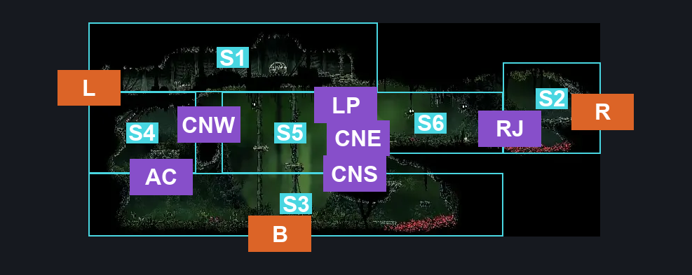
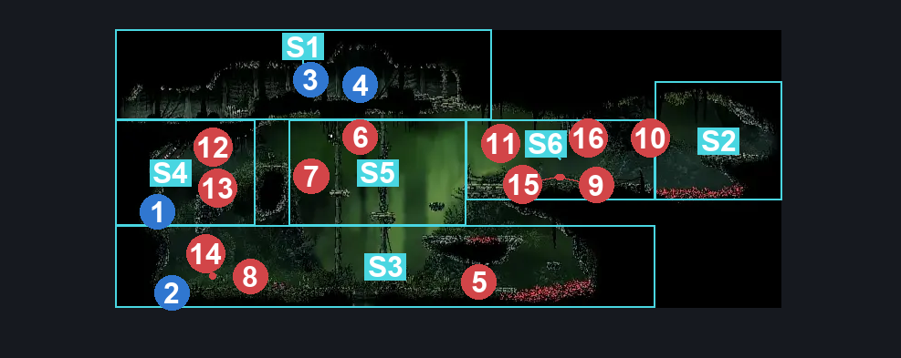
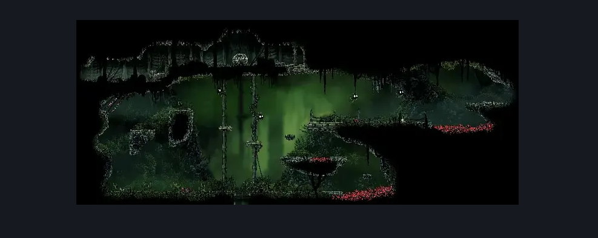

# Far Fields Fort Upper Passage (Bone_East_17)

**Game ID:** Bone_East_17

**Contributors:** herounit

## Subrooms

| No. | Subroom | Annotated |
| --- | --- | --- |
| S1 | left exit area | ✓ |
| S2 | right exit area | ✓ |
| S3 | main area | ✓ |
| S4 | check niche | ✓ |
| S5 | central rise | ✓ |
| S6 | right exit ledge | ✓ |

## Room Transitions

| Alias | Name | From subroom | Destination | Destination alias | Requirements | TODO | Verification | Annotated | Notes |
| --- | --- | --- | --- | --- | --- | --- | --- | --- | --- |
| L | left1 | left exit area | [Far Fields Deep Docks Loopback (Bone_East_15)](far-fields-deep-docks-loopback.md) | R | none |  | Verified | ✓ |  |
| B | bot1 | main area | [Far Fields Fort Flea Rescue (Bone_East_17b)](far-fields-fort-flea-rescue.md) | C | none |  | Verified | ✓ |  |
| R | right1 | right exit area | [Far Fields Wind Shaft (Bone_East_07)](far-fields-wind-shaft.md) | L4 | none |  | Verified | ✓ |  |

## Subroom Connections

| Alias | Name | Source | Destination | Requirements | TODO | Verification | Annotated | Notes |
| --- | --- | --- | --- | --- | --- | --- | --- | --- |
| LP | lower platforms | left exit area | central rise | activate Far Fields - Fort Upper Passage - Stair Release Switch |  | Verified | ✓ |  |
| LP | lower platforms | central rise | left exit area | activate Far Fields - Fort Upper Passage - Stair Release Switch |  | Verified | ✓ |  |
| RJ | running jump | right exit ledge | right exit area | run  OR (ledge grab right AND (dash right OR flea brew OR easy voltvessels stall)) OR drifter's cloak  OR faydown cloak  OR clawline right OR sharpdart OR easy beast pogo OR (proficient movement AND cling grip both AND architect slash right) OR (silk soar AND (easy [architect, hunter] pogo OR ((medium shaman pogo OR easy [voltvessels, plasmium] stall x 1 OR easy cross stitch stall x 1 ) AND ledge grab right) OR dash right OR easy [voltvessels, flintslate, plasmium] stall x 2)) OR easy [beast, architect] needle strike OR (easy pogo off Flapping Fertid AND (easy [reaper, shaman, architect] pogo OR (easy damage boost off Flapping Fertid AND (easy hunter pogo OR easy naked pogo)))) |  | Verified | ✓ | silk soar doesn't get enough horizontal distance without one of the skills that just gets you there |
| RJ | running jump | right exit area | right exit ledge | none (falling) |  | Verified | ✓ |  |
| AC | access niche | main area | check niche | (faydown cloak AND (cling  grip right OR ledge grab left)) OR cling grip left OR easy scuttlebrace OR silk soar OR medium pogo off Skarr Stalker |  | Verified | ✓ |  |
| AC | access niche | check niche | main area | none (falling) |  | Verified | ✓ |  |
| CNW | central network west | central rise | check niche | run OR dash left OR ledge grab left OR cling grip either OR faydown cloak OR clawline left OR sharpdart OR easy scuttlebrace OR architect slash left OR easy [shaman, beast, hunter] pogo OR easy pogo off Flapping Fertid OR easy naked pogo OR medium architect pogo OR easy [witch, architect, wanderer, reaper] needle strike |  | Verified | ✓ |  |
| CNW | central network west | check niche | central rise | none |  | Verified | ✓ |  |
| CNS | central network south | main area | central rise | none (jumping) |  | Verified | ✓ |  |
| CNS | central network south | central rise | main area | none (falling) |  | Verified | ✓ |  |
| CNE | central network east | central rise | right exit ledge | none (jumping) |  | Verified | ✓ |  |
| CNE | central network east | right exit ledge | central rise | none (falling) |  | Verified | ✓ |  |

## Check Locations

| No. | Check | Subroom | Requirements | TODO | Verification | Location Type | Annotated | Notes |
| --- | --- | --- | --- | --- | --- | --- | --- | --- |
| 1 | Far Fields - Fort Upper Passage - Rosaries Niche Stash 1 | check niche | none |  | Verified | collectible | ✓ | formerly rosary cache far fields 14 |
| 2 | Far Fields - Fort Upper Passage - Rosaries Niche Stash 2 | main area | none |  | Verified | collectible | ✓ | formerly rosary cache far fields 15 |
| 3 | Far Fields - Fort Upper Passage - Stair Release Switch | left exit area | flip switch up |  | Verified | switch | ✓ | formerly lower platform switch |
| 4 | Far Fields - Fort Upper Passage - Skarr Rosaries Hoard Chest | left exit area | none |  | Verified | collectible | ✓ | randomized? |
| 5 | Fertid 1 | main area | none |  | Verified | enemy | ✓ |  |
| 6 | Flapping Fertid 1 | central rise | none |  | Verified | enemy | ✓ |  |
| 7 | Flapping Fertid 2 | central rise | Normal World Spawn |  | Verified | enemy | ✓ |  |
| 8 | Skarr Stalker 1 | main area | Normal World Spawn |  | Verified | enemy | ✓ |  |
| 9 | Skarr Scout 1 | right exit ledge | Normal World Spawn |  | Verified | enemy | ✓ |  |
| 10 | Flapping Fertid 3 | right exit ledge | Normal World Spawn |  | Verified | enemy | ✓ |  |
| 11 | Flapping Fertid 4 | right exit ledge | Normal World Spawn |  | Verified | enemy | ✓ |  |
| 12 | Void Mass 1 | check niche | Black Thread World Spawn |  | Verified | enemy | ✓ |  |
| 13 | Spear Skarr 1 | check niche | Black Thread World Spawn |  | Verified | enemy | ✓ |  |
| 14 | Skarr Stalker 2 | main area | Black Thread World Spawn |  | Verified | enemy | ✓ |  |
| 15 | Skarr Scout 2 | right exit ledge | Black Thread World Spawn |  | Verified | enemy | ✓ |  |
| 16 | Spear Skarr 2 | right exit ledge | Black Thread World Spawn |  | Verified | enemy | ✓ |  |

## Room Images

### Connections

### Checks

### Scene

