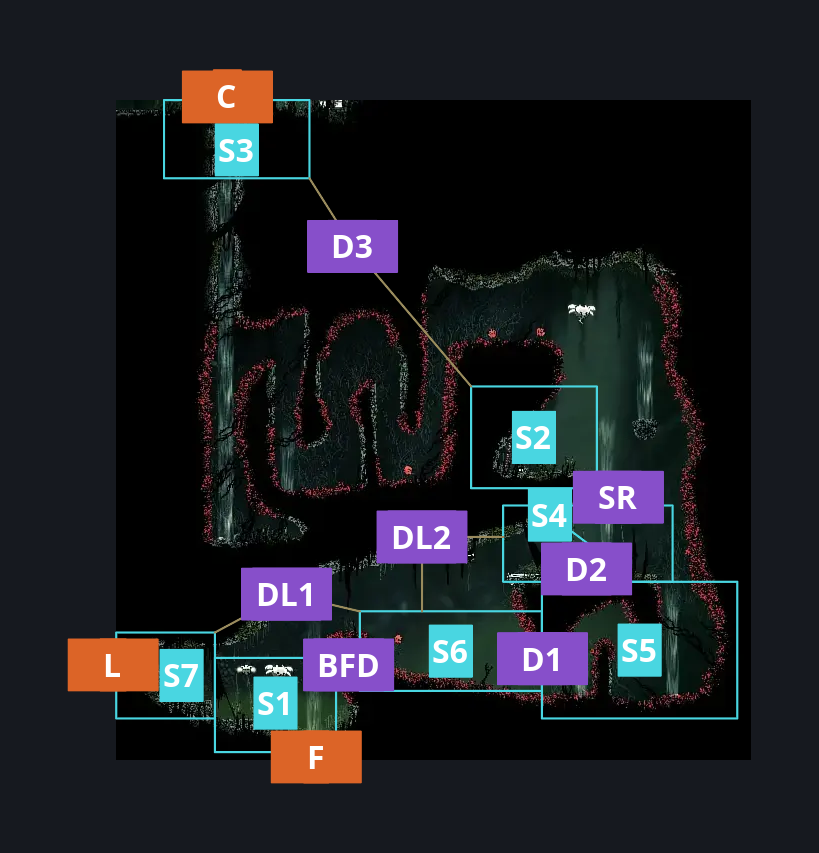
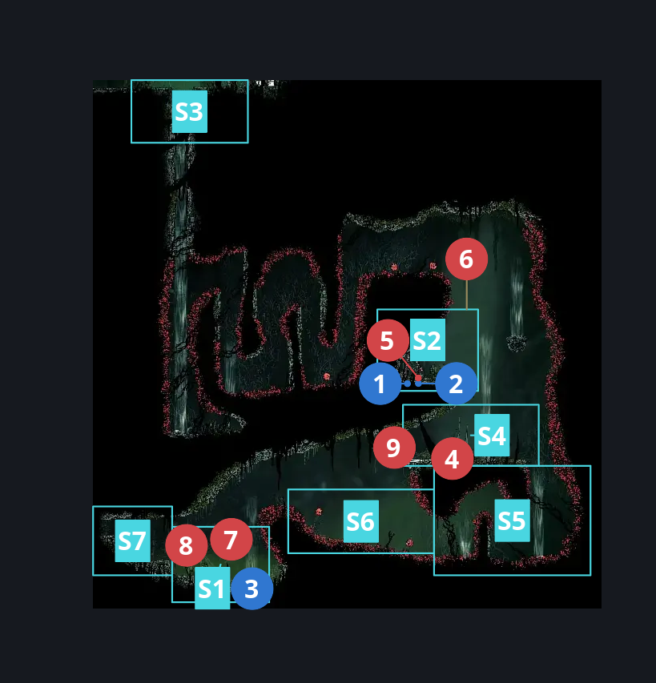
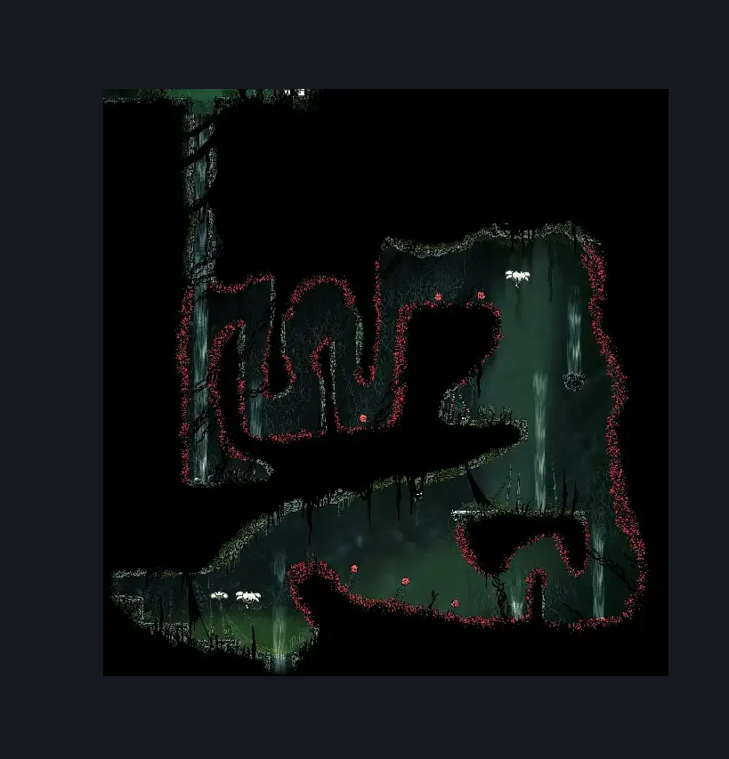

# Far Fields Pinstress Attic (Bone_East_09b)

**Game ID:** Bone_East_09b

**Contributors:** herounit, Cry

## Subrooms

| No. | Subroom | Annotated |
| --- | --- | --- |
| S1 | bottom left area | ✓ |
| S2 | upper right area | ✓ |
| S3 | ceiling exit | ✓ |
| S4 | thorn pit spire landing | ✓ |
| S5 | thorn pit under spire | ✓ |
| S6 | thorn pit rose pogo | ✓ |
| S7 | bellway thicket entrance | ✓ |

## Room Transitions

| Alias | Name | From subroom | Destination | Destination alias | Requirements | TODO | Verification | Annotated | Notes |
| --- | --- | --- | --- | --- | --- | --- | --- | --- | --- |
| L | left1 | bellway thicket entrance | [Far Fields Bellway (Bellway_03)](far-fields-bellway.md) | R | none |  | Verified | ✓ |  |
| F | bot1 | bottom left area | [Far Fields Pinstress Room (Bone_East_09)](far-fields-pinstress-room.md) | T | clear blast rock pinstress attic |  | Verified | ✓ |  |
| C | top1 | ceiling exit | [Far Fields Pilgrim's Rest Church (Bone_East_10_Church)](far-fields-pilgrim-s-rest-church.md) | F | none |  | Verified | ✓ |  |

## Subroom Connections

| Alias | Name | Source | Destination | Requirements | TODO | Verification | Annotated | Notes |
| --- | --- | --- | --- | --- | --- | --- | --- | --- |
| D1 | drift passage 1 | thorn pit rose pogo | thorn pit under spire | drifter's cloak |  | Verified | ✓ |  |
| D2 | drift passage 2 | thorn pit under spire | thorn pit spire landing | drifter's cloak |  | Verified | ✓ | inverse traversal possible but redundant |
| D3 | drift passage 3 | upper right area | ceiling exit | drifter's cloak  AND (cling grip left  OR (faydown cloak AND medium scuttlebrace)) |  | Verified | ✓ | one way - might need some further validation |
| DL1 | driftless 1 | bellway thicket entrance | thorn pit rose pogo | ((run OR cling grip left) AND faydown cloak AND (clawline right x 2 OR sharpdart x 2))  OR (proficient movement AND faydown cloak AND clawline right x 1 AND easy beast pogo) |  | Verified | ✓ |  |
| DL2 | driftless 2 | thorn pit rose pogo | thorn pit spire landing | faydown cloak AND (((sharpdart OR clawline right OR medium reaper pogo) AND (cling grip right OR ledge grab right)) OR easy shaman pogo OR easy pogo off [Caranid, Vicious Caranid, Flapping Fertid]) |  | Verified | ✓ |  |
| DL2 | driftless 2 | thorn pit spire landing | thorn pit rose pogo | none (falling) |  | Verified | ✓ |  |
| SR | spire rise | thorn pit spire landing | upper right area | silk soar OR drifter's cloak OR (faydown cloak AND (cling grip left OR ledge grab left OR proficient movement) AND (medium pogo off [Skarr Scout, Caranid])) OR (faydown cloak AND cling grip left AND (elite ball knowledge AND dash either AND hard air bind stall x 2 AND own crest beast)) |  | Verified | ✓ |  |
| SR | spire rise | upper right area | thorn pit spire landing | none (falling) |  | Verified | ✓ |  |
| BFD | before drift thicket | bottom left area | thorn pit rose pogo | (drifter's cloak AND (clear Far Fields - Pinstress Attic Wind Tunnel Boulder IN far fields pinstress room OR ((easy pogo off Caranid OR medium pogo off Vicious Caranid) AND (easy [hunter, wanderer, shaman, reaper, architect] pogo OR medium [witch, beast] pogo )))) OR (faydown cloak AND (proficient movement AND (easy pogo off Caranid OR medium pogo off Vicious Caranid))) |  | Verified | ✓ |  |
| BFD | before drift thicket | thorn pit rose pogo | bottom left area | dash left OR clawline left  OR sharpdart OR easy beast pogo |  | Verified | ✓ |  |

## Check Locations

| No. | Check | Subroom | Requirements | TODO | Verification | Location Type | Annotated | Notes |
| --- | --- | --- | --- | --- | --- | --- | --- | --- |
| 1 | rosary cache far field 3 | upper right area | none |  | Verified | collectible | ✓ |  |
| 2 | rosary cache far field 4 | upper right area | none |  | Verified | collectible | ✓ |  |
| 3 | blast rock pinstress attic | bottom left area | break blast rock down |  | Verified | blockade | ✓ | formerly blast rock exit block |
| 4 | Skarr Scout 1 | thorn pit spire landing | none |  | Verified | enemy | ✓ |  |
| 5 | Fertid 1 | upper right area | none |  | Verified | enemy | ✓ |  |
| 6 | Vicious Caranid 3 | upper right area | none |  | Verified | enemy | ✓ |  |
| 7 | Vicious Caranid 4 | bottom left area | none |  | Verified | enemy | ✓ |  |
| 8 | Caranid 1 | bottom left area | none |  | Verified | enemy | ✓ |  |
| 9 | Flapping Fertid 1 | thorn pit spire landing | none |  | Verified | enemy | ✓ |  |

## Room Images

### Connections

### Checks

### Scene

