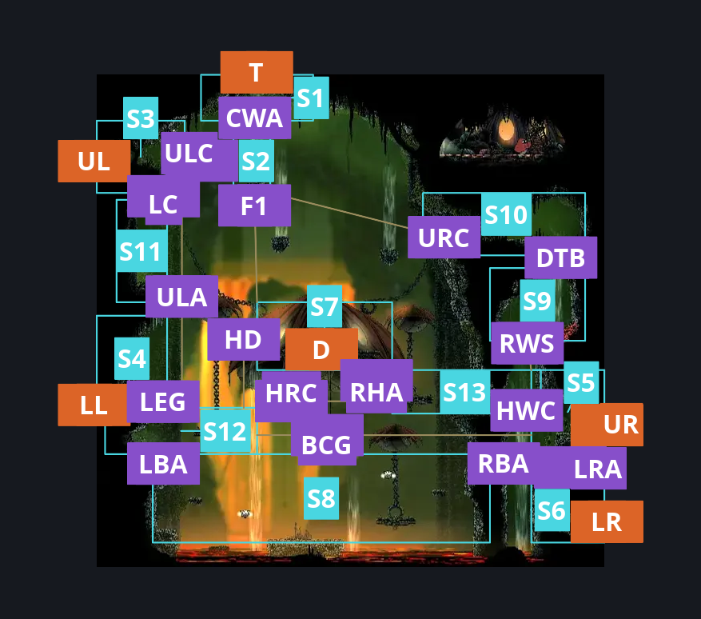
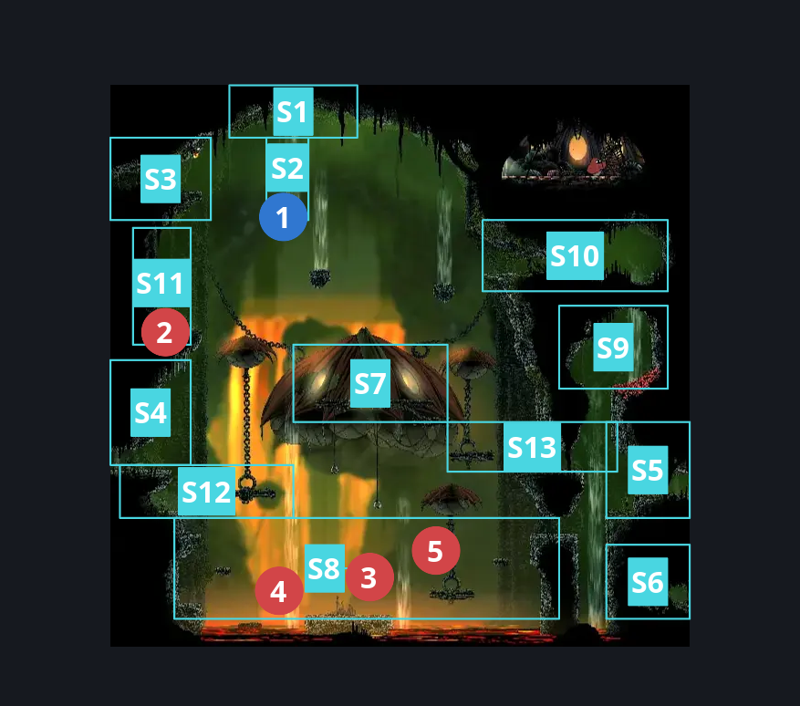
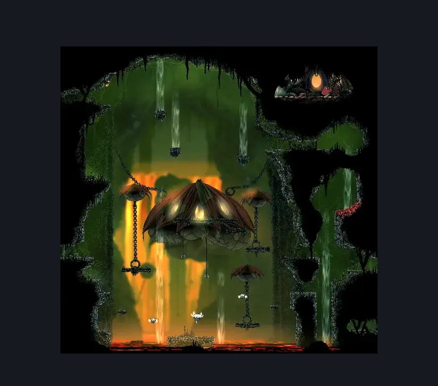

# Far Fields Pinstress Room (Bone_East_09)

**Game ID:** Bone_East_09

**Contributors:** herounit

## Subrooms

| No. | Subroom | Annotated |
| --- | --- | --- |
| S1 | ceiling exit area | ✓ |
| S2 | ceiling wind tunnel | ✓ |
| S3 | upper left exit area | ✓ |
| S4 | lower left exit area | ✓ |
| S5 | upper right exit area | ✓ |
| S6 | lower right exit area | ✓ |
| S7 | pinstress hut platform | ✓ |
| S8 | lava basin | ✓ |
| S9 | right rise silo | ✓ |
| S10 | pinstress's secret | ✓ |
| S11 | lonely fertid hangoff | ✓ |
| S12 | lower hangoff platform | ✓ |
| S13 | pinstress lower walkway | ✓ |

## Room Transitions

| Alias | Name | From subroom | Destination | Destination alias | Requirements | TODO | Verification | Annotated | Notes |
| --- | --- | --- | --- | --- | --- | --- | --- | --- | --- |
| T | top1 | ceiling exit area | [Far Fields Pinstress Attic (Bone_East_09b)](far-fields-pinstress-attic.md) | F | clear blast rock pinstress attic IN far fields pinstress attic |  | Verified | ✓ |  |
| UL | left3 | upper left exit area | [Far Fields Pinstress Mask Shard (Bone_East_20)](far-fields-pinstress-mask-shard.md) | R | none |  | Verified | ✓ |  |
| LR | right2 | lower right exit area | [Far Fields Skull Room West (Bone_East_14)](far-fields-skull-room-west.md) | LL | none |  | Verified | ✓ |  |
| LL | left2 | lower left exit area | [Far Fields Chorus (Bone_East_08)](far-fields-chorus.md) | R | none |  | Verified | ✓ |  |
| UR | right1 | upper right exit area | [Far Fields Skull Room West (Bone_East_14)](far-fields-skull-room-west.md) | UL | none |  | Verified | ✓ |  |
| D | door1 | pinstress hut platform | [Far Fields Pinstress Hut Interior (Bone_East_Umbrella)](far-fields-pinstress-hut-interior.md) | L | none |  | Verified | ✓ |  |

## Subroom Connections

| Alias | Name | Source | Destination | Requirements | TODO | Verification | Annotated | Notes |
| --- | --- | --- | --- | --- | --- | --- | --- | --- |
| LBA | left basin access | lower hangoff platform | lava basin | none (falling) |  | Verified | ✓ |  |
| LBA | left basin access | lava basin | lower hangoff platform | ledge grab both  OR drifter's cloak  OR faydown cloak  OR silk soar  OR scuttlebrace  OR easy shaman pogo  OR (easy beast pogo AND easy flea brew stall)  OR easy beast needle strike  OR cling grip left  OR easy pogo off [Caranid, Vicious Caranid] OR (ledge grab right AND (easy beast pogo OR medium [voltvessels, plasmium] stall OR clawline left OR sharp dart)) |  | Verified | ✓ |  |
| RBA | right basin access | upper right exit area | lava basin | none |  | Verified | ✓ | actually none both ways - not even ledge grab |
| RBA | right basin access | lava basin | upper right exit area | none |  | Verified | ✓ | actually none both ways - not even ledge grab |
| LRA | lower right access | upper right exit area | lower right exit area | none (falling) |  | Verified | ✓ |  |
| LRA | lower right access | lower right exit area | upper right exit area | cling grip either  OR easy scuttlebrace  OR drifter's cloak  OR (faydown cloak AND ledge grab left AND medium [flea brew, rune rage, thread storm] stall) |  | Verified | ✓ |  |
| RHA | right hut access | pinstress lower walkway | pinstress hut platform | ledge grab left  OR faydown cloak  OR cling grip left  OR scuttlebrace  OR clawline  OR easy beast pogo  OR flea brew  OR easy shaman pogo  OR easy pogo off Caranid OR medium pogo off Vicious Caranid OR (cling grip right AND (run OR dash right OR clawline right OR sharpdart OR architect slash right) AND (dash left  OR clawline left  OR sharpdart OR (architect slash left AND easy architect pogo))) OR (cling grip right AND (drifter's cloak OR easy architect needle strike)) OR (ponder the orb AND dash either) |  | Verified | ✓ |  |
| RHA | right hut access | pinstress hut platform | pinstress lower walkway | none (falling) |  | Verified | ✓ |  |
| HA | hut ascend | lava basin | pinstress hut platform | drifter's cloak OR silk soar |  | Verified |  |  |
| HA | hut ascend | pinstress hut platform | lava basin | none (falling) |  | Verified |  |  |
| ULA | upper left ascend | lower hangoff platform | upper left exit area | silk soar |  | Verified | ✓ |  |
| ULA | upper left ascend | upper left exit area | lower hangoff platform | none (falling) |  | Verified | ✓ |  |
| URC | upper right crossing | pinstress's secret | ceiling wind tunnel | ( drifter's cloak AND break blast rock down ) OR ((faydown cloak AND (cling grip left OR ledge grab left) AND (clawline left OR (run AND dash left) OR sharpdart OR easy beast pogo OR easy architect needle strike OR easy architect pogo))) OR (silk soar AND (scuttlebrace OR faydown cloak)) |  | Verified | ✓ | maybe someone else try to find other options? |
| URC | upper right crossing | ceiling wind tunnel | pinstress's secret | ( drifter's cloak AND break blast rock down ) OR (faydown cloak AND clawline right ) OR (silk soar AND (scuttlebrace OR faydown cloak)) |  | Verified | ✓ |  |
| CWA | ceiling wind ascend | ceiling wind tunnel | ceiling exit area | silk soar OR (clear Far Fields - Pinstress Attic Wind Tunnel Boulder AND drifter's cloak) |  | Verified | ✓ |  |
| CWA | ceiling wind ascend | ceiling exit area | ceiling wind tunnel | none (falling) |  | Verified | ✓ |  |
| F1 | fall 1 | ceiling wind tunnel | pinstress hut platform | none (falling) |  | Verified | ✓ |  |
| ULC | upper left crossing | upper left exit area | ceiling wind tunnel | run OR dash right OR easy beast pogo OR drifter's cloak OR faydown cloak OR silk soar OR sharpdart OR scuttlebrace OR clawline left |  | Verified | ✓ |  |
| ULC | upper left crossing | ceiling wind tunnel | upper left exit area | run OR (easy beast pogo AND ledge grab right) OR drifter's cloak OR faydown cloak OR silk soar OR sharpdart |  | Verified | ✓ | left ledge is slightly higher, so fewer options this way |
| RWS | right wall scale | upper right exit area | right rise silo | cling grip either  OR (faydown cloak AND (medium pogo off Vicious Caranid OR easy pogo off Caranid OR easy scuttlebrace)) OR silk soar OR drifter's cloak |  | Verified | ✓ |  |
| RWS | right wall scale | right rise silo | upper right exit area | none (falling) |  | Verified | ✓ |  |
| DTB | drift to blastrocks | right rise silo | pinstress's secret | drifter's cloak OR (cling grip right AND (clawline right OR dash right OR easy [architect, beast] needle strike OR sharp dart OR faydown cloak)) OR (faydown cloak AND (easy pogo off Caranid OR medium pogo off Vicious Caranid)) |  | Verified | ✓ |  |
| DTB | drift to blastrocks | pinstress's secret | right rise silo | none (falling) |  | Verified | ✓ |  |
| LEG | left exit gap | lower hangoff platform | lower left exit area | run OR faydown cloak OR drifter's cloak OR ledge grab left OR silk soar OR cling grip left OR dash left OR clawline left OR sharpdart OR easy beast pogo OR architect slash left OR easy [beast, architect, wanderer] needle strike OR hard witch needle strike OR flea brew OR easy voltvessels stall OR (cling grip right AND (proficient movement OR easy [hunter, reaper, architect, shaman] pogo OR easy naked pogo OR easy witch needle strike)) OR medium shaman pogo OR easy pogo off Caranid OR medium pogo off Vicious Caranid |  | Verified | ✓ |  |
| LEG | left exit gap | lower left exit area | lower hangoff platform | none (falling) |  | Verified | ✓ |  |
| HD | hut drop | pinstress hut platform | lower hangoff platform | none (falling) |  | Verified | ✓ |  |
| HD | hut drop | lower hangoff platform | pinstress hut platform | drifter's cloak |  | Verified | ✓ |  |
| HWC | hut walkway cross | upper right exit area | pinstress lower walkway | ledge grab left OR cling grip left OR (cling grip right AND (architect slash left OR easy [shaman, reaper] pogo OR easy wanderer needle strike OR easy voltvessels stall)) OR drifter's cloak OR clawline left OR run OR dash left OR easy beast pogo OR easy [beast, architect] needle strike OR flea brew OR easy pogo off Caranid OR medium pogo off Vicious Caranid |  | Verified | ✓ |  |
| HWC | hut walkway cross | pinstress lower walkway | upper right exit area | none (falling) |  | Verified | ✓ |  |
| LC | lonesome climb | lonely fertid hangoff | upper left exit area | (cling grip left AND (faydown cloak OR (clawline right AND cling grip right AND (sharpdart OR easy shaman pogo)))) OR silk soar |  | Verified | ✓ |  |
| LC | lonesome climb | upper left exit area | lonely fertid hangoff | none (falling) |  | Verified | ✓ |  |
| BCG | basin clawline glide | upper right exit area | lower hangoff platform | clawline left x 4 OR (clawline left AND silkhearts x 2) |  | Verified | ✓ | redundant inverse connection, can be navigated without additional abilities |
| HRC | hut ring clawline | pinstress lower walkway | lower hangoff platform | clawline left x 3 OR (clawline left AND silkhearts x 2) |  | Verified | ✓ |  |
| HRC | hut ring clawline | lower hangoff platform | pinstress lower walkway | (easy shaman pogo OR ledge grab right OR cling grip right) AND (clawline right x 3 OR (clawline right AND silkhearts x 2)) |  | Verified | ✓ |  |

## Check Locations

| No. | Check | Subroom | Requirements | TODO | Verification | Location Type | Annotated | Notes |
| --- | --- | --- | --- | --- | --- | --- | --- | --- |
| 1 | Far Fields - Pinstress Attic Wind Tunnel Boulder | ceiling wind tunnel | none (attack) |  | Verified | blockade | ✓ | Required to cross first gap with Drifter's in Pinstress Attic - ER relevant |
| 2 | Fertid 1 | lonely fertid hangoff | none |  | Verified | enemy | ✓ | shell shards |
| 3 | Vicious Caranid 1 | lava basin | none |  | Verified | enemy | ✓ | shell shards |
| 4 | Caranid 1 | lava basin | none |  | Verified | enemy | ✓ | shell shards |
| 5 | Caranid 2 | lava basin | none |  | Verified | enemy | ✓ | shell shards |

## Room Images

### Connections

### Checks

### Scene

