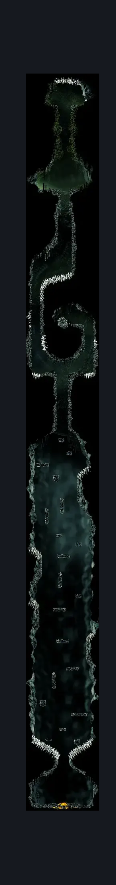

# Far Fields Skull Arena (Bone_East_LavaChallenge)

**Game ID:** Bone_East_LavaChallenge

**Contributors:** herounit

## Subrooms

| No. | Subroom | Annotated |
| --- | --- | --- |
| S1 | entrance |  |
| S2 | arena |  |
| S3 | crossing |  |
| S4 | check alcove |  |
| S5 | mask alcove |  |

## Room Transitions

| Alias | Name | From subroom | Destination | Destination alias | Requirements | TODO | Verification | Annotated | Notes |
| --- | --- | --- | --- | --- | --- | --- | --- | --- | --- |
| L | left1 | entrance | [Far Fields Skull Room East (Bone_East_14b)](far-fields-skull-room-east.md) | D | none |  | Verified | ✓ |  |

## Subroom Connections

| Alias | Name | Source | Destination | Requirements | TODO | Verification | Annotated | Notes |
| --- | --- | --- | --- | --- | --- | --- | --- | --- |
| ET | entrance tunnel | entrance | crossing | break blast rock down AND ( spike pogo OR drifter's cloak OR faydown cloak OR clawline OR dash OR scuttlebrace ) |  | Verified |  |  |
| ET | entrance tunnel | crossing | entrance | ( cling grip OR scuttlebrace ) AND ( spike pogo OR dash OR clawline OR drifter's cloak OR faydown cloak  ) |  | Verified |  |  |
| CT | check tunnel | crossing | check alcove | break blast rock up AND ( scuttlebrace OR cling grip ) |  | Verified |  |  |
| CT | check tunnel | check alcove | crossing | none (falling) |  | Verified |  |  |
| AT | arena tunnel | crossing | arena | break blast rock down |  | Verified |  |  |
| LA | lava ascend | arena | mask alcove | cling grip AND drifter's cloak AND faydown cloak AND dash |  | Verified |  |  |
| MD | mask descend | mask alcove | entrance | none (falling) |  | Verified |  |  |

## Check Locations

| No. | Check | Subroom | Requirements | TODO | Verification | Location Type | Annotated | Notes |
| --- | --- | --- | --- | --- | --- | --- | --- | --- |
| 1 | shell shard cache far fields 8 | check alcove | none |  | Verified | collectible |  | this becomes inaccessible after defeating the gauntlet - perhaps auto collect? |
| 2 | mask shard far fields skull cave | mask alcove | none |  | Verified | collectible |  |  |
| 3 | Gauntlet | arena | Combat Requirements |  | Verified | gauntlet |  |  |
| 4 | Beastfly 1 |  |  |  |  | enemy | ✓ |  |
| 5 | Beastfly 2 |  |  |  |  | enemy | ✓ |  |
| 6 | Tarmite 1 |  |  |  |  | enemy | ✓ |  |
| 7 | Vicious Caranid 1 |  |  |  |  | enemy | ✓ |  |
| 8 | Vicious Caranid 2 |  |  |  |  | enemy | ✓ |  |
| 9 | Tarmite 2 |  |  |  |  | enemy | ✓ |  |
| 10 | Tarmite 3 |  |  |  |  | enemy | ✓ |  |
| 11 | Tarmite 4 |  |  |  |  | enemy | ✓ |  |
| 12 | Tarmite 5 |  |  |  |  | enemy | ✓ |  |
| 13 | Tarmite 6 |  |  |  |  | enemy | ✓ |  |
| 14 | Tarmite 7 |  |  |  |  | enemy | ✓ |  |
| 15 | Tarmite 8 |  |  |  |  | enemy | ✓ |  |
| 16 | Tarmite 9 |  |  |  |  | enemy | ✓ |  |

## Notes

modeled this area as:
entrance <-> crossing <-> check alcove <-> crossing -> arena -> mask alcove -> entrance 
the arena to mask shard connections are one-way so the full requirement chain is enforced

## Room Images

### Connections

### Checks

### Scene

