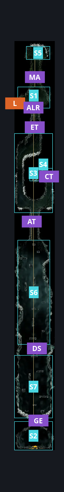
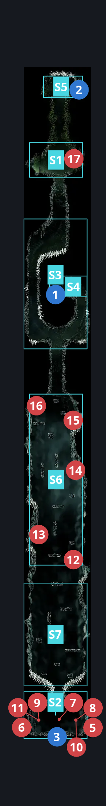

# Far Fields Skull Arena (Bone_East_LavaChallenge)

**Game ID:** Bone_East_LavaChallenge

**Contributors:** herounit

## Subrooms

| No. | Subroom | Annotated |
| --- | --- | --- |
| S1 | entrance | ✓ |
| S2 | arena | ✓ |
| S3 | crossing | ✓ |
| S4 | check alcove | ✓ |
| S5 | mask alcove | ✓ |
| S6 | dungeon descent | ✓ |
| S7 | dungeon spike pit | ✓ |

## Room Transitions

| Alias | Name | From subroom | Destination | Destination alias | Requirements | TODO | Verification | Annotated | Notes |
| --- | --- | --- | --- | --- | --- | --- | --- | --- | --- |
| L | left1 | entrance | [Far Fields Skull Room East (Bone_East_14b)](far-fields-skull-room-east.md) | D | none |  | Verified | ✓ | soft Gauntlet req? Once you enter the room fully, the entrance is ceiled w/ rubble until you clear it. |

## Subroom Connections

| Alias | Name | Source | Destination | Requirements | TODO | Verification | Annotated | Notes |
| --- | --- | --- | --- | --- | --- | --- | --- | --- |
| ET | entrance tunnel | entrance | crossing | break blast rock down AND ( spike pogo OR drifter's cloak OR faydown cloak OR  dash left OR scuttlebrace ) |  | Verified | ✓ |  |
| ET | entrance tunnel | crossing | entrance | cling grip both OR (faydown cloak AND (cling grip right OR easy scuttlebrace)) OR (faydown cloak AND cling grip left AND (medium shaman pogo OR (medium flea brew stall AND medium reaper pogo))) |  | Verified | ✓ |  |
| CT | check tunnel | crossing | check alcove | break blast rock up AND (medium scuttlebrace OR cling grip right OR (faydown cloak AND (cling grip left OR easy scuttlebrace OR spike pogo))) |  | Verified | ✓ |  |
| CT | check tunnel | check alcove | crossing | none (falling) |  | Verified | ✓ |  |
| AT | arena tunnel | crossing | dungeon descent | break blast rock down |  | Verified | ✓ |  |
| AT | arena tunnel | dungeon descent | crossing | cling grip both AND (dash both OR clawline both OR faydown cloak OR drifter's) |  | Verified | ✓ |  |
| MA | mask ascent | mask alcove | entrance | none (falling) |  | Verified | ✓ |  |
| MA | mask ascent | entrance | mask alcove | clear Gauntlet AND (drifter's cloak OR (faydown cloak AND dash either AND Hard pogo off Tarmite AND (cling grip either OR easy scuttlebrace))) |  | Verified | ✓ |  |
| DS | dungeon scaffold | dungeon descent | dungeon spike pit | none (falling) |  | Verified | ✓ |  |
| DS | dungeon scaffold | dungeon spike pit | dungeon descent | cling grip both AND (dash both OR clawline both OR faydown cloak OR drifter's) |  | Verified | ✓ |  |
| ALR | arena lava rise | arena | entrance | clear gauntlet AND cling grip both AND (dash both OR clawline both OR faydown cloak OR drifter's) |  | Verified | ✓ | One-way post arena gauntlet climb with the lava; an invisible ceiling prevents silk soaring out of the arena before finishing the gauntlet, and the walls are too short to scaffold out of, even with full mobility options. |
| GE | gauntlet entrance | dungeon spike pit | arena | none (falling) |  | Verified | ✓ | One-way drop; an invisible ceiling prevents silk soaring out of the arena before finishing the gauntlet, and the walls are too short to scaffold out of, even with full mobility options. |

## Check Locations

| No. | Check | Subroom | Requirements | TODO | Verification | Location Type | Annotated | Notes |
| --- | --- | --- | --- | --- | --- | --- | --- | --- |
| 1 | Far Fields - Skull Arena - Shell Shard Cache | check alcove | none |  | Verified | collectible | ✓ | this becomes inaccessible after defeating the gauntlet - perhaps auto collect? formerly shell shard cache far fields 8 |
| 2 | Far Fields - Skull Arena - Mask Shard | mask alcove | none |  | Verified | collectible | ✓ | mask shard far fields skull cave |
| 3 | gauntlet blast rock | arena | none (attack) |  | Verified | logic-point | ✓ | cry - breaking this blast rock initiates the gauntlet |
| 4 | Gauntlet | arena | Combat Requirements |  | Verified | gauntlet |  |  |
| 5 | Beastfly 1 | arena | none |  | Verified | enemy | ✓ |  |
| 6 | Beastfly 2 | arena | none |  | Verified | enemy | ✓ |  |
| 7 | Tarmite 1 | arena | none |  | Verified | enemy | ✓ |  |
| 8 | Vicious Caranid 1 | arena | none |  | Verified | enemy | ✓ |  |
| 9 | Vicious Caranid 2 | arena | none |  | Verified | enemy | ✓ |  |
| 10 | Tarmite 2 | arena | none |  | Verified | enemy | ✓ |  |
| 11 | Tarmite 3 | arena | none |  | Verified | enemy | ✓ |  |
| 12 | Tarmite 4 | dungeon descent | none |  | Verified | enemy | ✓ |  |
| 13 | Tarmite 5 | dungeon descent | none |  | Verified | enemy | ✓ |  |
| 14 | Tarmite 6 | dungeon descent | none |  | Verified | enemy | ✓ |  |
| 15 | Tarmite 7 | dungeon descent | none |  | Verified | enemy | ✓ |  |
| 16 | Tarmite 8 | dungeon descent | none |  | Verified | enemy | ✓ |  |
| 17 | Tarmite 9 | entrance | complete Gauntlet |  | Verified | enemy | ✓ |  |

## Notes

modeled this area as:
entrance <-> crossing <-> check alcove <-> crossing -> arena -> mask alcove -> entrance 
the arena to mask shard connections are one-way so the full requirement chain is enforced

## Room Images

### Connections

### Checks

### Scene

