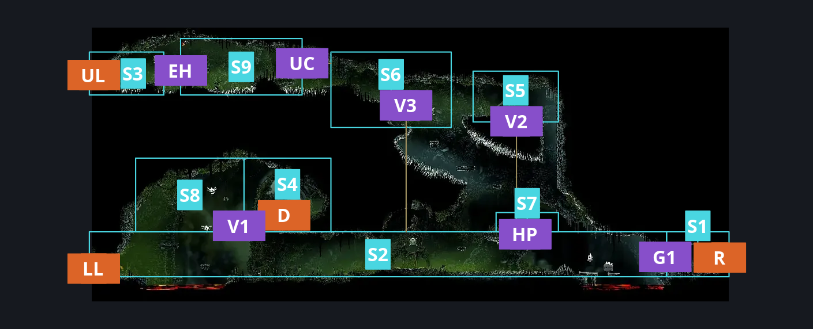
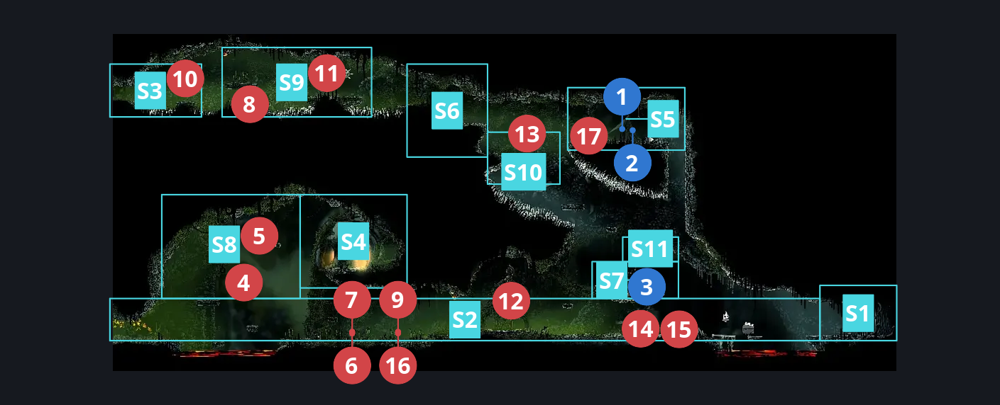
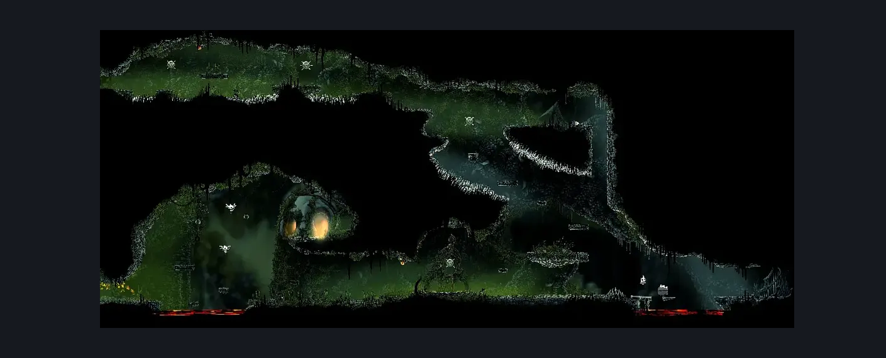

# Far Fields Skull Room East (Bone_East_14b)

**Game ID:** Bone_East_14b

**Contributors:** herounit, Cry

## Subrooms

| No. | Subroom | Annotated |
| --- | --- | --- |
| S1 | weavenest platform | ✓ |
| S2 | main floor | ✓ |
| S3 | upper left exit area | ✓ |
| S4 | skull platform | ✓ |
| S5 | rosary platform | ✓ |
| S6 | upper passage | ✓ |
| S7 | herald platform | ✓ |
| S8 | clawline acrobatics | ✓ |
| S9 | upper exit channel | ✓ |
| S10 | upper passage spike exit | ✓ |
| S11 | herald lifted platform | ✓ |

## Room Transitions

| Alias | Name | From subroom | Destination | Destination alias | Requirements | TODO | Verification | Annotated | Notes |
| --- | --- | --- | --- | --- | --- | --- | --- | --- | --- |
| UL | left1 | upper left exit area | [Far Fields Skull Room West (Bone_East_14)](far-fields-skull-room-west.md) | UR | none |  | Verified | ✓ |  |
| LL | left2 | main floor | [Far Fields Skull Room West (Bone_East_14)](far-fields-skull-room-west.md) | LR | none |  | Verified | ✓ |  |
| D | door1 | skull platform | [Far Fields Skull Arena (Bone_East_LavaChallenge)](far-fields-skull-arena.md) | L | none |  | Verified | ✓ |  |
| R | right1 | weavenest platform | [Weavenest Cindril (Bone_East_Weavehome)](weavenest-cindril.md) | L | needolin |  | Verified | ✓ |  |

## Subroom Connections

| Alias | Name | Source | Destination | Requirements | TODO | Verification | Annotated | Notes |
| --- | --- | --- | --- | --- | --- | --- | --- | --- |
| G1 | gap 1 | main floor | weavenest platform | run  OR flea brew OR dash right  OR easy [hunter, architect, beast, shaman] pogo  OR easy naked pogo OR easy [beast, architect, wanderer, witch] needle strike OR drifters cloak  OR faydown cloak  OR clawline right  OR sharpdart  OR easy scuttlebrace OR easy [thread storm, rune rage, voltvessels, plasmium] stall OR medium [air bind, cross stitch] stall OR (ledge grab right AND medium [flintslate, pale nails] stall) |  | Verified | ✓ |  |
| G1 | gap 1 | weavenest platform | main floor | run  OR flea brew OR dash left  OR easy [beast, architect, wanderer] needle strike OR easy [hunter, architect, beast, shaman] pogo  OR easy naked pogo OR drifters cloak  OR faydown cloak  OR clawline left  OR sharpdart  OR easy scuttlebrace OR (cling grip right AND (proficient movement OR ledge grab left)) OR (ledge grab left AND medium [flintslate, pale nails] stall) |  | Verified | ✓ |  |
| V1 | vertical 1 | main floor | skull platform | silk soar  OR (faydown cloak AND  (cling grip right OR ledge grab right OR (medium flea brew stall x 2 AND scuttlebrace))) |  | Verified | ✓ |  |
| V1 | vertical 1 | skull platform | main floor | none (falling) |  | Verified | ✓ |  |
| V2 | vertical 2 | herald lifted platform | rosary platform | faydown cloak OR ( (ledge grab left OR cling grip left) AND ( run OR dash right OR drifter's cloak OR clawline right OR sharpdart OR easy [shaman, reaper, architect] pogo OR easy pogo off Hoker ) ) OR cling grip right |  | Verified | ✓ |  |
| V2 | vertical 2 | rosary platform | herald lifted platform | none (falling) |  | Verified | ✓ |  |
| V3 | vertical 3 | herald lifted platform | upper passage spike exit | ledge grab left  OR faydown cloak  OR cling grip left OR easy shaman pogo OR (elite ball knowledge AND ((dash either AND (clawline left OR sharpdart) AND (medium [hunter, shaman, architect, witch, reaper, witch] pogo OR clawline right)) OR (dash left AND flea brew AND medium flea brew stall AND spike pogo))) |  | Verified | ✓ | might be missing options here |
| V3 | vertical 3 | upper passage spike exit | herald lifted platform | none (falling) |  | Verified | ✓ |  |
| UC | upper crossing | upper passage | upper exit channel | ledge grab either OR spike pogo OR easy naked pogo OR run OR dash left OR drifter's cloak OR faydown cloak OR clawline left OR sharpdart OR scuttlebrace |  | Verified | ✓ |  |
| UC | upper crossing | upper exit channel | upper passage | ledge grab left OR spike pogo OR easy naked pogo OR run OR dash left OR drifter's cloak OR faydown cloak OR clawline left OR sharpdart OR scuttlebrace |  | Verified | ✓ |  |
| HP | herald platform access | main floor | herald platform | ledge grab right OR cling grip right OR silk soar OR faydown OR easy pogo off [Pilgrim Hulk, Pilgrim Hornfly] |  | Verified | ✓ |  |
| HP | herald platform access | herald platform | main floor | none (falling) |  | Verified | ✓ |  |
| EH | exit hop | upper left exit area | upper exit channel | none |  | Verified | ✓ |  |
| EH | exit hop | upper exit channel | upper left exit area | none |  | Verified | ✓ |  |
| RS | rosary silk soar | main floor | rosary platform | silk soar |  | Verified | ✓ |  |
| RS | rosary silk soar | rosary platform | main floor | none (falling) |  | Verified | ✓ |  |
| V4 | vertical 4 | upper passage spike exit | upper passage | cling grip left OR ledge grab left OR silk soar OR faydown cloak |  | Verified | ✓ |  |
| V4 | vertical 4 | upper passage | upper passage spike exit | none (falling) |  | Verified | ✓ |  |
| RPG | rosary passage gap | rosary platform | upper passage | (cling grip right AND (clawline left OR sharpdart)) OR (run AND (easy beast needle strike OR clawline left OR sharp dart OR (dash left AND (easy [architect, wanderer] needle strike OR easy shaman pogo OR drifter's cloak)))) |  | Verified | ✓ | redundant inverse, shared reqs with RSG connection |
| RSG | rosary spike gap | upper passage spike exit | rosary platform | run  OR drifter's cloak OR clawline right  OR sharpdart  OR faydown cloak OR cling grip right OR (ledge grab right  AND (flea brew OR architect slash right OR easy plasmium stall OR easy shaman pogo OR easy architect needle strike)) OR (elite ball knowledge AND easy [shaman, reaper, architect] pogo) |  | Verified | ✓ |  |
| RSG | rosary spike gap | rosary platform | upper passage spike exit | none (falling) |  | Verified | ✓ |  |
| HP2 | herald platform link | herald platform | herald lifted platform | silk soar OR ledge grab either OR cling grip either OR faydown cloak |  | Verified | ✓ |  |
| HP2 | herald platform link | herald lifted platform | herald platform | none (falling) |  | Verified | ✓ |  |
| MTA | main to acrobatics | main floor | clawline acrobatics | ledge grab left  OR cling grip left OR medium scuttlebrace OR faydown cloak OR silk soar OR ((clawline left OR sharpdart) AND (medium [flea brew] stall OR ledge grab right)) OR (proficient movement AND architect slash left AND (medium [plasmium, flea brew] stall)) |  | Verified | ✓ |  |
| MTA | main to acrobatics | clawline acrobatics | main floor | none (falling) |  | Verified | ✓ |  |
| ATS | acrobatics to skull platform | clawline acrobatics | skull platform | (faydown cloak AND (clawline right OR sharpdart x 2 OR (dash right AND easy beast needle strike AND easy beast pogo)))  OR (run AND proficient movement AND (faydown cloak AND (drifter's cloak OR sharpdart OR (flea brew AND (easy beast pogo OR (easy architect needle strike AND architect slash right))))))  OR (run AND clawline right AND (ledge grab right OR cling grip right)) OR (cling grip left AND clawline right x 2) |  | Verified | ✓ |  |
| ATS | acrobatics to skull platform | skull platform | clawline acrobatics | none (falling) |  | Verified | ✓ |  |

## Check Locations

| No. | Check | Subroom | Requirements | TODO | Verification | Location Type | Annotated | Notes |
| --- | --- | --- | --- | --- | --- | --- | --- | --- |
| 1 | Far Fields - Skull Room East - Hoker Grave Beads | rosary platform | none |  | Verified | collectible | ✓ | formerly rosary cache far fields 7 |
| 2 | Far Fields - Skull Room East - Hoker Grave Beads 2 | rosary platform | none |  | Verified | collectible | ✓ | formerly rosary cache far fields 8 |
| 3 | Mister Mushroom Meeting Far Fields | herald platform | after THE Mister Mushroom Meeting Bone Bottom AND Needolin |  | Verified | event | ✓ |  |
| 4 | Tarmite 1 | clawline acrobatics | complete Gauntlet IN Far Fields Skull Arena |  | Verified | enemy | ✓ | shell shards |
| 5 | Tarmite 2 | clawline acrobatics | complete Gauntlet IN Far Fields Skull Arena |  | Verified | enemy | ✓ | shell shards |
| 6 | Fertid 1 | main floor | none |  | Verified | enemy | ✓ |  |
| 7 | Fertid 2 | main floor | none |  | Verified | enemy | ✓ |  |
| 8 | Fertid 3 | upper exit channel | none |  | Verified | enemy | ✓ |  |
| 9 | Fertid 4 | main floor | none |  | Verified | enemy | ✓ |  |
| 10 | Hoker 1 | upper left exit area | none |  | Verified | enemy | ✓ | shell shards, used to farm flexible spines |
| 11 | Hoker 2 | upper exit channel | none |  | Verified | enemy | ✓ | shell shards, used to farm flexible spines |
| 12 | Hoker 3 | main floor | none |  | Verified | enemy | ✓ | shell shards, used to farm flexible spines |
| 13 | Hoker 4 | upper passage spike exit | none |  | Verified | enemy | ✓ | shell shards, used to farm flexible spines |
| 14 | Pilgrim Hulk 1 | main floor | none |  | Verified | enemy | ✓ |  |
| 15 | Pilgrim Hornfly 1 | main floor | none |  | Verified | enemy | ✓ |  |
| 16 | Fertid 5 | main floor | Normal World Spawn |  | Verified | enemy | ✓ |  |
| 17 | Pilgrim Hulk 2 | rosary platform | Normal World Spawn |  | Verified | enemy | ✓ |  |

## Room Images

### Connections

### Checks

### Scene

