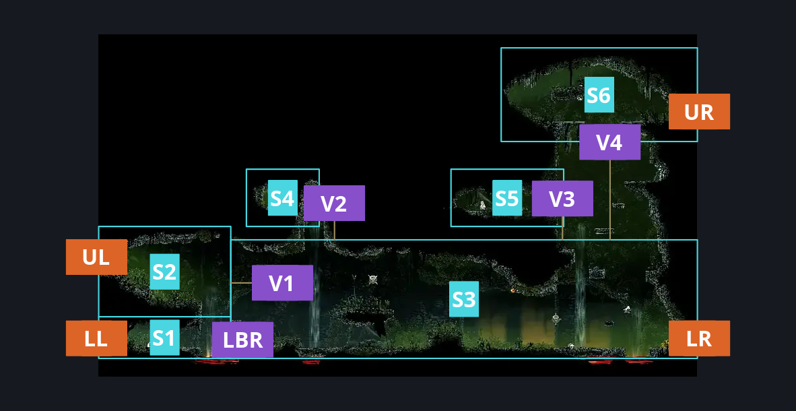
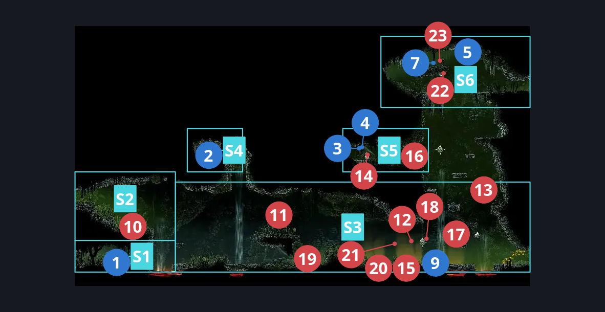

# Far Fields Skull Room West (Bone_East_14)

**Game ID:** Bone_East_14

**Contributors:** herounit, Cry

## Subrooms

| No. | Subroom | Annotated |
| --- | --- | --- |
| S1 | lower left exit area | ✓ |
| S2 | upper left exit area | ✓ |
| S3 | main floor | ✓ |
| S4 | relic alcove | ✓ |
| S5 | rosary alcove | ✓ |
| S6 | bone bridge | ✓ |
| S7 | main floor platform | ✓ |
| S8 | bone bridge silo | ✓ |
| S9 | rosary store | ✓ |

## Room Transitions

| Alias | Name | From subroom | Destination | Destination alias | Requirements | TODO | Verification | Annotated | Notes |
| --- | --- | --- | --- | --- | --- | --- | --- | --- | --- |
| UL | left1 | upper left exit area | [Far Fields Pinstress Room (Bone_East_09)](far-fields-pinstress-room.md) | UR | none |  | Verified | ✓ |  |
| LL | left2 | lower left exit area | [Far Fields Pinstress Room (Bone_East_09)](far-fields-pinstress-room.md) | LR | none |  | Verified | ✓ |  |
| UR | right1 | bone bridge | [Far Fields Skull Room East (Bone_East_14b)](far-fields-skull-room-east.md) | UL | none |  | Verified | ✓ |  |
| LR | right2 | main floor | [Far Fields Skull Room East (Bone_East_14b)](far-fields-skull-room-east.md) | LL | break blast rock right |  | Verified | ✓ | Rock cannot be broken from inside the wall if you enter here (ER relevant) |

## Subroom Connections

| Alias | Name | Source | Destination | Requirements | TODO | Verification | Annotated | Notes |
| --- | --- | --- | --- | --- | --- | --- | --- | --- |
| LBR | left blast rock | lower left exit area | main floor | clear lower left blast rock blockade |  | Verified | ✓ |  |
| LBR | left blast rock | main floor | lower left exit area | clear lower left blast rock blockade |  | Verified | ✓ |  |
| V1 | vertical 1 | main floor | upper left exit area | ledge grab left OR silk soar  OR easy [beast, shaman] pogo OR (easy enemy pogo off [Pilgrim Pouncer, Winged Pilgrim] AND  (architect slash left OR easy architect needle strike OR easy wanderer needle strike OR easy beast needle strike)) OR drifter's cloak OR faydown cloak  OR cling grip left  OR clawline left  OR easy scuttlebrace  OR run  OR dash left |  | Verified | ✓ |  |
| V1 | vertical 1 | upper left exit area | main floor | clear upper left blast rock blockade |  | Verified | ✓ |  |
| V2 | vertical 2 | main floor | relic alcove | clear upper left blast rock blockade AND ( drifter's cloak OR silk soar OR (faydown AND medium damage boost off hoker AND easy pogo off hoker AND (cling grip either OR (easy drill crystal pogo AND ledge grab left))) OR (easy shaman pogo AND easy pogo off hoker AND faydown AND (cling grip either OR easy scuttlebrace))) |  | Verified | ✓ |  |
| V2 | vertical 2 | relic alcove | main floor | none (falling) |  | Verified | ✓ |  |
| V3 | vertical 3 | bone bridge silo | rosary alcove | drifter's cloak  OR faydown cloak  OR silk soar  OR ((medium shaman pogo OR ledge grab right) AND ( run OR dash left OR easy beast pogo OR cling grip left OR clawline left x 2 OR sharpdart x 2 OR easy scuttlebrace OR (sharpdart AND ledge grab left))) OR (easy pogo off winged pilgrim AND (dash left OR easy damage boost off winged pilgrim OR easy beast pogo OR easy architect charge OR ledge grab both)) |  | Verified | ✓ | Not sure if I should list this one; a hoker pogo/damage boost is possible in place of the winged pilgrim listed, but there are two spawns it can flip between on any given room reload, affecting which reqs it could substitute. - Cry 11/25 |
| V3 | vertical 3 | rosary alcove | bone bridge silo | none (falling) |  | Verified | ✓ |  |
| V4 | vertical 4 | bone bridge silo | bone bridge | clear spine break blast rock AND (faydown cloak OR silk soar OR ledge grab both OR cling grip right OR easy pogo off Winged Pilgrim) |  | Verified | ✓ |  |
| V4 | vertical 4 | bone bridge | bone bridge silo | clear spine break blast rock |  | Verified | ✓ |  |
| V5 | vertical 5 | main floor platform | relic alcove | ((faydown AND medium damage boost off hoker AND easy pogo off hoker AND (cling grip either OR (easy drill crystal pogo AND ledge grab left))) OR (easy shaman pogo AND easy pogo off hoker AND faydown AND (cling grip either OR easy scuttlebrace))) |  | Verified | ✓ |  |
| MG | main gap | main floor | main floor platform | run OR faydown cloak  OR easy beast pogo  OR easy [beast, architect] needle strike OR ((flea brew OR cling grip right OR easy [hunter, shaman, witch, reaper] pogo) AND (architect slash left OR easy wanderer needle strike OR cling grip left OR ledge grab left)) OR clawline left OR sharpdart |  | Verified | ✓ |  |
| MBS | main to bridge silo | main floor | bone bridge silo | ledge grab right OR faydown cloak OR cling grip right OR silk soar |  | Verified | ✓ |  |
| MBS | main to bridge silo | bone bridge silo | main floor | none (falling) |  | Verified | ✓ |  |
| AR | alcove rosaries | rosary alcove | rosary store | none |  | Verified | ✓ |  |
| AR | alcove rosaries | rosary store | rosary alcove | none |  | Verified | ✓ |  |
| SRS | Silo Rosary Snipe | bone bridge silo | rosary store | easy [curveclaw, conchcutter, straight pin, throwing ring, threefold pin, cogwork wheel, silkshot original, sting shard] use |  | Verified | ✓ |  |

## Check Locations

| No. | Check | Subroom | Requirements | TODO | Verification | Location Type | Annotated | Notes |
| --- | --- | --- | --- | --- | --- | --- | --- | --- |
| 1 | Far Fields - Skull Room - Fallen Rosary String | lower left exit area | none |  | Verified | collectible | ✓ | formerly rosary string far fields |
| 2 | Far Fields - Skull Room - Relic Bone Scroll | relic alcove | none |  | Verified | collectible | ✓ | relic bone scroll far fields |
| 3 | Far Fields - Skull Room - Pilgrim Alcove Rosary 1 | rosary alcove | none |  | Verified | collectible | ✓ | formerly rosary cache far fields 5 |
| 4 | Far Fields - Skull Room - Pilgrim Alcove Rosary 2 | rosary alcove | none |  | Verified | collectible | ✓ | formerly rosary cache far fields 6 |
| 5 | spine break blast rock | bone bridge | break blast rock up |  | Verified | blockade | ✓ |  |
| 6 | lower left blast rock blockade | lower left exit area | break blast rock right |  | Verified | blockade | ✓ |  |
| 7 | Resting Site Far Fields | bone bridge | complete THE a vassal lost wish promised |  | Verified | event | ✓ |  |
| 8 | upper left blast rock blockade | relic alcove | break blast rock left |  | Verified | blockade | ✓ |  |
| 9 | Garmond and Zaza Act 3 Meeting Far Fields East | main floor | Black Thread World Spawn |  | Verified | event | ✓ |  |
| 10 | Fertid 1 | upper left exit area | none |  | Verified | enemy | ✓ |  |
| 11 | Hoker 1 | main floor platform | none |  | Verified | enemy | ✓ |  |
| 12 | Hoker 2 | main floor | none |  | Verified | enemy | ✓ |  |
| 13 | Hoker 3 | bone bridge silo | none |  | Verified | enemy | ✓ |  |
| 14 | Pilgrim Pouncer 1 | rosary alcove | Normal World Spawn |  | Verified | enemy | ✓ |  |
| 15 | Pilgrim Groveller 1 | main floor | Normal World Spawn |  | Verified | enemy | ✓ |  |
| 16 | Pilgrim Groveller 3 | rosary alcove | Normal World Spawn |  | Verified | enemy | ✓ |  |
| 17 | Winged Pilgrim 1 | main floor | Normal World Spawn |  | Verified | enemy | ✓ |  |
| 18 | Hoker 4 | main floor | Normal World Spawn |  | Verified | enemy | ✓ |  |
| 19 | Pilgrim Pouncer 3 | main floor | Normal World Spawn |  | Verified | enemy | ✓ |  |
| 20 | Pilgrim Hulk 1 | main floor | Black Thread World Spawn |  | Verified | enemy | ✓ |  |
| 21 | Winged Pilgrim 2 | main floor | Black Thread World Spawn |  | Verified | enemy | ✓ |  |
| 22 | Shardillard 1 | bone bridge | none |  | Verified | enemy | ✓ |  |
| 23 | Fertid 3 | bone bridge | none |  | Verified | enemy | ✓ |  |

## Room Images

### Connections

### Checks

### Scene

