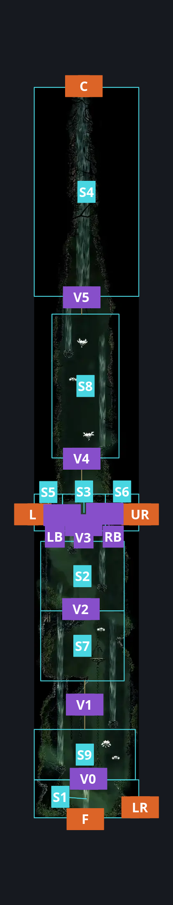
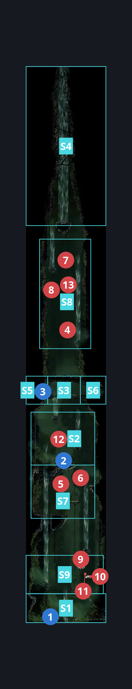
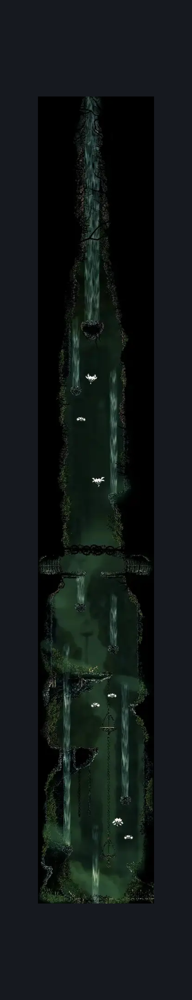

# Far Fields Upper Shaft (Bone_East_11)

**Game ID:** Bone_East_11

**Contributors:** herounit

## Subrooms

| No. | Subroom | Annotated |
| --- | --- | --- |
| S1 | the bottom | ✓ |
| S2 | above middle gate | ✓ |
| S3 | hunters march bridge | ✓ |
| S4 | top wind tunnel | ✓ |
| S5 | left march bridge room | ✓ |
| S6 | right march bridge room | ✓ |
| S7 | first shaft scaffold | ✓ |
| S8 | wind shaft ascent | ✓ |
| S9 | bottom platforms | ✓ |

## Room Transitions

| Alias | Name | From subroom | Destination | Destination alias | Requirements | TODO | Verification | Annotated | Notes |
| --- | --- | --- | --- | --- | --- | --- | --- | --- | --- |
| C | top1 | top wind tunnel | [Greymoor West Bellshrine Room (Greymoor_01)](../greymoor/greymoor-west-bellshrine-room.md) | D | drifter's cloak OR (silk soar AND (cling grip either OR easy scuttlebrace)) |  | Verified | ✓ | silk soar will not attach to the exit ceiling |
| UR | right1 | right march bridge room | [Far Fields Deep Entrance (Bone_East_24)](far-fields-deep-entrance.md) | L | none |  | Verified | ✓ |  |
| L | left1 | left march bridge room | [Hunter's March Deep Entrance (Ant_09)](../hunter-s-march/hunter-s-march-deep-entrance.md) | R | none |  | Verified | ✓ |  |
| LR | right2 | the bottom | [Far Fields Pilgrim's Rest (Bone_East_10)](far-fields-pilgrim-s-rest.md) | UL | none |  | Verified | ✓ |  |
| F | bot1 | the bottom | [Far Fields Wind Shaft (Bone_East_07)](far-fields-wind-shaft.md) | C | none (activate lower gate lever) |  | Verified | ✓ |  |

## Subroom Connections

| Alias | Name | Source | Destination | Requirements | TODO | Verification | Annotated | Notes |
| --- | --- | --- | --- | --- | --- | --- | --- | --- |
| V0 | vertical 0 | the bottom | bottom platforms | cling grip left OR  (drifter's cloak AND activate lower gate lever AND clear r4 blast rock IN far fields wind shaft) OR (faydown cloak AND (ledge grab left OR easy scuttlebrace OR (medium beast heal stall AND easy beast pogo))) |  | Verified | ✓ |  |
| V0 | vertical 0 | bottom platforms | the bottom | none (falling) |  | Verified | ✓ |  |
| V1 | vertical 1 | bottom platforms | first shaft scaffold | (drifter's cloak AND break blast rock down) OR silk soar  OR cling grip right  OR (easy scuttlebrace AND faydown cloak) |  | Verified | ✓ |  |
| V1 | vertical 1 | first shaft scaffold | bottom platforms | none (falling) |  | Verified | ✓ |  |
| V2 | vertical 2 | first shaft scaffold | above middle gate | drifter's cloak  OR silk soar OR (faydown cloak AND (easy scuttlebrace OR cling grip either OR ledge grab left OR easy pogo off Caranid)) OR (cling grip right AND proficient movement) OR (cling grip left AND activate middle gate lever) |  | Verified | ✓ |  |
| V2 | vertical 2 | above middle gate | first shaft scaffold | none (falling) |  | Verified | ✓ |  |
| V3 | vertical 3 | above middle gate | hunters march bridge | (drifter's cloak AND activate lower gate lever AND activate middle gate lever AND break blast rock down) OR silk soar OR (activate hunter's march bridge lever AND (faydown cloak  AND (cling grip left  OR (cling grip right  AND (dash left  OR clawline left  OR easy [beast, architect] pogo  OR easy [architect, beast, wanderer, witch] needle strike  OR architect slash left OR (easy reaper pogo AND easy reaper needle strike))) OR (proficient movement AND easy scuttlebrace AND easy flea brew stall )))) |  | Verified | ✓ |  |
| V3 | vertical 3 | hunters march bridge | above middle gate | none (falling) |  | Verified | ✓ |  |
| LB | left bridge crossing | left march bridge room | hunters march bridge | activate hunter's march bridge lever |  | Verified | ✓ |  |
| LB | left bridge crossing | hunters march bridge | left march bridge room | activate hunter's march bridge lever |  | Verified | ✓ |  |
| RB | right bridge crossing | hunters march bridge | right march bridge room | activate hunter's march bridge lever |  | Verified | ✓ |  |
| RB | right bridge crossing | right march bridge room | hunters march bridge | activate hunter's march bridge lever |  | Verified | ✓ |  |
| V4 | vertical 4 | hunters march bridge | wind shaft ascent | silk soar OR drifter's cloak |  | Verified | ✓ | the bridge blocks the wind stream - not sure exactly how this should be represented - resolved by Morch's bandaid fix -- |
| V4 | vertical 4 | wind shaft ascent | hunters march bridge | none (falling) |  | Verified | ✓ |  |
| V5 | vertical 5 | wind shaft ascent | top wind tunnel | silk soar OR drifter's cloak |  | Verified | ✓ |  |
| V5 | vertical 5 | top wind tunnel | wind shaft ascent | none (falling) |  | Verified | ✓ |  |

## Check Locations

| No. | Check | Subroom | Requirements | TODO | Verification | Location Type | Annotated | Notes |
| --- | --- | --- | --- | --- | --- | --- | --- | --- |
| 1 | lower gate lever | the bottom | flip switch down |  | Verified | switch | ✓ |  |
| 2 | middle gate lever | above middle gate | flip switch down |  | Verified | switch | ✓ |  |
| 3 | hunter's march bridge lever | left march bridge room | flip switch down |  | Verified | switch | ✓ |  |
| 4 | Vicious Caranid 1 | wind shaft ascent | none |  | Verified | enemy | ✓ | shell shards |
| 5 | Caranid 1 | first shaft scaffold | none |  | Verified | enemy | ✓ | shell shards |
| 6 | Caranid 2 | first shaft scaffold | none |  | Verified | enemy | ✓ | shell shards |
| 7 | Vicious Caranid 2 | wind shaft ascent | Normal World Spawn |  | Verified | enemy | ✓ | shell shards |
| 8 | Caranid 3 | wind shaft ascent | Normal World Spawn |  | Verified | enemy | ✓ | shell shards |
| 9 | Vicious Caranid 3 | bottom platforms | Normal World Spawn |  | Verified | enemy | ✓ | shell shards |
| 10 | Caranid 4 | bottom platforms | Normal World Spawn |  | Verified | enemy | ✓ | shell shards |
| 11 | Vicious Caranid 4 | bottom platforms | Black Thread World Spawn |  | Verified | enemy | ✓ | shell shards |
| 12 | Vicious Caranid 5 | above middle gate | Black Thread World Spawn |  | Verified | enemy | ✓ | shell shards |
| 13 | Caranid 5 | wind shaft ascent | Black Thread World Spawn |  | Verified | enemy | ✓ | shell shards |

## Room Images

### Connections

### Checks

### Scene

