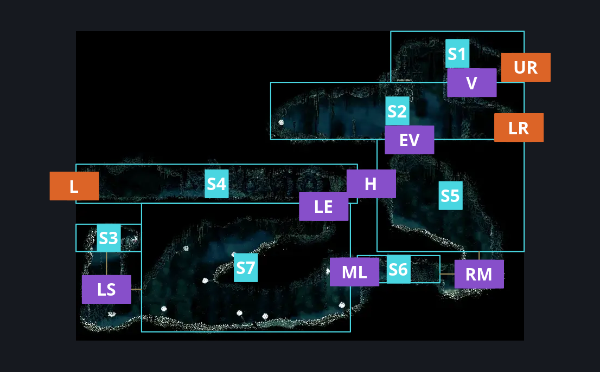
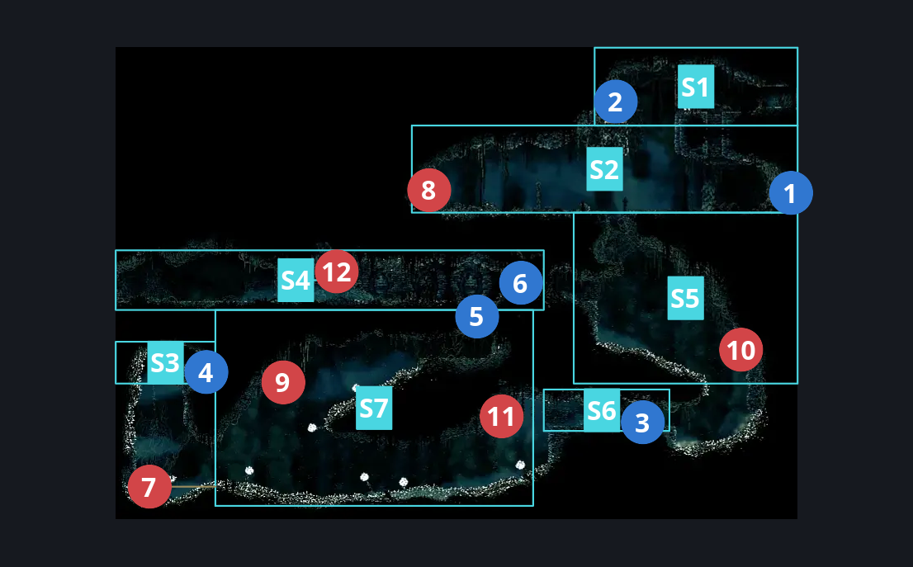
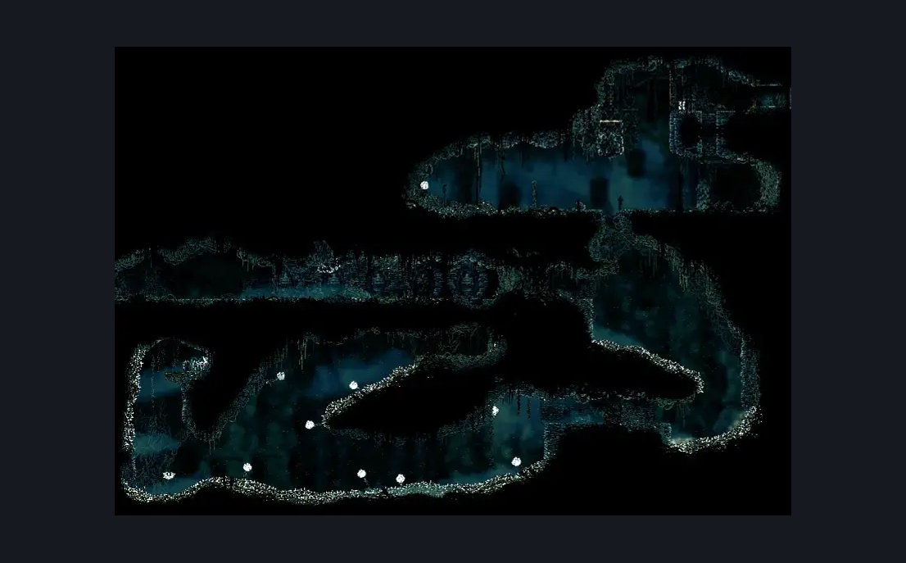

# Entrance to Nyleth (Under_27)

**Game ID:** Under_27

**Contributors:** Pyxl, Gallos

## Subrooms

| No. | Subroom | Annotated |
| --- | --- | --- |
| S1 | Entrance upper | ✓ |
| S2 | Entrance lower | ✓ |
| S3 | Shell Shard Ledge | ✓ |
| S4 | Exit | ✓ |
| S5 | Vine hell right | ✓ |
| S6 | Vine hell middle | ✓ |
| S7 | Vine hell left | ✓ |

## Room Transitions

| Alias | Name | From subroom | Destination | Destination alias | Requirements | TODO | Verification | Annotated | Notes |
| --- | --- | --- | --- | --- | --- | --- | --- | --- | --- |
| L | left1 | Exit | [Shrine Guardian Seth (Shellwood_22)](shrine-guardian-seth.md) | R | None |  | Verified | ✓ |  |
| UR | right1 | Entrance upper | [Grand Elevator (Under_01)](grand-elevator.md) | SLT | none |  | Verified | ✓ |  |
| LR | right2 | Entrance lower | [Grand Elevator (Under_01)](grand-elevator.md) | SLB | clear Grand Gate - Vine door |  | Verified | ✓ |  |

## Subroom Connections

| Alias | Name | Source | Destination | Requirements | TODO | Verification | Annotated | Notes |
| --- | --- | --- | --- | --- | --- | --- | --- | --- |
| V | upper <> lower | Entrance upper | Entrance lower | none |  | Verified | ✓ | falling |
| V | upper <> lower | Entrance lower | Entrance upper | silk soar OR (faydown AND cling grip left) |  | Verified | ✓ |  |
| EV | entrance <> vine hell | Entrance lower | Vine hell right | activate Grand Gate - Breakable Chain Nyleth |  | Verified | ✓ |  |
| EV | entrance <> vine hell | Vine hell right | Entrance lower | activate Grand Gate - Breakable Chain Nyleth AND (silk soar OR cling grip either OR easy scuttlebrace OR (faydown AND ledge grab either)) |  | Verified | ✓ |  |
| H | vine hell right <> exit | Vine hell right | Exit | (clear Grand Gate - Breakable Vines Exit Wall OR cbt silkspear use (ghost spear)) AND (dash left OR faydown OR clawline left OR drifters OR easy beast pogo OR easy architect charge OR (medium shaman pogo AND hard pale nails stall x 3) OR (medium voltvessels stall AND (medium hunter pogo OR medium architect pogo)) OR (cling grip left AND (easy [architect,hunter] pogo OR easy [voltvessels,flea brew,plasmium] stall OR medium [flintslate] stall OR medium wanderer charge OR medium shaman pogo))) |  | Verified | ✓ |  |
| H | vine hell right <> exit | Exit | Vine hell right | clear Grand Gate - Breakable Vines Exit Wall |  | Verified | ✓ |  |
| RM | right <> middle | Vine hell right | Vine hell middle | clawline both OR (faydown AND drifters AND (ledge grab left OR clawline left OR sharpdart OR cling grip left)) OR (faydown AND dash right AND (clawline left OR sharpdart)) OR (clawline either AND sharpdart) OR (medium beast pogo AND cling grip right AND (cling grip left OR clawline left OR sharpdart)) |  | Verified | ✓ |  |
| RM | right <> middle | Vine hell middle | Vine hell right | faydown AND cling grip both AND clawline left |  | Verified | ✓ |  |
| ML | middle <> left | Vine hell middle | Vine hell left | clear Grand Gate - Breakable Vines Vine hell middle |  | Verified | ✓ |  |
| ML | middle <> left | Vine hell left | Vine hell middle | clear Grand Gate - Breakable Vines Vine hell middle |  | Verified | ✓ |  |
| LE | leff <> Exit | Vine hell left | Exit | (((clawline both x 5 AND easy shaman pogo AND medium damage boost off phacia) OR (clawline both x 5 AND faydown)) AND (cling grip either OR silk soar)) AND clear Grand Gate - Breakable Vines Exit Ceiling |  | Verified | ✓ |  |
| LE | leff <> Exit | Exit | Vine hell left | none |  | Verified | ✓ | falling |
| LS | left <> shard | Vine hell left | Shell Shard Ledge | (clawline left AND cling grip both AND (faydown OR clawline right)) OR (faydown AND clawline left AND cling grip right AND medium pogo off phacia AND easy shaman pogo) |  | Verified | ✓ |  |
| LS | left <> shard | Shell Shard Ledge | Vine hell left | none |  | Verified | ✓ |  |

## Check Locations

| No. | Check | Subroom | Requirements | TODO | Verification | Location Type | Annotated | Notes |
| --- | --- | --- | --- | --- | --- | --- | --- | --- |
| 1 | Grand Gate - Vine door | Entrance lower | break wall right |  | Verified | blockade | ✓ |  |
| 2 | Grand Gate - Breakable Chain Nyleth | Entrance upper | Silk Soar OR (faydown AND (cling grip left OR (cling grip right AND (hard beast bind stall OR easy pogo off phacia OR clawline left OR (clawline right AND medium shaman pogo))))) OR (cling grip left AND easy shaman pogo AND medium pogo off phacia) |  | Verified | blockade | ✓ |  |
| 3 | Grand Gate - Breakable Vines Vine hell middle | Vine hell middle | break wall either |  | Verified | blockade | ✓ |  |
| 4 | Grand Gate - Shell Shard Cache | Shell Shard Ledge | None |  | Verified | resource | ✓ |  |
| 5 | Grand Gate - Breakable Vines Exit Ceiling | Vine hell left | break wall up |  | Verified | blockade | ✓ |  |
| 6 | Grand Gate - Breakable Vines Exit Wall | Exit | break wall right |  | Verified | blockade | ✓ |  |
| 7 | Phacia 1 | Vine hell left | none |  | Verified | enemy | ✓ |  |
| 8 | Phacia 2 | Entrance lower | none |  | Verified | enemy | ✓ |  |
| 9 | Phacia 3 | Vine hell left | none |  | Verified | enemy | ✓ |  |
| 10 | Phacia 4 | Vine hell right | invalid |  | Verified | enemy | ✓ |  |
| 11 | Pollenica 1 | Vine hell left | none |  | Verified | enemy | ✓ |  |
| 12 | Void Mass 1 | Exit | Black Thread World Spawn |  | Verified | enemy | ✓ |  |

## Room Images

### Connections

### Checks

### Scene

