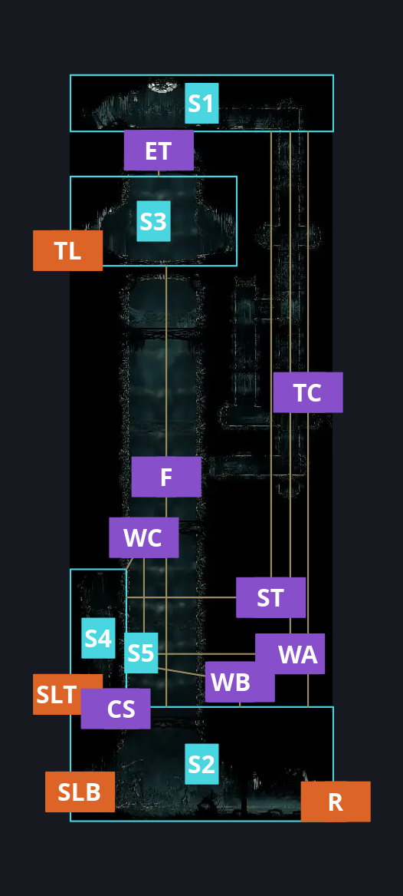
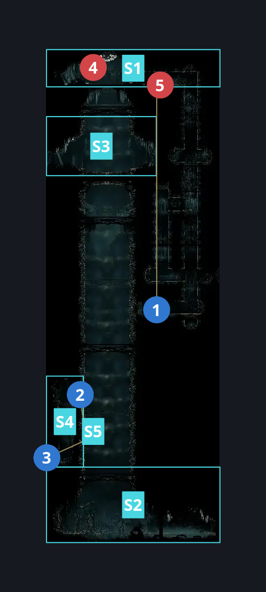
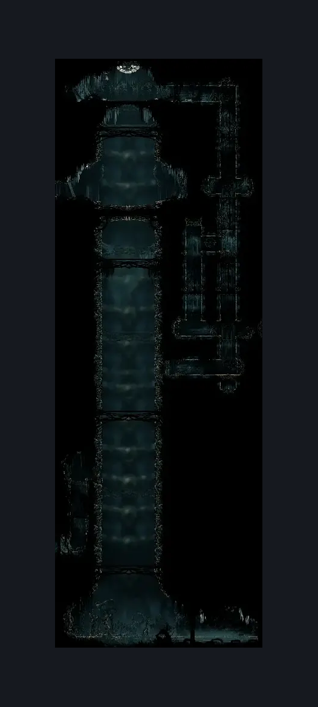

# Grand Elevator (Under_01)

**Game ID:** Under_01

**Contributors:** samupo, Gallos

## Subrooms

| No. | Subroom | Annotated |
| --- | --- | --- |
| S1 | Top | ✓ |
| S2 | Crash Site | ✓ |
| S3 | elevator | ✓ |
| S4 | Nyleth shaft | ✓ |
| S5 | walls | ✓ |

## Room Transitions

| Alias | Name | From subroom | Destination | Destination alias | Requirements | TODO | Verification | Annotated | Notes |
| --- | --- | --- | --- | --- | --- | --- | --- | --- | --- |
| TL | left1 | elevator | [Grand Gate Courtroom (Song_19_entrance)](grand-gate-courtroom.md) | R | none |  | Verified | ✓ |  |
| SLB | left3 | Crash Site | [Entrance to Nyleth (Under_27)](entrance-to-nyleth.md) | LR | clear Grand Gate - Vine door IN Entrance to Nyleth |  | Verified | ✓ |  |
| SLT | left2 | Nyleth shaft | [Entrance to Nyleth (Under_27)](entrance-to-nyleth.md) | UR | none |  | Verified | ✓ |  |
| R | right1 | Crash Site | [Broken Elevator (Under_01b)](../underworks/broken-elevator.md) | L | none |  | Verified | ✓ |  |

## Subroom Connections

| Alias | Name | Source | Destination | Requirements | TODO | Verification | Annotated | Notes |
| --- | --- | --- | --- | --- | --- | --- | --- | --- |
| F | Falling | elevator | Crash Site | none |  | Verified | ✓ | Just once |
| ET | elevator <> top | elevator | Top | silk soar OR (faydown AND cling grip either AND proficient movement AND (hard beast bind stall OR hard shaman pogo OR hard reserve bind stall OR hard flea brew stall x 2)) |  | Verified | ✓ |  |
| ET | elevator <> top | Top | elevator | none |  | Verified | ✓ |  |
| TC | top <> crash | Top | Crash Site | activate Grand Gate - Elevator lever |  | Verified | ✓ |  |
| TC | top <> crash | Crash Site | Top | activate Grand Gate - Elevator lever AND silk soar AND (cling grip either OR easy scuttlebrace OR elite ball knowledge) |  | Verified | ✓ |  |
| CS | crash <> shaft | Crash Site | Nyleth shaft | silk soar AND clear Grand Gate - Elevator Wall AND clear Grand Gate - Elevator Vine Wall |  | Verified | ✓ |  |
| CS | crash <> shaft | Nyleth shaft | Crash Site | clear Grand Gate - Elevator Wall AND clear Grand Gate - Elevator Vine Wall AND (cling grip either OR easy scuttlebrace OR silk soar) |  | Verified | ✓ |  |
| ST | shaft <> | Nyleth shaft | Top | (cling grip either OR easy scuttlebrace) AND  clear Grand Gate - Elevator Wall AND clear Grand Gate - Elevator Vine Wall AND activate Grand Gate - Elevator lever |  | Verified | ✓ |  |
| ST | shaft <> | Top | Nyleth shaft | clear Grand Gate - Elevator Wall AND clear Grand Gate - Elevator Vine Wall AND activate Grand Gate - Elevator lever |  | Verified | ✓ |  |
| WA | Top to wall | Top | walls | activate Grand Gate - Elevator lever AND attack left |  | Verified | ✓ |  |
| WB | Crash to wall | Crash Site | walls | attack left AND silk soar |  | Verified | ✓ |  |
| WC | nyleth to wall | Nyleth shaft | walls | attack right AND (cling grip either OR easy scuttlebrace OR silk soar) |  | Verified | ✓ |  |

## Check Locations

| No. | Check | Subroom | Requirements | TODO | Verification | Location Type | Annotated | Notes |
| --- | --- | --- | --- | --- | --- | --- | --- | --- |
| 1 | Grand Gate - Elevator lever | Top | hit switch left |  | Verified | switch | ✓ |  |
| 2 | Grand Gate - Elevator Wall | walls | break wall either |  | Verified | blockade | ✓ |  |
| 3 | Grand Gate - Elevator Vine Wall | walls | break wall either |  | Verified | blockade | ✓ |  |
| 4 | Drapefly 1 | Top | none |  | Verified | enemy | ✓ |  |
| 5 | Drapemite 1 | Top | none |  | Verified | enemy | ✓ |  |

## Room Images

### Connections

### Checks

### Scene

