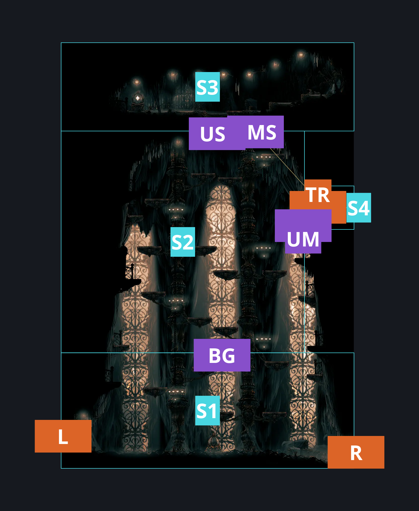
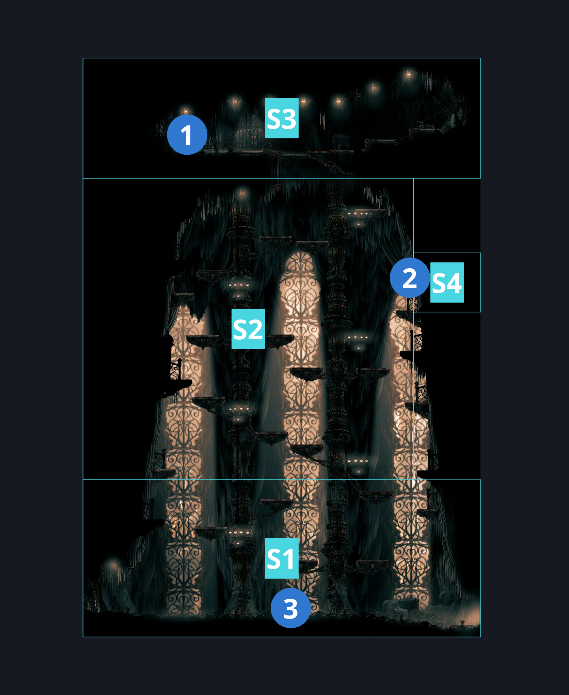
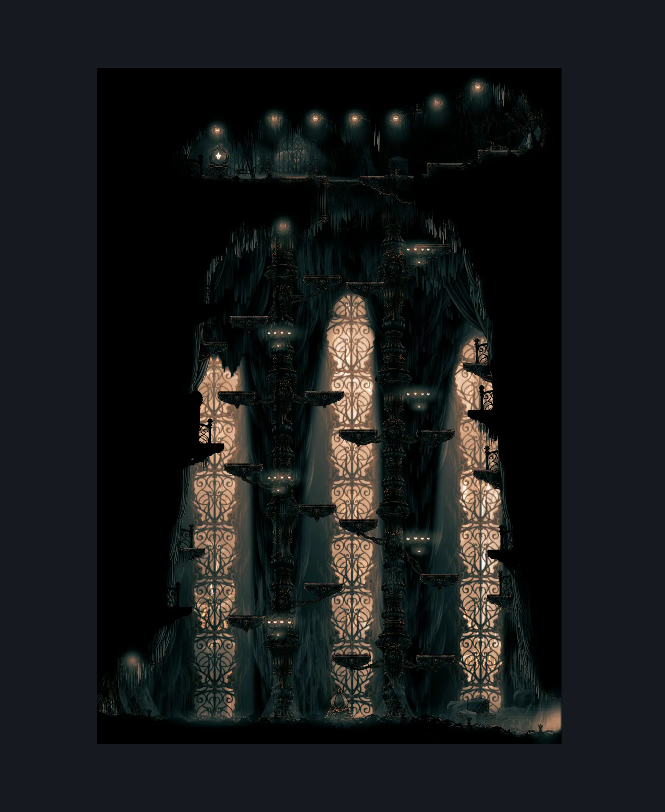

# Grand Gate Courtroom (Song_19_entrance)

**Game ID:** Song_19_entrance

**Contributors:** samupo, heric, Gallos

## Subrooms

| No. | Subroom | Annotated |
| --- | --- | --- |
| S1 | lower section | ✓ |
| S2 | upper section | ✓ |
| S3 | spool room | ✓ |
| S4 | Maintenance side | ✓ |

## Room Transitions

| Alias | Name | From subroom | Destination | Destination alias | Requirements | TODO | Verification | Annotated | Notes |
| --- | --- | --- | --- | --- | --- | --- | --- | --- | --- |
| L | left1 | lower section | [Grand Bridge (Coral_10)](grand-bridge.md) | R | activate Grand Bridge Plate IN Grand Bridge |  | Verified | ✓ | blocked |
| TR | right1 | Maintenance side | [Grand Gate Maintenance Room (Song_01c)](grand-gate-maintenance-room.md) | L | clear Grand Gate - Courtroom metal wall OR clear Grand Gate - Maintenance metal wall IN grand gate maintenance room |  | Verified | ✓ |  |
| R | right2 | lower section | [Grand Elevator (Under_01)](grand-elevator.md) | TL | none |  | Verified | ✓ |  |

## Subroom Connections

| Alias | Name | Source | Destination | Requirements | TODO | Verification | Annotated | Notes |
| --- | --- | --- | --- | --- | --- | --- | --- | --- |
| BG | big gap | lower section | upper section | silk soar OR faydown OR  ((medium shaman pogo OR ((cling grip left OR ledge grab left) AND (ledge grab right OR cling grip right))) AND (dash left OR clawline left OR sharpdart OR run   OR flea brew OR easy [hunter,beast,architect] pogo OR easy [architect, wanderer] charge OR drifters OR easy [plasmium, voltvessels] stall x 2 OR medium [parry,flintslate] stall x 2)) |  | Verified | ✓ |  |
| BG | big gap | upper section | lower section | nothing |  | Verified | ✓ |  |
| US | upper to spool | upper section | spool room | ((cling grip left OR easy scuttlebrace) AND ((medium shaman pogo AND proficient movement) OR ledge grab right OR cling grip right)) OR silk soar OR (faydown AND (ledge grab either OR cling grip either)) |  | Verified | ✓ |  |
| US | upper to spool | spool room | upper section | none |  | Verified | ✓ |  |
| UM | upper to maintenance | upper section | Maintenance side | silk soar OR faydown OR  (medium shaman pogo AND proficient movement) OR ((cling grip left OR ledge grab left) AND (ledge grab right OR cling grip right)) |  | Verified | ✓ |  |
| UM | upper to maintenance | Maintenance side | upper section | none |  | Verified | ✓ |  |
| MS | maintenance to spool | Maintenance side | spool room | ((cling grip left OR easy scuttlebrace) AND (easy shaman pogo OR ledge grab right OR cling grip right)) OR silk soar OR (faydown AND (ledge grab either OR cling grip either)) |  | Verified | ✓ |  |
| MS | maintenance to spool | spool room | Maintenance side | none |  | Verified | ✓ |  |

## Check Locations

| No. | Check | Subroom | Requirements | TODO | Verification | Location Type | Annotated | Notes |
| --- | --- | --- | --- | --- | --- | --- | --- | --- |
| 1 | Spool Fragment: Grand Gate | spool room | none |  | Verified | collectible | ✓ |  |
| 2 | Grand Gate - Courtroom metal wall | upper section | break wall right OR clear Grand Gate - Maintenance metal wall IN grand gate maintenance room |  | Verified | blockade | ✓ |  |
| 3 | Grande Gate map purchase | lower section | spend 40 rosaries |  | Verified | collectible | ✓ |  |

## Notes

the syntax assumes upswing is not randomized otherwise, must make upswing required for the subroom transition and the check of the spool

## Room Images

### Connections

### Checks

### Scene

