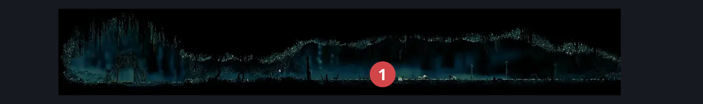
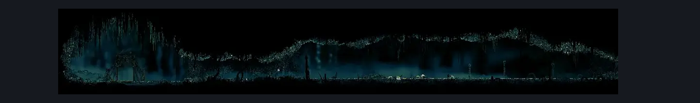

# Shrine Guardian Seth (Shellwood_22)

**Game ID:** Shellwood_22

**Contributors:** Pyxl, Gallos

## Subrooms

No subrooms defined.

## Room Transitions

| Alias | Name | From subroom | Destination | Destination alias | Requirements | TODO | Verification | Annotated | Notes |
| --- | --- | --- | --- | --- | --- | --- | --- | --- | --- |
| D | door1 |  | [Nyleth Shrine (Shellwood_11b)](nyleth-shrine.md) | R | defeat Boss: Shrine Guardian Seth |  | Verified | ✓ |  |
| R | right1 |  | [Entrance to Nyleth (Under_27)](entrance-to-nyleth.md) | L | None |  | Verified | ✓ |  |

## Subroom Connections

No subroom connections defined.

## Check Locations

| No. | Check | Subroom | Requirements | TODO | Verification | Location Type | Annotated | Notes |
| --- | --- | --- | --- | --- | --- | --- | --- | --- |
| 1 | Boss: Shrine Guardian Seth |  | Combat Requirements |  | Verified | enemy | ✓ |  |

## Room Images

### Connections

### Checks

### Scene

