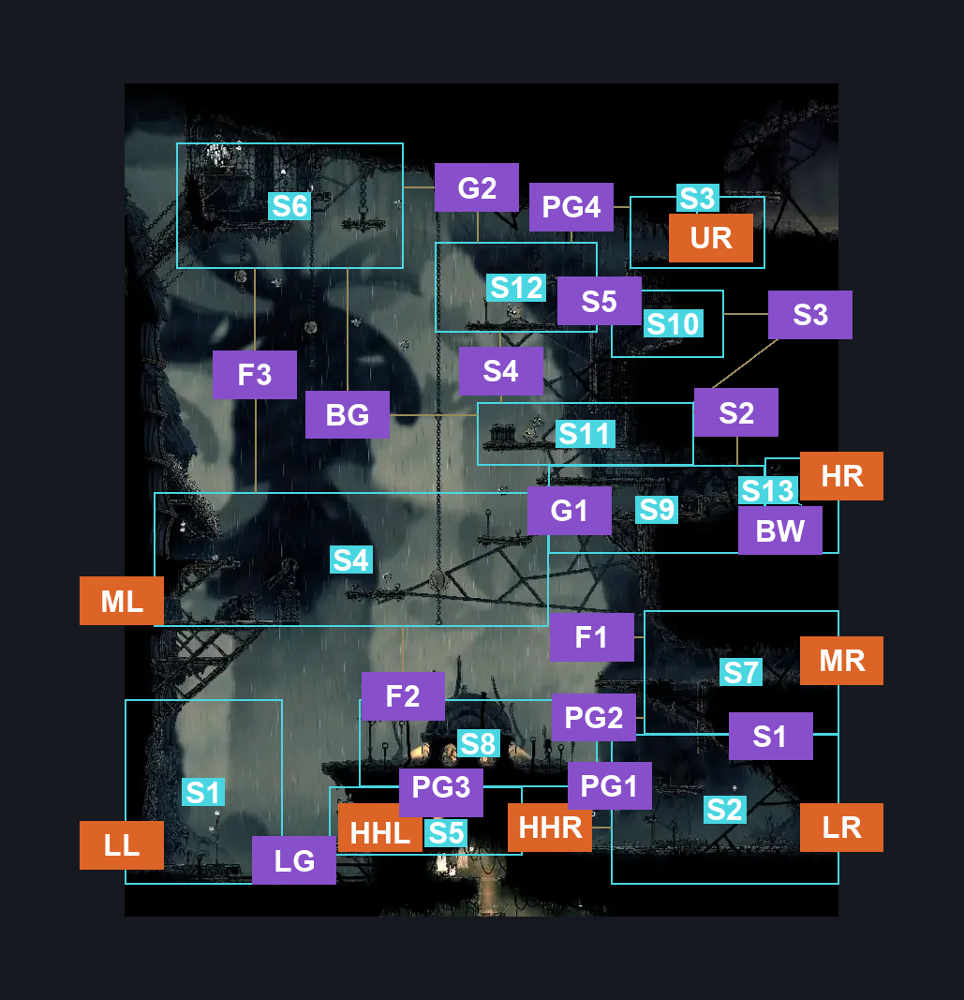
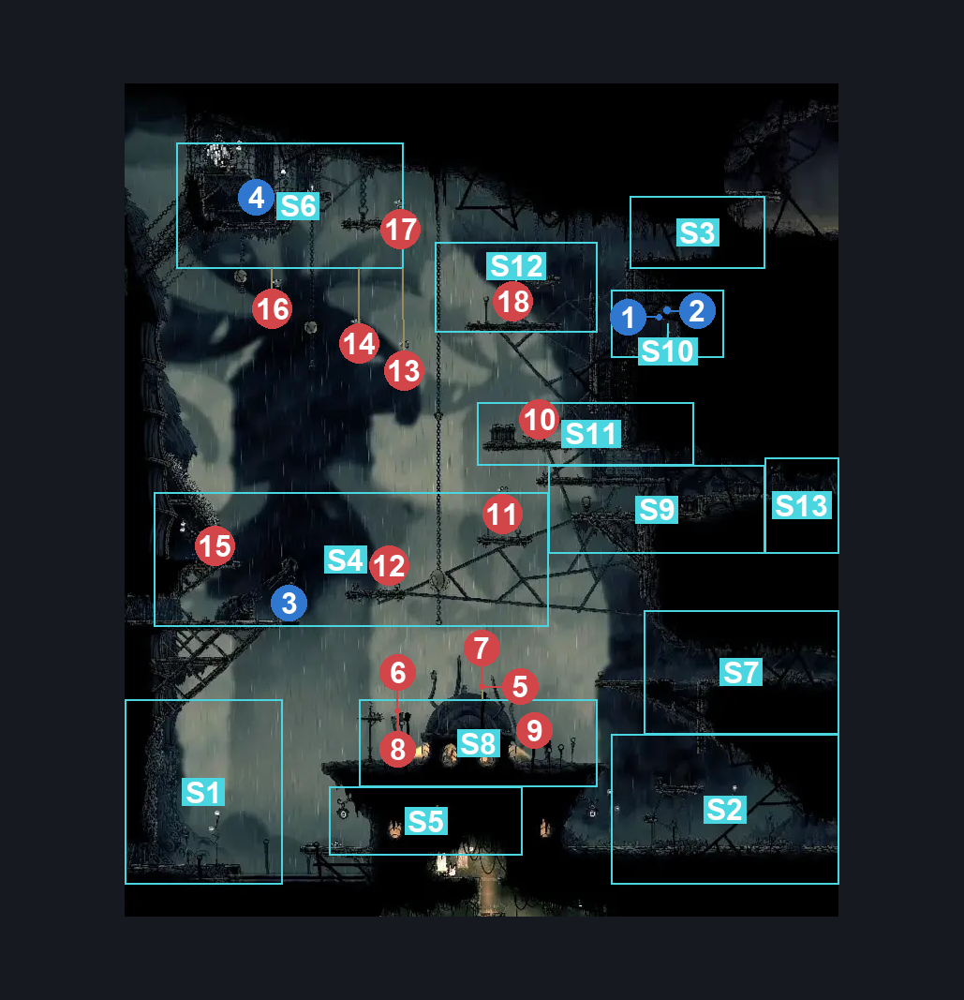
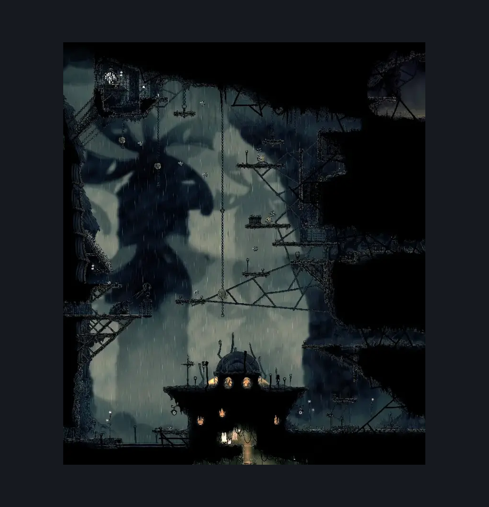

# Greymoor Halfway Home Exterior (Greymoor_03)

**Game ID:** Greymoor_03

**Contributors:** Isssma

## Subrooms

| No. | Subroom | Annotated |
| --- | --- | --- |
| S1 | lower left section | ✓ |
| S2 | lower right section | ✓ |
| S3 | sinner road entrance | ✓ |
| S4 | tower platform | ✓ |
| S5 | building left | ✓ |
| S6 | upper center room | ✓ |
| S7 | middle right section | ✓ |
| S8 | building roof | ✓ |
| S9 | upper right section | ✓ |
| S10 | upper stash | ✓ |
| S11 | lower guarded platform | ✓ |
| S12 | upper guarded plaform | ✓ |
| S13 | hidden passage | ✓ |

## Room Transitions

| Alias | Name | From subroom | Destination | Destination alias | Requirements | TODO | Verification | Annotated | Notes |
| --- | --- | --- | --- | --- | --- | --- | --- | --- | --- |
| LL | lower left | lower left section | [Greymoor Eastern Tower (Greymoor_04)](greymoor-eastern-tower.md) | LR | nothing |  | Verified | ✓ |  |
| LR | lower right | lower right section | [Greymoor Lower Halfway Home Path (Greymoor_13)](greymoor-lower-halfway-home-path.md) | L | nothing |  | Verified | ✓ |  |
| HR | hidden right | hidden passage | [Greymoor Kratt Room (Greymoor_24)](greymoor-kratt-room.md) | L | nothing |  | Verified | ✓ |  |
| MR | middle right | middle right section | [Greymoor Upper Halfway Home Path (Greymoor_12)](greymoor-upper-halfway-home-path.md) | L | nothing |  | Verified | ✓ |  |
| HHR | halfway home right | lower right section | [Greymoor Halfway Home (Halfway_01)](greymoor-halfway-home.md) | R | activate pressure plate IN greymoor halfway home |  | Verified | ✓ |  |
| UR | upper right | sinner road entrance | [Sinner's Road Entrance (Dust_01)](../sinner-s-road/sinner-s-road-entrance.md) | L | nothing |  | Verified | ✓ |  |
| HHL | halfway home left | building left | [Greymoor Halfway Home (Halfway_01)](greymoor-halfway-home.md) | L | nothing |  | Verified | ✓ |  |
| ML | middle left | tower platform | [Greymoor Eastern Tower (Greymoor_04)](greymoor-eastern-tower.md) | MR | nothing |  | Verified | ✓ |  |

## Subroom Connections

| Alias | Name | Source | Destination | Requirements | TODO | Verification | Annotated | Notes |
| --- | --- | --- | --- | --- | --- | --- | --- | --- |
| S1 | shaft 1 | lower right section | middle right section | silk soar OR ((ACT 1 OR ACT 2) AND ( cling grip right OR (faydown cloak AND easy scuttlebrace))) |  | Verified | ✓ |  |
| S1 | shaft 1 | middle right section | lower right section | none (just fall) |  | Verified | ✓ |  |
| PG1 | platform gap 1 | lower right section | building roof | silk soar OR ((ACT 1 OR ACT 2) AND (flea brew OR drifters cloak OR faydown cloak OR progressive swift step 1 left OR clawline left x 1 OR sharpdart x 1 OR easy beast pogo  OR easy [architect, wanderer] needle strike OR ((easy reaper needle strike OR medium shaman pogo) AND ledge grab left))) |  | Verified | ✓ |  |
| PG1 | platform gap 1 | building roof | lower right section | none (just fall) |  | Verified | ✓ |  |
| PG2 | platform gap 2 | building roof | middle right section | silk soar OR (faydown cloak AND (progressive swift step 2 right OR sharpdart OR (ledge grab right AND (progressive swift step 1 right OR clawline right x 1 OR drifters cloak OR medium [shaman, beast] pogo)))) OR (cling grip right AND (clawline right x 1 OR sharpdart x 1 OR progressive swift step 2 right OR faydown cloak OR drifters cloak OR (progressive swift step 1 right AND flea brew))) |  | Verified | ✓ | removed the craw enemy pogo since they dissapear when the crawbug clearing wish is completed |
| PG2 | platform gap 2 | middle right section | building roof | none (just fall) |  | Verified | ✓ |  |
| F1 | fall 1 | middle right section | tower platform | silk soar |  | Verified | ✓ |  |
| F1 | fall 1 | tower platform | middle right section | none (just fall) |  | Verified | ✓ |  |
| F2 | fall 2 | tower platform | building roof | none |  | Verified | ✓ |  |
| F2 | fall 2 | building roof | tower platform | silk soar OR activate tower elevator |  | Verified | ✓ |  |
| LG | lake gap | building left | lower left section | progressive swift step 1 left OR clawline left x 1 OR sharpdart x 1 OR faydown cloak OR silk soar OR drifters cloak OR activate tower elevator OR swim OR easy [hunter, reaper, beast, witch, architect, shaman] pogo |  | Verified | ✓ |  |
| LG | lake gap | lower left section | building left | silk soar OR faydown cloak  OR drifters cloak  OR progressive swift step 1 right  OR sharpdart x 1 OR clawline right x 1  OR easy beast pogo  OR easy architect needle strike  OR (swim AND (ledge grab right OR cling grip right)) |  | Verified | ✓ |  |
| PG3 | platform gap 3 | building roof | building left | none (just fall) |  | Verified | ✓ |  |
| PG3 | platform gap 3 | building left | building roof | silk soar OR (activate tower elevator AND faydown cloak) |  | Verified | ✓ |  |
| G1 | gap 1 | tower platform | upper right section | silksoar OR ((ACT 1 OR ACT 2) AND (ledge grab right OR easy [hunter, reaper, beast, shaman] pogo OR flea brew OR progressive swift step 1 right OR clawline right x 1 OR sharpdart x 1 OR faydown cloak OR drifters cloak  OR architect needle right)) OR (ACT 3 AND (clawline right x 2 OR (clawline right x 1 AND (faydown cloak OR progressive swift step 2 right OR easy [beast, architect] pogo OR drifters cloak)) OR (faydown cloak AND (sharpdart x 1 OR drifters cloak OR (progressive swift step 2 right AND easy [beast, architect] pogo))) OR (sharpdart x 1 AND (progressive swift step 2 right OR drifters cloak)))) |  | Verified | ✓ |  |
| G1 | gap 1 | upper right section | tower platform | none (just fall) |  | Verified | ✓ |  |
| S2 | shaft 2 | upper right section | lower guarded platform | silk soar OR cling grip left OR cling grip right OR easy scuttlebrace OR ledge grab left OR ledge grab right OR easy shaman pogo |  | Verified | ✓ |  |
| S2 | shaft 2 | lower guarded platform | upper right section | none (just fall) |  | Verified | ✓ |  |
| BG | baloon gap | lower guarded platform | upper center room | (hard pogo off fluttermite) OR (medium pogo off fluttermite AND (clawline left x 3 OR (drifters cloak))) OR (easy pogo off fluttermite AND (drifters cloak AND faydown cloak)) |  | Verified | ✓ |  |
| BG | baloon gap | upper center room | lower guarded platform | none (just fall) |  | Verified | ✓ |  |
| G2 | gap 2 | upper center room | upper guarded plaform | easy pogo off fluttermite OR clawline right x 1 OR progressive swift step 1 right OR faydown cloak OR drifters cloak OR sharpdart x 1 OR easy [hunter, reaper, beast, witch, architect] pogo |  | Verified | ✓ |  |
| G2 | gap 2 | upper guarded plaform | upper center room | silk soar OR (faydown cloak AND (clawline left x 1 OR sharpdart x 1 OR easy pogo off fluttermite OR drifters cloak OR ((flea brew) AND (intended [reaper, beast, architect] pogo)))) OR (progressive swift step 1 AND (medium pogo off fluttermite OR ( easy pogo off fluttermite AND (clawline left x 1 OR sharpdart x 1 OR drifters cloak) AND (ledge grab either OR intended [reaper, shaman, wanderer] pogo)))) OR (progressive swift step 2 left AND (easy pogo off fluttermite OR flea brew) AND (ledge grab either OR intended [reaper, wanderer] pogo)) |  | Verified | ✓ |  |
| F3 | fall 3 | tower platform | upper center room | silk soar |  | Verified | ✓ |  |
| F3 | fall 3 | upper center room | tower platform | none (just fall) |  | Verified | ✓ |  |
| S3 | shaft 3 | lower guarded platform | upper stash | cling grip left OR cling grip right OR silk soar OR easy scuttlebrace |  | Verified | ✓ |  |
| S3 | shaft 3 | upper stash | lower guarded platform | none |  | Verified | ✓ |  |
| S4 | shaft 4 | lower guarded platform | upper guarded plaform | cling grip left OR cling grip right OR silk soar OR (easy pogo off fluttermite AND faydown cloak) |  | Verified | ✓ |  |
| S4 | shaft 4 | upper guarded plaform | lower guarded platform | none |  | Verified | ✓ |  |
| S5 | shaft 5 | upper stash | upper guarded plaform | cling grip left OR cling grip right OR silk soar OR easy scuttlebrace OR (faydown cloak AND ( ledge grab left OR easy shaman pogo)) |  | Verified | ✓ |  |
| S5 | shaft 5 | upper guarded plaform | upper stash | none |  | Verified | ✓ |  |
| PG4 | platform gap 4 | upper guarded plaform | sinner road entrance | ledge grab right OR progressive swift step 1 right OR clawline right x 1 OR sharpdart x 1 OR cling grip right OR silk soar OR faydown cloak OR medium shaman pogo OR drifters cloak OR easy beast pogo |  | Verified | ✓ |  |
| PG4 | platform gap 4 | sinner road entrance | upper guarded plaform | nothing |  | Verified | ✓ |  |
| BW | breakable wall | upper right section | hidden passage | break wall right OR break wall up |  | Verified | ✓ |  |
| BW | breakable wall | hidden passage | upper right section | break wall left OR break wall up |  | Verified | ✓ |  |

## Check Locations

| No. | Check | Subroom | Requirements | TODO | Verification | Location Type | Annotated | Notes |
| --- | --- | --- | --- | --- | --- | --- | --- | --- |
| 1 | Greymoor - Rosary Cache bellow sinners road entrance | upper stash | none |  | Verified | resource | ✓ |  |
| 2 | Greymoor - sinner road entrance guards lunch money | upper stash | none |  | Verified | resource | ✓ |  |
| 3 | tower elevator | tower platform | none (pressure switch) |  | Verified | switch | ✓ |  |
| 4 | Greymoor - Orders | upper center room | nothing |  | Verified | lore | ✓ |  |
| 5 | Craw 1 | building roof | nothing |  | Verified | enemy | ✓ | Random chance of appearing, 2 minimun  They will despawn once Crawbug clearing wish has been Granted |
| 6 | Craw 2 | building roof | nothing |  | Verified | enemy | ✓ | Random chance of appearing, 2 minimun  They will despawn once Crawbug clearing wish has been Granted |
| 7 | Craw 3 | building roof | nothing |  | Verified | enemy | ✓ | Random chance of appearing, 2 minimun  They will despawn once Crawbug clearing wish has been Granted |
| 8 | Craw 4 | building roof | nothing |  | Verified | enemy | ✓ | Random chance of appearing, 2 minimun  They will despawn once Crawbug clearing wish has been Granted |
| 9 | Craw 5 | building roof | nothing |  | Verified | enemy | ✓ | Random chance of appearing, 2 minimun  They will despawn once Crawbug clearing wish has been Granted |
| 10 | Dreg Catcher 1 | lower guarded platform | nothing |  | Verified | enemy | ✓ |  |
| 11 | Fluttermite 1 | tower platform | nothing |  | Verified | enemy | ✓ |  |
| 12 | Fluttermite 2 | tower platform | Normal World Spawn |  | Verified | enemy | ✓ |  |
| 13 | Fluttermite 3 | upper center room | silk soar OR easy pogo off fluttermite |  | Verified | enemy | ✓ |  |
| 14 | Fluttermite 4 | upper center room | Normal World Spawn AND (silk soar OR hard pogo off fluttermite) |  | Verified | enemy | ✓ |  |
| 15 | Mite 1 | tower platform | ledge grab left OR faydown cloak OR progressive swift step 2 left OR clawline left x 1 OR sharpdart x 1 OR silk soar |  | Verified | enemy | ✓ | technically can be lured without reaching the platform but its inconsistent |
| 16 | Fluttermite 5 | upper center room | silk soar OR hard pogo off fluttermite |  | Verified | enemy | ✓ |  |
| 17 | Fluttermite 6 | upper center room | Normal World Spawn |  | Verified | enemy | ✓ |  |
| 18 | Dreg Catcher 2 | upper guarded plaform | Normal World Spawn |  | Verified | enemy | ✓ |  |

## Room Images

### Connections

### Checks

### Scene

