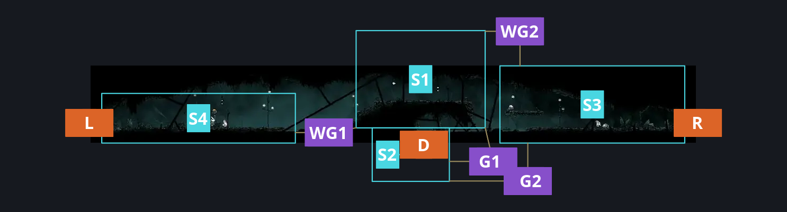
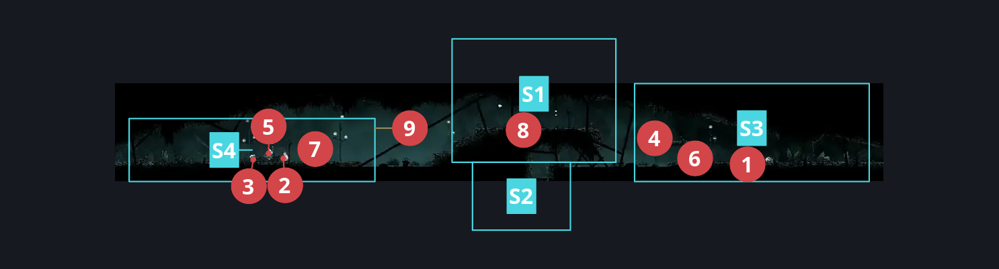
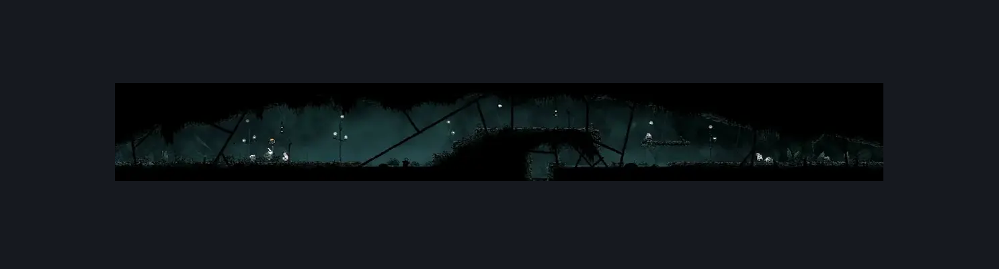

# Greymoor Lower Halfway Home Path (Greymoor_13)

**Game ID:** Greymoor_13

**Contributors:** Isssma

## Subrooms

| No. | Subroom | Annotated |
| --- | --- | --- |
| S1 | center section | ✓ |
| S2 | down and under | ✓ |
| S3 | right section | ✓ |
| S4 | left section | ✓ |

## Room Transitions

| Alias | Name | From subroom | Destination | Destination alias | Requirements | TODO | Verification | Annotated | Notes |
| --- | --- | --- | --- | --- | --- | --- | --- | --- | --- |
| L | left | left section | [Greymoor Halfway Home Exterior (Greymoor_03)](greymoor-halfway-home-exterior.md) | LR | nothing |  | Verified | ✓ |  |
| R | right | center section | [Greymoor West Bellshrine Room (Greymoor_01)](greymoor-west-bellshrine-room.md) | LL | nothing |  | Verified | ✓ |  |
| D | down | down and under | [Greymoor Bone Scroll Room (Greymoor_21)](greymoor-bone-scroll-room.md) | T | nothing |  | Verified | ✓ |  |

## Subroom Connections

| Alias | Name | Source | Destination | Requirements | TODO | Verification | Annotated | Notes |
| --- | --- | --- | --- | --- | --- | --- | --- | --- |
| G1 | gap 1 | center section | down and under | swim OR (clawline left x 1 AND (ledge grab left OR faydown cloak OR cling grip left)) |  | Verified | ✓ |  |
| G1 | gap 1 | down and under | center section | swim OR (clawline right x 1 AND faydown cloak AND cling grip left) |  | Verified | ✓ |  |
| WG1 | water gap 1 | center section | left section | clawline left x 1 OR faydown cloak OR drifters cloak OR sharpdart x 1 OR progressive swift step 2 left OR ((progressive swift step 1 left OR flea brew) AND faydown cloak) OR swim OR easy [hunter, wanderer] voltwater pogo x 2 |  | Verified | ✓ | Voltvessel water pogo crusade was here 17/11 |
| WG1 | water gap 1 | left section | center section | swim OR progressive swift step 2 right OR clawline right x 1 OR sharpdart x 1 OR (drifters cloak AND (ledge grab right OR progressive swift step 1 right OR faydown cloak)) OR ((faydown cloak OR (flea brew AND ledge grab right)) AND progressive swift step 1 right) OR easy [hunter, wanderer] voltwater pogo x 2 |  | Verified | ✓ | Voltvessel water pogo crusade was here 17/11 |
| WG2 | water gap 2 | right section | center section | ((Act 1 OR Act 2) AND (progressive swift step 1 left OR clawline left x 1 OR faydown cloak OR drifters cloak OR sharpdart x 1 OR easy beast pogo OR flea brew OR easy architect needle strike OR (cling grip left AND (easy [hunter, reaper, witch, architect, shaman] pogo OR swim)))) OR (ACT 3 AND ((cling grip left AND (clawline left x 1 OR sharpdart x 1 OR progressive swift step 2 left OR (easy [hunter, wanderer, reaper, beast, architect, witch, shaman] pogo) OR (drifters cloak AND (progressive swift step 1 left OR flea brew)))) OR (faydown cloak AND (clawline left x 1 OR sharpdart x 1 OR progressive swift step 1 left OR (ledge grab left AND drifters cloak))) OR (silk soar AND ((Clawline left x 2 AND ledge grab left)  OR (clawline left x 1 AND (progressive swift step 2 left OR drifters cloak)))))) OR medium [hunter, wanderer] voltwater pogo x 2 |  | Verified | ✓ | Voltvessel water pogo crusade was here 17/11 ========== added a new pogo route using the courier enviroment things - Isssma 25/11 |
| WG2 | water gap 2 | center section | right section | swim OR clawline right x 1 OR sharpdart x 1 OR drifters cloak OR faydown cloak OR ((ACT 1 OR ACT 2) AND (progressive swift step 1 right OR ((easy hunter pogo OR cling grip left) AND ledge grab right) OR easy [beast, architect] pogo OR (easy shaman pogo) OR easy voltvessels stall x 1)) OR (ACT 3 AND (progressive swift step 2 right OR (progressive swift step 1 right AND (easy [beast, architect] pogo OR (easy hunter pogo AND ledge grab right))) OR ((easy [hunter, architect, beast] pogo OR medium shaman pogo OR (easy reaper pogo AND ledge grab right))))) |  | Verified | ✓ | I think in ACT 3 this is always free? There are 2 convinient courier-swag-like objects to pogo ~Hutyrix 17/11 ============ Had a look, act 3 doesnt make it 3 but them objects may add new routes which werent written down already - Pyxl 23/11 ============ After some testing i added the crest pogo inside their own block at the end of act 3, in the act 2 block it also allows shaman pogo to clear the platform    - Isssma 25/11 |
| G2 | gap 2 | down and under | right section | swim OR ((normal world spawn AND ((clawline right x 1 AND (faydown cloak AND progressive swift step 2 right AND ledge grab right)))) OR (ACT 3 AND ((faydown cloak AND (clawline right x 2 OR sharpdart x 2 OR ((drifters cloak OR progressive swift step 2 right OR easy [hunter, reaper, wanderer, beast, architect, shaman] pogo) AND (clawline left x 1 OR sharpdart x 1))))))) |  | Verified | ✓ |  |
| G2 | gap 2 | right section | down and under | swim OR ((normal world spawn AND ((clawline left x 1 AND (ledge grab left OR faydown cloak OR cling grip left)) OR (ACT 3 AND ((clawline left x 1 AND faydown cloak) OR (clawline left x 1 AND (ledge grab left OR cling grip left) AND (easy [hunter, wanderer, beast,architect, witch, shaman] pogo OR progressive swift step 1 OR drifters cloak OR sharpdart x 1))))))) |  | Verified | ✓ |  |

## Check Locations

| No. | Check | Subroom | Requirements | TODO | Verification | Location Type | Annotated | Notes |
| --- | --- | --- | --- | --- | --- | --- | --- | --- |
| 1 | Pilgrim Groveller 1 | right section | nothing |  | Verified | enemy | ✓ |  |
| 2 | Pilgrim Pouncer 1 | left section | Normal World Spawn |  | Verified | enemy | ✓ |  |
| 3 | Pilgrim Bellbearer 1 | left section | Normal World Spawn |  | Verified | enemy | ✓ |  |
| 4 | Pilgrim Bellbearer 2 | right section | Normal World Spawn |  | Verified | enemy | ✓ |  |
| 5 | Pilgrim Guide 1 | left section | Normal World Spawn |  | Verified | enemy | ✓ |  |
| 6 | Pilgrim Pouncer 2 | right section | Normal World Spawn |  | Verified | enemy | ✓ |  |
| 7 | Pilgrim Guide 2 | left section | Black Thread World Spawn |  | Verified | enemy | ✓ |  |
| 8 | Mite 1 | center section | Black Thread World Spawn |  | Verified | enemy | ✓ |  |
| 9 | Winged Pilgrim Bellbearer 1 | left section | Black Thread World Spawn |  | Verified | enemy | ✓ |  |

## Room Images

### Connections

### Checks

### Scene

