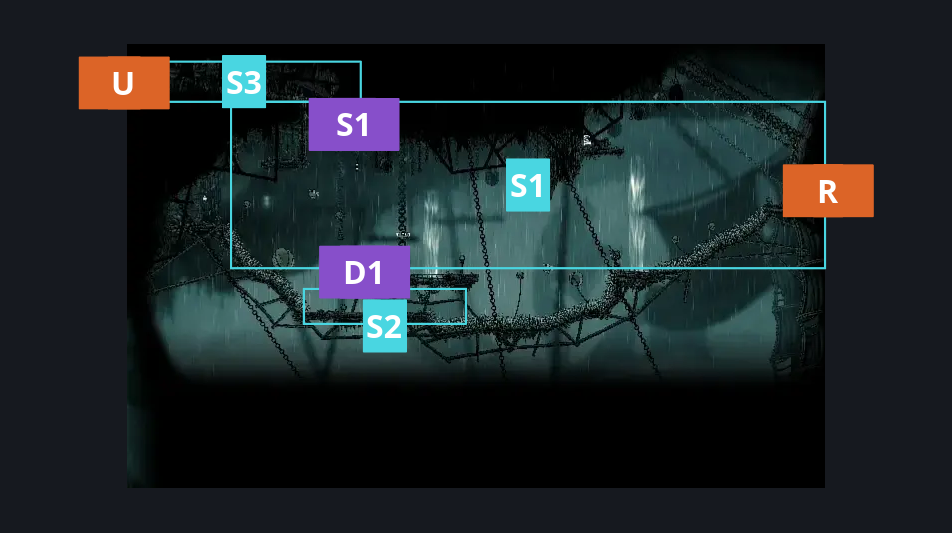
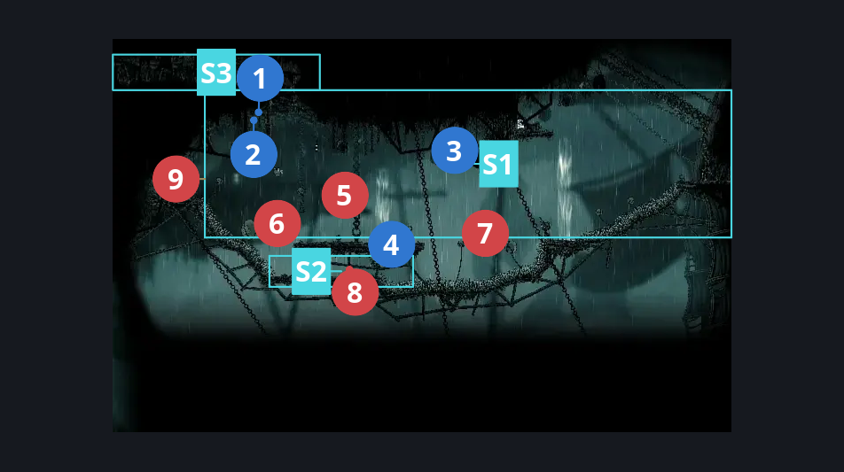
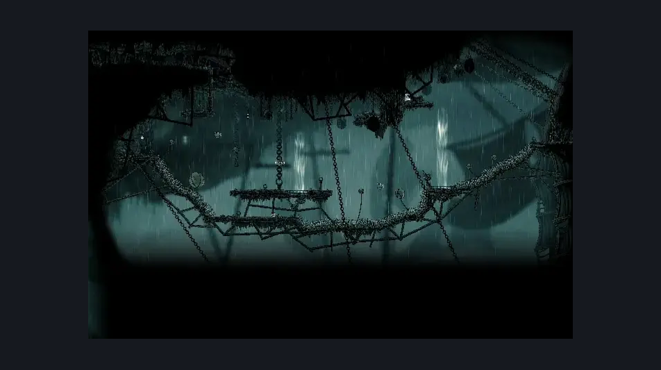

# Greymoor Upper Towers Path (Greymoor_11)

**Game ID:** Greymoor_11

**Contributors:** Isssma

## Subrooms

| No. | Subroom | Annotated |
| --- | --- | --- |
| S1 | main section | ✓ |
| S2 | airstream lever | ✓ |
| S3 | upper corridor | ✓ |

## Room Transitions

| Alias | Name | From subroom | Destination | Destination alias | Requirements | TODO | Verification | Annotated | Notes |
| --- | --- | --- | --- | --- | --- | --- | --- | --- | --- |
| U | up | upper corridor | [Greymoor Western Tower (Greymoor_06)](greymoor-western-tower.md) | UR | nothing |  | Verified | ✓ |  |
| R | right | main section | [Greymoor Eastern Tower (Greymoor_04)](greymoor-eastern-tower.md) | UL | nothing |  | Verified | ✓ |  |

## Subroom Connections

| Alias | Name | Source | Destination | Requirements | TODO | Verification | Annotated | Notes |
| --- | --- | --- | --- | --- | --- | --- | --- | --- |
| S1 | shaft 1 | main section | upper corridor | silk soar OR cling grip left OR medium scuttlebrace OR (faydown cloak AND (hard pogo off Roachcatcher OR (cling grip right AND easy [wanderer, reaper, shaman] pogo))) |  | Verified | ✓ |  |
| S1 | shaft 1 | upper corridor | main section | none (just fall) |  | Verified | ✓ |  |
| D1 | drop 1 | main section | airstream lever | none (just fall) |  | Verified | ✓ |  |
| D1 | drop 1 | airstream lever | main section | spike pogo OR silk soar OR ledge grab right OR (easy pogo off mite) OR cling grip right OR faydown cloak |  | Verified | ✓ |  |

## Check Locations

| No. | Check | Subroom | Requirements | TODO | Verification | Location Type | Annotated | Notes |
| --- | --- | --- | --- | --- | --- | --- | --- | --- |
| 1 | Greymoor - another smaller hanging rosary string at the left side of the room | main section | none |  | Verified | collectible | ✓ |  |
| 2 | Greymoor - Rosary Cache hanging at the left side of the room | main section | none |  | Verified | collectible | ✓ |  |
| 3 | Greymoor - Someones rosary pocket change above the airstream | main section | drifters cloak OR (silk soar AND (progressive swift step 2 right OR sharpdart x 1 OR clawline right x 1 OR faydown cloak OR hard pogo off roachcatcher)) |  | Verified | collectible | ✓ |  |
| 4 | airstream | airstream lever | hit lever right OR hit lever up |  | Verified | switch | ✓ |  |
| 5 | Roachcatcher 1 | main section | nothing |  | Verified | enemy | ✓ |  |
| 6 | Fluttermite 1 | main section | nothing |  | Verified | enemy | ✓ |  |
| 7 | Fluttermite 2 | main section | nothing |  | Verified | enemy | ✓ |  |
| 8 | Mite 1 | airstream lever | nothing |  | Verified | enemy | ✓ |  |
| 9 | Void Mass 1 | main section | Black Thread World Spawn |  | Verified | enemy | ✓ |  |

## Notes

if you see Geo Small Persistent (1), ignore it, it doesnt exist, its a lie, kill it on sight even

## Room Images

### Connections

### Checks

### Scene

