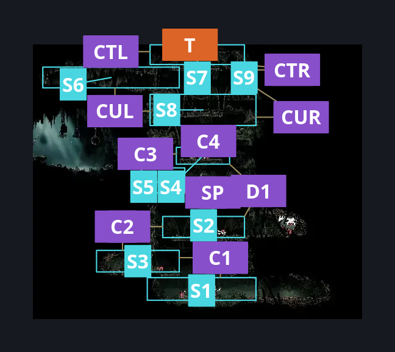
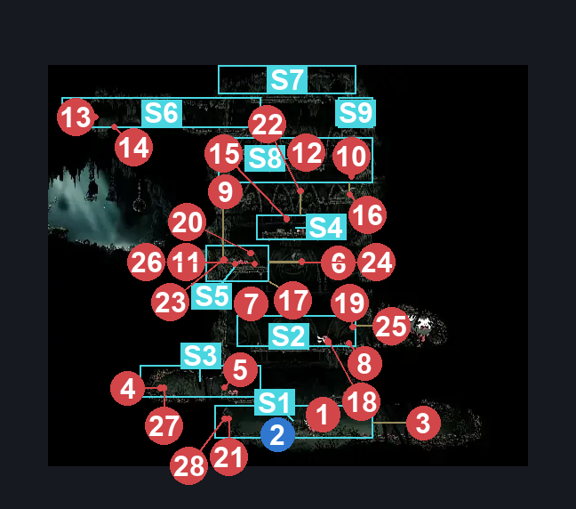
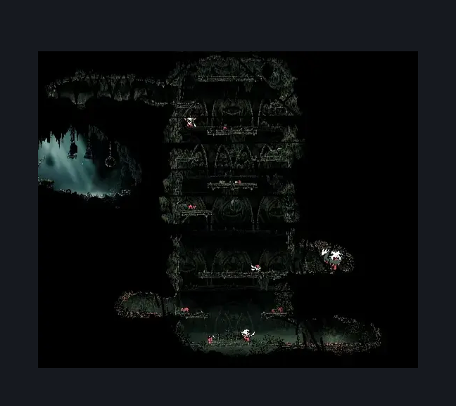

# Halfway Home Cellar (Ant_08)

**Game ID:** Ant_08

**Contributors:** Isssma

## Subrooms

| No. | Subroom | Annotated |
| --- | --- | --- |
| S1 | nectar section | ✓ |
| S2 | big fella platform | ✓ |
| S3 | left platform above nectar | ✓ |
| S4 | upper section low | ✓ |
| S5 | mid left platform | ✓ |
| S6 | upper section left corridor | ✓ |
| S7 | cellar door | ✓ |
| S8 | upper section mid top | ✓ |
| S9 | upper section right top | ✓ |

## Room Transitions

| Alias | Name | From subroom | Destination | Destination alias | Requirements | TODO | Verification | Annotated | Notes |
| --- | --- | --- | --- | --- | --- | --- | --- | --- | --- |
| T | Top | cellar door | [Greymoor Halfway Home (Halfway_01)](greymoor-halfway-home.md) | B | nothing |  | Verified | ✓ | once the gauntlet starts the exit is locked |

## Subroom Connections

| Alias | Name | Source | Destination | Requirements | TODO | Verification | Annotated | Notes |
| --- | --- | --- | --- | --- | --- | --- | --- | --- |
| C1 | climb 1 | nectar section | left platform above nectar | ledge grab left OR faydown cloak OR silk soar OR cling grip left OR ((ledge grab right OR cling grip right) AND (clawline left x 1 OR progressive swift step 1 OR sharpdart x 1 OR easy beast pogo OR easy architect needle strike OR drifters cloak)) |  | Verified | ✓ |  |
| C1 | climb 1 | left platform above nectar | nectar section | nothing |  | Verified | ✓ |  |
| C2 | climb 2 | left platform above nectar | big fella platform | cling grip left OR silk soar OR (faydown cloak AND (ledge grab right  OR cling grip right)) |  | Verified | ✓ |  |
| C2 | climb 2 | big fella platform | left platform above nectar | nothing |  | Verified | ✓ |  |
| SP | Schrodinger platform | big fella platform | mid left platform | silk soar OR cling grip either OR faydown cloak OR ((ledge grab left) AND (cling grip right)) |  | Verified | ✓ |  |
| SP | Schrodinger platform | mid left platform | big fella platform | nothing |  | Verified | ✓ |  |
| D1 | drop 1 | big fella platform | upper section low | silk soar OR cling grip right OR (easy scuttlebrace AND ledge grab left) |  | Verified | ✓ |  |
| D1 | drop 1 | upper section low | big fella platform | nothing |  | Verified | ✓ |  |
| C3 | climb 3 | mid left platform | upper section low | cling grip left OR ledge grab right OR silk soar OR faydown cloak OR easy scuttlebrace |  | Verified | ✓ |  |
| C3 | climb 3 | upper section low | mid left platform | nothing |  | Verified | ✓ |  |
| C4 | climb 4 | upper section low | upper section mid top | silk soar OR faydown OR cling grip either OR ledge grab both OR easy scuttlebrace |  | Verified | ✓ |  |
| C4 | climb 4 | upper section mid top | upper section low | nothing |  | Verified | ✓ |  |
| CUL | climb upper left | upper section mid top | upper section left corridor | ledge grab left OR cling grip left OR easy scuttlebrace OR faydown cloak OR silk soar |  | Verified | ✓ |  |
| CUL | climb upper left | upper section left corridor | upper section mid top | nothing |  | Verified | ✓ |  |
| CUR | climb upper right | upper section mid top | upper section right top | ledge grab right OR cling grip right OR easy scuttlebrace OR faydown cloak OR silk soar |  | Verified | ✓ |  |
| CUR | climb upper right | upper section right top | upper section mid top | nothing |  | Verified | ✓ |  |
| CTL | climb top left | upper section left corridor | cellar door | ledge grab right OR cling grip right OR easy scuttlebrace OR faydown cloak OR silk soar |  | Verified | ✓ |  |
| CTL | climb top left | cellar door | upper section left corridor | nothing |  | Verified | ✓ |  |
| CTR | climb top right | upper section right top | cellar door | ledge grab right OR cling grip either OR easy scuttlebrace OR faydown cloak OR silk soar |  | Verified | ✓ |  |
| CTR | climb top right | cellar door | upper section right top | nothing |  | Verified | ✓ |  |

## Check Locations

| No. | Check | Subroom | Requirements | TODO | Verification | Location Type | Annotated | Notes |
| --- | --- | --- | --- | --- | --- | --- | --- | --- |
| 1 | Halfway Home Gauntlet | nectar section | Combat Requirements |  | Verified | gauntlet | ✓ | The enemies spawn in waves across all the room, therefore on top of enemy souls its necessary to be able to go from subroom nectar section to subroom upper section left corridor |
| 2 | vintage nectar | nectar section | complete Halfway Home Gauntlet |  | Verified | event | ✓ |  |
| 3 | Skarr Stalker 1 | nectar section | nothing |  | Verified | enemy | ✓ | 1st wave |
| 4 | Skarrlid 1 | left platform above nectar | nothing |  | Verified | enemy | ✓ | 1st wave |
| 5 | Skarr Scout 1 | left platform above nectar | nothing |  | Verified | enemy | ✓ | 1st wave  spawns in this subroom but instantly picks agro and jumps down |
| 6 | Spear Skarr 1 | mid left platform | nothing |  | Verified | enemy | ✓ | 1st wave   he is stationed in the breakable platform but has easy agro and follows you, the reqs for SP should account for any way to reach this enemy |
| 7 | Skarrwing 1 | big fella platform | nothing |  | Verified | enemy | ✓ | 1st wave |
| 8 | Skarrlid 2 | big fella platform | nothing |  | Verified | enemy | ✓ | 1st wave |
| 9 | Skarr Scout 2 | upper section mid top | nothing |  | Verified | enemy | ✓ | 1st wave   this could be changed properly and divide this subroom in 3 but i am taking advantage of needing to reach the top to clear the wave |
| 10 | Skarrwing 2 | upper section mid top | nothing |  | Verified | enemy | ✓ | 1st wave  this could be changed properly and divide this subroom in 3 but i am taking advantage of needing to reach the top to clear the wave |
| 11 | Skarrlid 3 | mid left platform | nothing |  | Verified | enemy | ✓ | 1st wave |
| 12 | Skarrlid 4 | upper section mid top | nothing |  | Verified | enemy | ✓ | 1st wave |
| 13 | Skarr Stalker 2 | upper section left corridor | nothing |  | Verified | enemy | ✓ | 1st wave |
| 14 | Mite 1 | upper section left corridor | nothing |  | Verified | enemy | ✓ |  |
| 15 | Fluttermite 1 | upper section low | nothing |  | Verified | enemy | ✓ |  |
| 16 | Mite 2 | upper section mid top | nothing |  | Verified | enemy | ✓ |  |
| 17 | Mite 3 | mid left platform | nothing |  | Verified | enemy | ✓ | on the paltform that gets destroyed |
| 18 | Mite 4 | big fella platform | nothing |  | Verified | enemy | ✓ |  |
| 19 | Fluttermite 2 | big fella platform | nothing |  | Verified | enemy | ✓ |  |
| 20 | Fluttermite 3 | mid left platform | nothing |  | Verified | enemy | ✓ |  |
| 21 | Skarr Stalker 3 | nectar section | nothing |  | Verified | enemy | ✓ | 2nd wave |
| 22 | Spear Skarr 2 | upper section low | nothing |  | Verified | enemy | ✓ | 2nd wave |
| 23 | Skarr Scout 3 | upper section mid top | nothing |  | Verified | enemy | ✓ | 2nd wave  After some testing depending on the position of the player when he spaws, the position of this enemy goes from this subroom or to the subroom mid left platform when the player is bellow said subroom |
| 24 | Skarrwing 3 | mid left platform | nothing |  | Verified | enemy | ✓ | nothing |
| 25 | Skarrgard 1 | big fella platform | nothing |  | Verified | enemy | ✓ | 2nd wave |
| 26 | Skarrlid 5 | mid left platform | nothing |  | Verified | enemy | ✓ | 2nd wave |
| 27 | Skarrlid 6 | left platform above nectar | nothing |  | Verified | enemy | ✓ | 2nd wave |
| 28 | Skarr Stalker 4 | nectar section | invalid |  | Verified | enemy | ✓ | according to the scene dump it s part of a test wave so it can be archived imo - Isssma |

## Notes

I imagine only the skarr enemy souls are mandatory for the gauntlet to start

enemy pogos are possible, however the mites and fluttermites dissapear once the gauntlet starts and the skarr enemies come in waves so they are not added as requirements

the room starts normally with mitees and fluttermites as enemies, once the player tries to grab the nectar the gauntlet starts removing any remaining enemy

the 1st wave doesnt change the layout of the room besides opening some corridors at the sides that are not important, to defeat the 1st wave the player must be able to reach the subroom upper section left corridor. once all skarr enemies are killeed the final wave starts

## Room Images

### Connections

### Checks

### Scene

