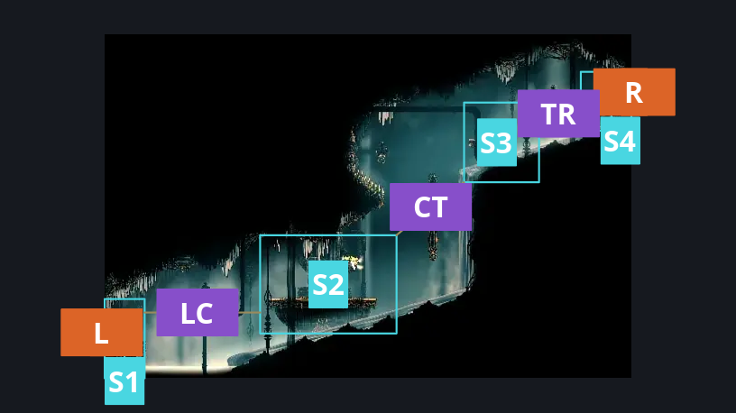
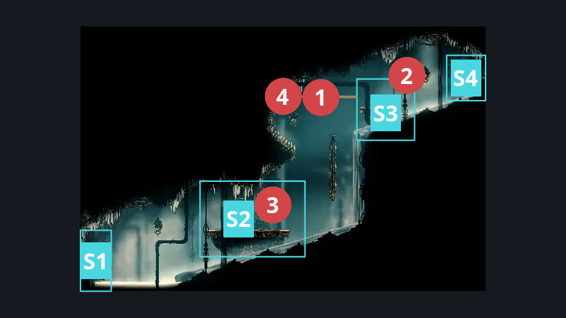
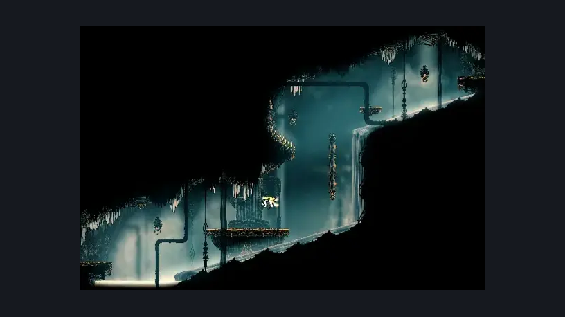

# High Halls Big Slide (Hang_13)

**Game ID:** Hang_13

**Contributors:** samupo, rebel, Gallos

## Subrooms

| No. | Subroom | Annotated |
| --- | --- | --- |
| S1 | Left Entrance | ✓ |
| S2 | Center Platform | ✓ |
| S3 | Top Platform | ✓ |
| S4 | Right Exit | ✓ |

## Room Transitions

| Alias | Name | From subroom | Destination | Destination alias | Requirements | TODO | Verification | Annotated | Notes |
| --- | --- | --- | --- | --- | --- | --- | --- | --- | --- |
| R | right1 | Right Exit | [High Halls Big Shaft (Hang_08)](high-halls-big-shaft.md) | TL | None |  | Verified | ✓ |  |
| L | left1 | Left Entrance | [High Halls Shaft Bottom (Hang_03)](high-halls-shaft-bottom.md) | TR | None |  | Verified | ✓ |  |

## Subroom Connections

| Alias | Name | Source | Destination | Requirements | TODO | Verification | Annotated | Notes |
| --- | --- | --- | --- | --- | --- | --- | --- | --- |
| LC | Left <> Center | Left Entrance | Center Platform | Clawline right OR (run AND dash right AND (Faydown Cloak OR ledge grab right OR cling grip right)) OR ((sharpdart OR clawline left OR Easy Plasmium Stall) AND Faydown Cloak AND run) |  | Verified | ✓ |  |
| LC | Left <> Center | Center Platform | Left Entrance | Drifter's cloak OR Clawline left OR (run AND (Dash left OR Faydown Cloak OR scuttlebrace)) OR (Swim AND (Ledge Grab left OR Cling Grip left)) OR (Faydown Cloak AND (Medium Plasmium Stall OR Medium Voltvessels Stall OR Easy Architect needle strike OR scuttlebrace)) OR (easy beast pogo AND easy beast needle strike) OR (easy architect needle strike AND dash left) OR (easy shaman pogo AND scuttlebrace) |  | Verified | ✓ |  |
| CT | Center <> Top | Center Platform | Top Platform | (Clawline right AND (Faydown Cloak OR ((Ledge Grab right OR Cling Grip right) AND spike pogo))) OR ((silk soar OR easy pogo off Maestro) AND spike pogo AND faydown cloak AND drifter's cloak AND (ledge grab right OR cling grip right)) OR (clawline left AND run AND faydown AND (cling grip right OR ledge grab right)) OR (proficient movement AND silk soar AND easy shaman pogo AND easy scuttlebrace) |  | Verified | ✓ |  |
| CT | Center <> Top | Top Platform | Center Platform | Ledge Grab left OR Swim OR Faydown Cloak OR Clawline left OR Sharpdart OR (Cling Grip left AND Proficient Movement) OR run OR Dash left OR Drifter's Cloak OR Easy [Reaper, Hunter, Beast, Shaman, Architect] Pogo OR easy [Hunter, Wanderer, Witch, Beast, Architect,Shaman] needle strike OR Easy Flintslate Stall OR Easy Plasmium Stall OR Easy Voltvessels Stall OR Flea Brew |  | Verified | ✓ | honestly just like literally anything in the game? |
| TR | Top <> Right | Top Platform | Right Exit | Clawline right OR (Faydown Cloak AND (run OR Drifter's Cloak OR Sharpdart OR (Swim AND (Ledge Grab right OR Cling Grip right)))) OR (easy shaman pogo AND scuttlebrace AND (silk soar OR easy enemy pogo off Minister OR faydown cloak)) |  | Verified | ✓ |  |
| TR | Top <> Right | Right Exit | Top Platform | Clawline left OR Sharpdart OR run OR (Faydown Cloak AND Dash right) OR swim OR easy scuttlebrace OR (easy beast needle strike AND easy beast pogo) OR (Easy Flintslate Stall OR Easy Plasmium Stall OR Easy Voltvessels Stall OR easy flea brew stall) |  | Verified | ✓ |  |

## Check Locations

| No. | Check | Subroom | Requirements | TODO | Verification | Location Type | Annotated | Notes |
| --- | --- | --- | --- | --- | --- | --- | --- | --- |
| 1 | Minister 1 | Top Platform | Nada |  | Verified | enemy | ✓ |  |
| 2 | Minister 2 | Top Platform | Nothing |  | Verified | enemy | ✓ |  |
| 3 | Maestro 1 | Center Platform | Free |  | Verified | enemy | ✓ |  |
| 4 | Void Mass 1 | Top Platform | Black Thread World Spawn |  | Verified | enemy | ✓ |  |

## Room Images

### Connections

### Checks

### Scene

