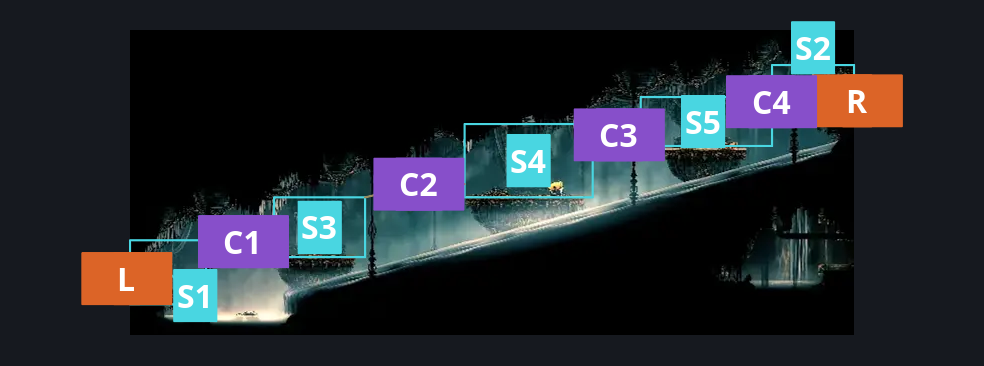
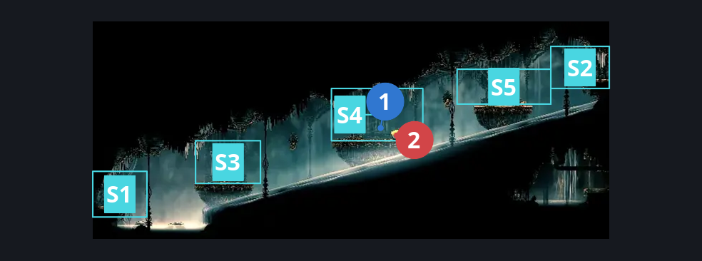
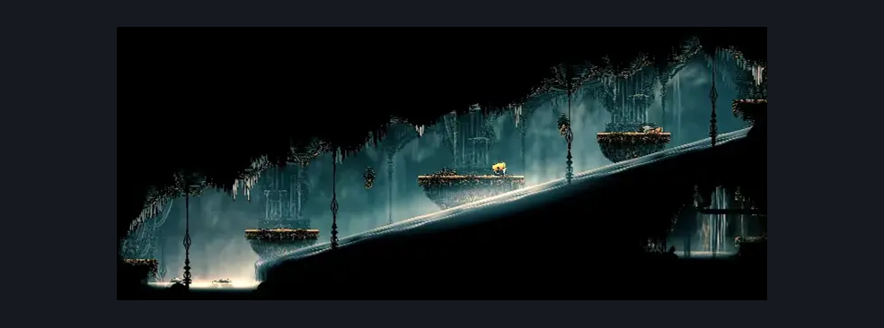

# High Halls Small Slide (Hang_02)

**Game ID:** Hang_02

**Contributors:** samupo, rebel, Gallos

## Subrooms

| No. | Subroom | Annotated |
| --- | --- | --- |
| S1 | left exit | ✓ |
| S2 | right exit | ✓ |
| S3 | left platform | ✓ |
| S4 | center platform | ✓ |
| S5 | right platform | ✓ |

## Room Transitions

| Alias | Name | From subroom | Destination | Destination alias | Requirements | TODO | Verification | Annotated | Notes |
| --- | --- | --- | --- | --- | --- | --- | --- | --- | --- |
| R | right1 | right exit | [High Halls Shaft Bottom (Hang_03)](high-halls-shaft-bottom.md) | ML | none |  | Verified | ✓ |  |
| L | left1 | left exit | [High Halls Entrance (Hang_01)](../choral-chambers/high-halls-entrance.md) | TP | none |  | Verified | ✓ |  |

## Subroom Connections

| Alias | Name | Source | Destination | Requirements | TODO | Verification | Annotated | Notes |
| --- | --- | --- | --- | --- | --- | --- | --- | --- |
| C1 | vertical 1 | left exit | left platform | (run AND dash right AND (cling grip right OR ledge grab right)) OR Clawline right OR (Sharpdart AND Proficient Movement) OR (Faydown Cloak AND (easy beast pogo OR Easy Scuttlebrace OR Drifter's Cloak OR Easy Voltvessels Stall OR Easy Plasmium Stall OR Medium Flintslate Stall OR Flea Brew OR easy architect needle strike OR dash right OR (easy hunter pogo AND ledge grab right) OR (swim AND (ledge grab right OR cling grip right)))) OR (run AND faydown AND clawline left) |  | Verified | ✓ |  |
| C1 | vertical 1 | left platform | left exit | (swim AND (easy shaman pogo OR ledge grab left OR cling grip left OR faydown)) OR Clawline left OR Sharpdart OR Faydown Cloak OR Drifter's Cloak OR Easy Scuttlebrace OR dash right OR (Flea Brew AND (Easy Flea Brew Stall OR Medium [Flintslate, Plasmium ,Voltvessels] Stall)) OR easy beast pogo OR (easy architect pogo AND easy architect needle strike) |  | Verified | ✓ |  |
| C2 | crossing 1 | left platform | center platform | Clawline right OR (Faydown Cloak AND (drifter's cloak OR run)  AND (cling grip right OR Ledge Grab right)) OR (Elite ball knowledge AND silk soar AND hard shaman pogo AND hard scuttlebrace) |  | Verified | ✓ |  |
| C2 | crossing 1 | center platform | left platform | Faydown Cloak OR Swift Step 2 OR swim OR Clawline left OR Sharpdart OR Easy Scuttlebrace OR Drifter's Cloak OR (Flea Brew AND Easy Flea Brew Stall) OR Medium Voltvessels Stall OR Medium Plasmium Stall  OR easy beast pogo |  | Verified | ✓ |  |
| C3 | crossing 2 | center platform | right platform | (easy pogo off maestro AND (dash right OR faydown cloak)) OR Clawline right OR (Faydown Cloak AND (run OR Dash right OR Drifter's Cloak OR Sharpdart OR easy Beast needle strike OR Easy Architect needle strike OR Easy Voltvessels Stall OR Easy Plasmium Stall OR Flea Brew OR (Easy Flintslate Stall AND (cling grip right OR Ledge Grab right)))) OR (Elite ball knowledge AND silk soar AND hard shaman pogo AND hard scuttlebrace) |  | Verified | ✓ |  |
| C3 | crossing 2 | right platform | center platform | Sprint OR Dash left OR swim OR Drifter's Cloak OR Faydown Cloak OR Clawline left OR Sharpdart OR Easy Scuttlebrace OR Easy [Flintslate,Voltvessels, Plasmium] Stall OR Flea Brew OR easy beast pogo |  | Verified | ✓ |  |
| C4 | crossing 3 | right platform | right exit | Faydown Cloak OR ((Cling Grip right OR Easy Scuttlebrace) AND (run OR Dash right OR Flea Brew OR Easy Architect Charge OR Easy Beast Charge OR Drifter's Cloak OR Easy Plasmium Stall)) OR ((Clawline right OR Sharpdart) AND (cling grip right OR Ledge Grab right)) OR (Elite ball knowledge AND silk soar AND hard shaman pogo AND hard scuttlebrace) |  | Verified | ✓ |  |
| C4 | crossing 3 | right exit | right platform | run OR Dash left OR Drifter's Cloak OR Faydown Cloak OR Clawline left OR Sharpdart OR Easy Scuttlebrace OR Easy Flintslate Stall OR Easy Voltvessels Stall OR Easy Plasmium Stall OR Flea Brew OR easy [hunter, beast] pogo OR easy [wanderer,architect] needle strike OR swim |  | Verified | ✓ |  |

## Check Locations

| No. | Check | Subroom | Requirements | TODO | Verification | Location Type | Annotated | Notes |
| --- | --- | --- | --- | --- | --- | --- | --- | --- |
| 1 | Second Sentinel Encounter | center platform | act 3 AND complete THE second sentinel activation |  | Verified | event | ✓ |  |
| 2 | Maestro 1 | center platform | normal world spawn |  | Verified | enemy | ✓ |  |

## Room Images

### Connections

### Checks

### Scene

