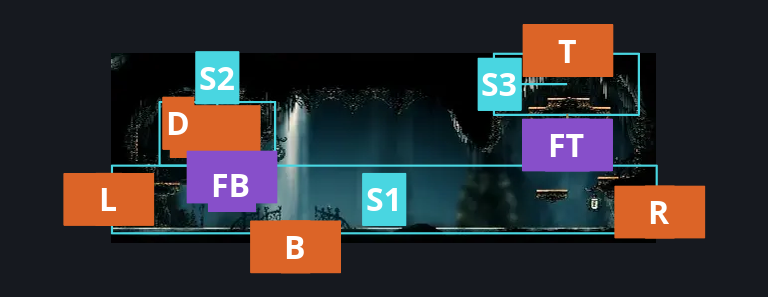
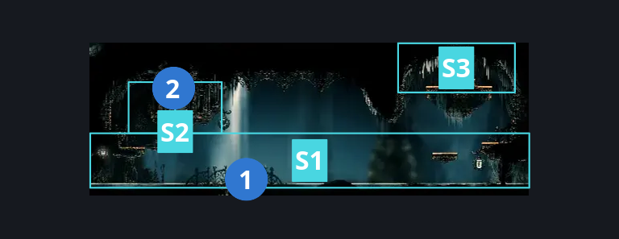
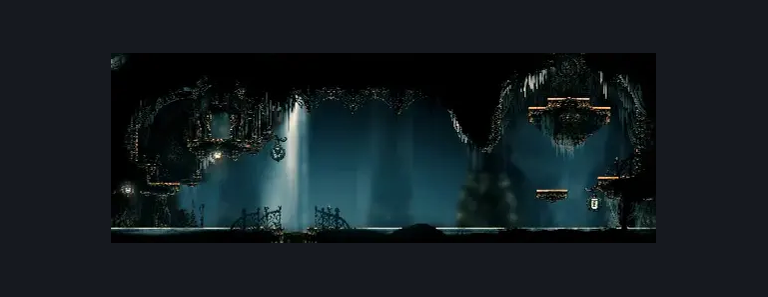

# High Halls Vault (Hang_06)

**Game ID:** Hang_06

**Contributors:** samupo, rebel, Gallos

## Subrooms

| No. | Subroom | Annotated |
| --- | --- | --- |
| S1 | Floor | ✓ |
| S2 | Bank | ✓ |
| S3 | Top Exit | ✓ |

## Room Transitions

| Alias | Name | From subroom | Destination | Destination alias | Requirements | TODO | Verification | Annotated | Notes |
| --- | --- | --- | --- | --- | --- | --- | --- | --- | --- |
| D | door1 | Bank | [High Halls Rosary Bank (Hang_06_bank)](high-halls-rosary-bank.md) | L | Unlock Rosary Bank Door |  | Verified | ✓ |  |
| L | left1 | Floor | [High Halls Arena (Hang_04)](high-halls-arena.md) | R | none |  | Verified | ✓ |  |
| B | bot1 | Floor | [High Halls Corridor (Hang_07)](../choral-chambers/high-halls-corridor.md) | T | Activate Vault - Floor lever |  | Verified | ✓ |  |
| R | right1 | Floor | [High Halls Ventrica (Hang_06b)](high-halls-ventrica.md) | L | none |  | Verified | ✓ |  |
| T | top1 | Top Exit | [High Halls Big Shaft (Hang_08)](high-halls-big-shaft.md) | B | none |  | Verified | ✓ |  |

## Subroom Connections

| Alias | Name | Source | Destination | Requirements | TODO | Verification | Annotated | Notes |
| --- | --- | --- | --- | --- | --- | --- | --- | --- |
| FB | Floor <> Bank | Floor | Bank | Cling Grip left OR ledge grab left OR faydown cloak OR silk soar |  | Verified | ✓ |  |
| FB | Floor <> Bank | Bank | Floor | none |  | Verified | ✓ | falling |
| FT | Floor <> Top | Floor | Top Exit | cling grip right OR (faydown cloak AND (ledge grab left OR cling grip left)) OR silk soar |  | Verified | ✓ |  |
| FT | Floor <> Top | Top Exit | Floor | none |  | Verified | ✓ | falling |

## Check Locations

| No. | Check | Subroom | Requirements | TODO | Verification | Location Type | Annotated | Notes |
| --- | --- | --- | --- | --- | --- | --- | --- | --- |
| 1 | Vault - Floor lever | Floor | Flip Lever Left OR Flip Lever Right |  | Verified | switch | ✓ |  |
| 2 | Rosary Bank Door | Bank | Own Simple Key Rosary Bank |  | Verified | lock | ✓ |  |

## Room Images

### Connections

### Checks

### Scene

