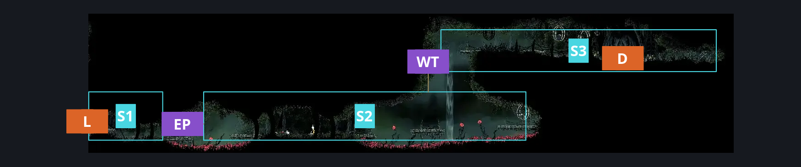
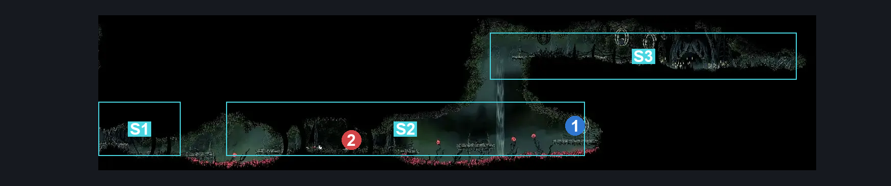
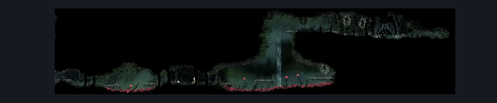

# Hunter's March Chapel Passage (Ant_20)

**Game ID:** Ant_20

**Contributors:** herounit

## Subrooms

| No. | Subroom | Annotated |
| --- | --- | --- |
| S1 | left entrance | ✓ |
| S2 | crossing platform | ✓ |
| S3 | chapel entrance | ✓ |

## Room Transitions

| Alias | Name | From subroom | Destination | Destination alias | Requirements | TODO | Verification | Annotated | Notes |
| --- | --- | --- | --- | --- | --- | --- | --- | --- | --- |
| L | left1 | left entrance | [Hunter's March Shaft (Ant_14)](hunter-s-march-shaft.md) | LR | none |  | Verified | ✓ |  |
| D | door1 | chapel entrance | [Chapel of the Beast (Ant_19)](chapel-of-the-beast.md) | L | none (door forced open) |  | Verified | ✓ | The randomizer will need to ensure this door stays open when this room is relevant |

## Subroom Connections

| Alias | Name | Source | Destination | Requirements | TODO | Verification | Annotated | Notes |
| --- | --- | --- | --- | --- | --- | --- | --- | --- |
| EP | evil pogo | left entrance | crossing platform | run  OR dash right  OR drifters  OR faydown  OR clawline right OR sharpdart  OR easy scuttlebrace  OR easy [ shaman, wanderer, beast, reaper, hunter ] pogo OR ( easy [ witch, architect ] pogo AND ( ledge grab right OR flea brew ) ) |  | Verified | ✓ |  |
| EP | evil pogo | crossing platform | left entrance | none |  | Verified | ✓ | can pogo the gap for free from this direction |
| WT | wind tunnel | crossing platform | chapel entrance | drifter's cloak OR silk soar |  | Verified | ✓ |  |
| WT | wind tunnel | chapel entrance | crossing platform | none (falling) |  | Verified | ✓ |  |

## Check Locations

| No. | Check | Subroom | Requirements | TODO | Verification | Location Type | Annotated | Notes |
| --- | --- | --- | --- | --- | --- | --- | --- | --- |
| 1 | memory locket | crossing platform | none |  | Verified | collectible | ✓ | need to break a cage |
| 2 | Skarr Stalker 1 | crossing platform | Normal World Spawn |  | Verified | enemy | ✓ |  |

## Room Images

### Connections

### Checks

### Scene

