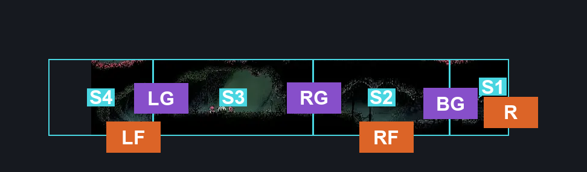
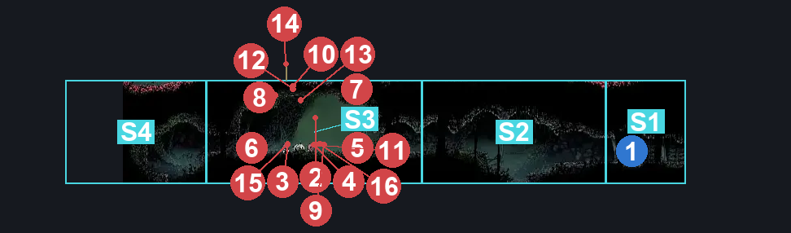
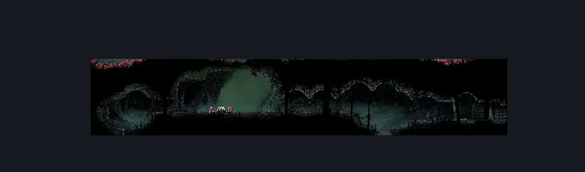

# Hunter's March Deep Docks Passage (Ant_05b)

**Game ID:** Ant_05b

**Contributors:** herounit

## Subrooms

| No. | Subroom | Annotated |
| --- | --- | --- |
| S1 | before gate | ✓ |
| S2 | right of gauntlet | ✓ |
| S3 | gauntlet | ✓ |
| S4 | left of gauntlet | ✓ |

## Room Transitions

| Alias | Name | From subroom | Destination | Destination alias | Requirements | TODO | Verification | Annotated | Notes |
| --- | --- | --- | --- | --- | --- | --- | --- | --- | --- |
| R | right1 | before gate | [Hunter's March Shaft (Ant_14)](hunter-s-march-shaft.md) | L4 | none |  | Verified | ✓ |  |
| LF | bot1 | left of gauntlet | [Is this still Deep Docks West (Bone_East_04b)](../deep-docks/is-this-still-deep-docks-west.md) | C | none |  | Verified | ✓ |  |
| RF | bot2 | right of gauntlet | [Is this still Deep Docks? East (Bone_East_04)](../deep-docks/is-this-still-deep-docks-east.md) | C | none |  | Verified | ✓ |  |

## Subroom Connections

| Alias | Name | Source | Destination | Requirements | TODO | Verification | Annotated | Notes |
| --- | --- | --- | --- | --- | --- | --- | --- | --- |
| BG | bone gate | before gate | right of gauntlet | activate bone switch |  | Verified | ✓ |  |
| BG | bone gate | right of gauntlet | before gate | activate bone switch |  | Verified | ✓ |  |
| RG | right gauntlet | right of gauntlet | gauntlet | none (starts gauntlet) |  | Verified | ✓ |  |
| RG | right gauntlet | gauntlet | right of gauntlet | defeat gauntlet fight |  | Verified | ✓ |  |
| LG | left gauntlet | left of gauntlet | gauntlet | none (starts gauntlet) |  | Verified | ✓ |  |
| LG | left gauntlet | gauntlet | left of gauntlet | defeat gauntlet fight |  | Verified | ✓ |  |

## Check Locations

| No. | Check | Subroom | Requirements | TODO | Verification | Location Type | Annotated | Notes |
| --- | --- | --- | --- | --- | --- | --- | --- | --- |
| 1 | bone switch | before gate | none |  | Verified | switch | ✓ |  |
| 2 | gauntlet fight | gauntlet | Combat Requirements |  | Verified | gauntlet | ✓ |  |
| 3 | Skarr Scout 1 | gauntlet | Normal World Spawn |  | Verified | enemy | ✓ |  |
| 4 | Skarr Scout 2 | gauntlet | Normal World Spawn |  | Verified | enemy | ✓ |  |
| 5 | Skarrlid 1 | gauntlet | Normal World Spawn |  | Verified | enemy | ✓ |  |
| 6 | Skarrlid 2 | gauntlet | Normal World Spawn |  | Verified | enemy | ✓ |  |
| 7 | Skarrwing 1 | gauntlet | Normal World Spawn |  | Verified | enemy | ✓ |  |
| 8 | Skarrwing 2 | gauntlet | Normal World Spawn |  | Verified | enemy | ✓ |  |
| 9 | Skarr Scout 3 | gauntlet | Normal World Spawn |  | Verified | enemy | ✓ |  |
| 10 | Skarrwing 3 | gauntlet | Normal World Spawn |  | Verified | enemy | ✓ |  |
| 11 | Skarr Scout 4 | gauntlet | Normal World Spawn |  | Verified | enemy | ✓ |  |
| 12 | Skarrwing 4 | gauntlet | Normal World Spawn |  | Verified | enemy | ✓ |  |
| 13 | Void Mass 1 | gauntlet | Black Thread World Spawn |  | Verified | enemy | ✓ |  |
| 14 | Spear Skarr 1 | gauntlet | Black Thread World Spawn |  | Verified | enemy | ✓ |  |
| 15 | Skarr Scout 5 | gauntlet | Black Thread World Spawn |  | Verified | enemy | ✓ |  |
| 16 | Skarr Scout 6 | gauntlet | Black Thread World Spawn |  | Verified | enemy | ✓ |  |

## Room Images

### Connections

### Checks

### Scene

