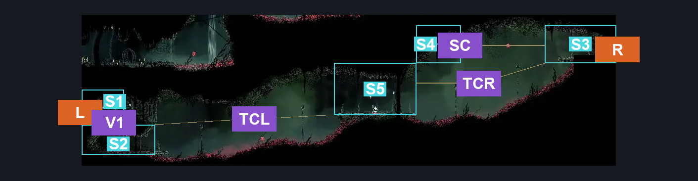
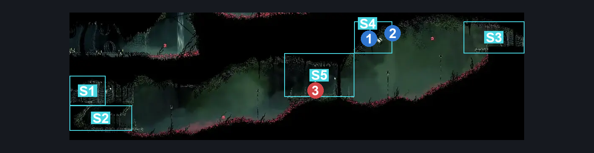
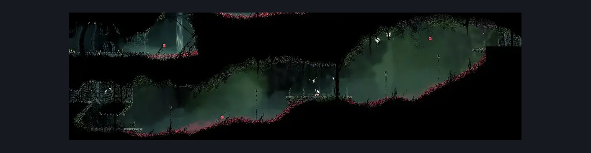

# Hunter's March Deep Entrance (Ant_09)

**Game ID:** Ant_09

**Contributors:** herounit

## Subrooms

| No. | Subroom | Annotated |
| --- | --- | --- |
| S1 | left exit area | ✓ |
| S2 | below left exit | ✓ |
| S3 | right exit area | ✓ |
| S4 | free silk | ✓ |
| S5 | center platform | ✓ |

## Room Transitions

| Alias | Name | From subroom | Destination | Destination alias | Requirements | TODO | Verification | Annotated | Notes |
| --- | --- | --- | --- | --- | --- | --- | --- | --- | --- |
| L | left1 | left exit area | [Hunter's March Statue (Ant_05c)](hunter-s-march-statue.md) | R | none |  | Verified | ✓ |  |
| R | right1 | right exit area | [Far Fields Upper Shaft (Bone_East_11)](../far-fields/far-fields-upper-shaft.md) | L | none |  | Verified | ✓ |  |

## Subroom Connections

| Alias | Name | Source | Destination | Requirements | TODO | Verification | Annotated | Notes |
| --- | --- | --- | --- | --- | --- | --- | --- | --- |
| V1 | vertical access | below left exit | left exit area | silk soar  OR cling grip right  OR ( faydown cloak AND ( ledge grab either OR cling grip left OR easy scuttlebrace ) ) |  | Verified | ✓ |  |
| V1 | vertical access | left exit area | below left exit | none (falling) |  | Verified | ✓ |  |
| SC | silk collection | right exit area | free silk | clawline left x 2 |  | Verified | ✓ |  |
| SC | silk collection | free silk | right exit area | clawline right x 2 |  | Verified | ✓ |  |
| TCL | thorn crossning left | below left exit | center platform | clawline right x 2 AND silkhearts x 1 AND faydown cloak |  | Verified | ✓ |  |
| TCR | thorn crossing right | center platform | right exit area | clawline right x 2 AND silkhearts x 1 AND faydown cloak |  | Verified | ✓ |  |
| TCL | thorn crossning left | center platform | below left exit | clawline left x 2 AND silkhearts x 1 AND faydown cloak |  | Verified | ✓ |  |
| TCR | thorn crossing right | right exit area | center platform | ( clawline left x 2 AND silkhearts x 1 AND faydown cloak ) OR ( clawline left x 3 AND silkhearts x 2 ) |  | Verified | ✓ |  |

## Check Locations

| No. | Check | Subroom | Requirements | TODO | Verification | Location Type | Annotated | Notes |
| --- | --- | --- | --- | --- | --- | --- | --- | --- |
| 1 | Silkcatcher Plant | free silk | attack left |  | Verified | resource | ✓ |  |
| 2 | Silkcatcher Plant (1) | free silk | attack left |  | Verified | resource | ✓ |  |
| 3 | Spear Skarr 1 | center platform | none |  | Verified | enemy | ✓ |  |

## Room Images

### Connections

### Checks

### Scene

