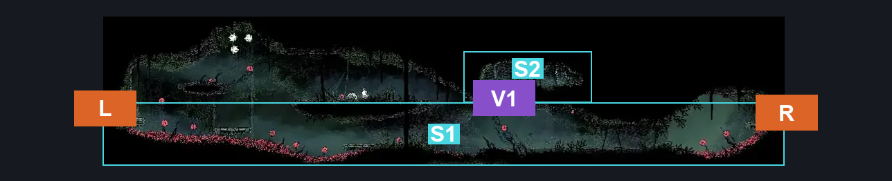
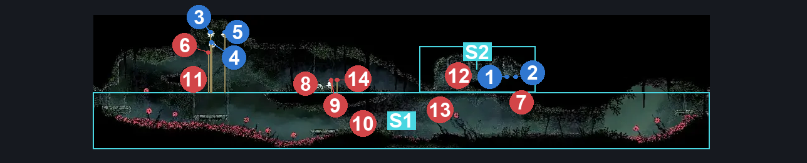
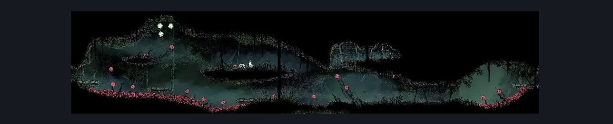

# Hunter's March Early Pathway East (Ant_04)

**Game ID:** Ant_04

**Contributors:** herounit

## Subrooms

| No. | Subroom | Annotated |
| --- | --- | --- |
| S1 | main area | ✓ |
| S2 | ceiling alcove | ✓ |

## Room Transitions

| Alias | Name | From subroom | Destination | Destination alias | Requirements | TODO | Verification | Annotated | Notes |
| --- | --- | --- | --- | --- | --- | --- | --- | --- | --- |
| R | right1 | main area | [Hunter's March Shaft (Ant_14)](hunter-s-march-shaft.md) | L3 | none |  | Verified | ✓ |  |
| L | left1 | main area | [Hunter's March Map Shop (Ant_04_mid)](hunter-s-march-map-shop.md) | R | none |  | Verified | ✓ |  |

## Subroom Connections

| Alias | Name | Source | Destination | Requirements | TODO | Verification | Annotated | Notes |
| --- | --- | --- | --- | --- | --- | --- | --- | --- |
| V1 | vertical 1 | main area | ceiling alcove | silk soar  OR easy [ shaman, reaper, wanderer ] pogo  OR faydown  OR cling grip either  OR ledge grab right |  | Verified | ✓ |  |
| V1 | vertical 1 | ceiling alcove | main area | none (falling) |  | Verified | ✓ |  |

## Check Locations

| No. | Check | Subroom | Requirements | TODO | Verification | Location Type | Annotated | Notes |
| --- | --- | --- | --- | --- | --- | --- | --- | --- |
| 1 | shell shard cache hunters march 3 | ceiling alcove | none |  | Verified | collectible | ✓ |  |
| 2 | shell shard cache hunters march 4 | ceiling alcove | none |  | Verified | collectible | ✓ |  |
| 3 | Silkcatcher Plant (2) | main area | attack up |  | Verified | resource | ✓ |  |
| 4 | Silkcatcher Plant (1) | main area | attack up |  | Verified | resource | ✓ |  |
| 5 | Silkcatcher Plant | main area | attack up |  | Verified | resource | ✓ |  |
| 6 | Spear Skarr 1 | main area | Invalid |  | Verified | enemy | ✓ | doesn't seem to appear |
| 7 | Skarrwing 1 | main area | Normal World Spawn |  | Verified | enemy | ✓ |  |
| 8 | Skarr Scout 1 | main area | Normal World Spawn |  | Verified | enemy | ✓ |  |
| 9 | Skarr Stalker 1 | main area | Normal World Spawn |  | Verified | enemy | ✓ |  |
| 10 | Skarr Scout 2 | main area | Normal World Spawn |  | Verified | enemy | ✓ |  |
| 11 | Skarrlid 1 | main area | Normal World Spawn |  | Verified | enemy | ✓ |  |
| 12 | Skarrlid 2 | ceiling alcove | Normal World Spawn |  | Verified | enemy | ✓ |  |
| 13 | Skarrwing 2 | main area | Black Thread World Spawn |  | Verified | enemy | ✓ |  |
| 14 | Skarr Stalker 2 | main area | Black Thread World Spawn |  | Verified | enemy | ✓ |  |

## Room Images

### Connections

### Checks

### Scene

