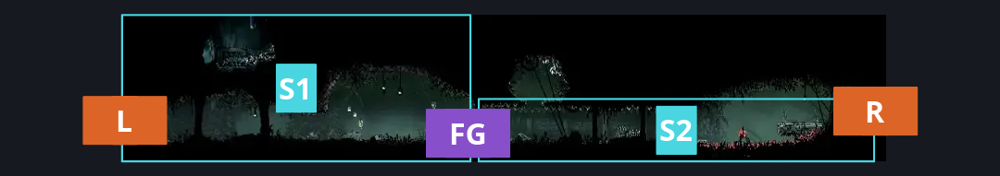
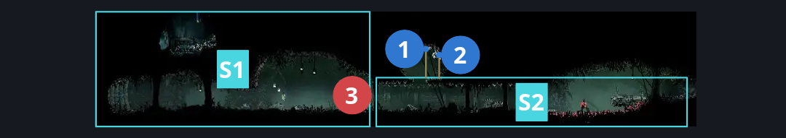
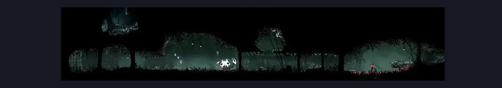

# Hunter's March Entrance (Ant_02)

**Game ID:** Ant_02

**Contributors:** herounit

## Subrooms

| No. | Subroom | Annotated |
| --- | --- | --- |
| S1 | before door | ✓ |
| S2 | after door | ✓ |

## Room Transitions

| Alias | Name | From subroom | Destination | Destination alias | Requirements | TODO | Verification | Annotated | Notes |
| --- | --- | --- | --- | --- | --- | --- | --- | --- | --- |
| L | left1 | before door | [The Marrow Jail Pathway (Bone_08)](../the-marrow/the-marrow-jail-pathway.md) | MR | none |  | Verified | ✓ |  |
| R | right1 | after door | [Hunter's March Pogo Intro (Ant_03)](hunter-s-march-pogo-intro.md) | L | none |  | Verified | ✓ |  |

## Subroom Connections

| Alias | Name | Source | Destination | Requirements | TODO | Verification | Annotated | Notes |
| --- | --- | --- | --- | --- | --- | --- | --- | --- |
| FG | fight grunt | before door | after door | defeat Skarrgard the March Gatekeeper |  | Verified | ✓ | test |
| FG | fight grunt | after door | before door | defeat Skarrgard the March Gatekeeper |  | Verified | ✓ | test  the gate doesn't appear until the Skarrgard spots you, so nothing is required to go this way  Needs testing, maybe enemy souls changes this |

## Check Locations

| No. | Check | Subroom | Requirements | TODO | Verification | Location Type | Annotated | Notes |
| --- | --- | --- | --- | --- | --- | --- | --- | --- |
| 1 | shell shard cache hunter's march 1 | after door | ledge grab either OR cling grip either OR faydown cloak OR silk soar OR (medium shaman pogo AND hard pale nails stall x 3) OR (hard beast bind stall AND hard plasmium stall) OR easy [voltvessels,pimpillo,sting shard,thread storm,rune rage] use OR medium [conchcutter] use OR hard throwing ring use |  | Verified | collectible | ✓ | hoping that these are labeled the correct way around |
| 2 | shell shard cache hunter's march 2 | after door | ledge grab either OR cling grip either OR faydown cloak OR silk soar OR (medium shaman pogo AND hard pale nails stall x 3) OR (hard beast bind stall AND hard plasmium stall) OR easy [voltvessels,pimpillo,sting shard,thread storm,rune rage] use OR medium [conchcutter] use OR medium beast charge OR shaman longclaw up OR (medium beast bind stall AND beast longclaw up) OR easy witch bind stall (hit the shards with bind) OR hard throwing ring use |  | Verified | collectible | ✓ |  |
| 3 | Skarrgard the March Gatekeeper | before door | none |  | Verified | miniboss | ✓ | Interesting. His FSM has something about having dash in it. |

## Notes

removed 'checks alcove' subroom to account for using tools from bottom

## Room Images

### Connections

### Checks

### Scene

