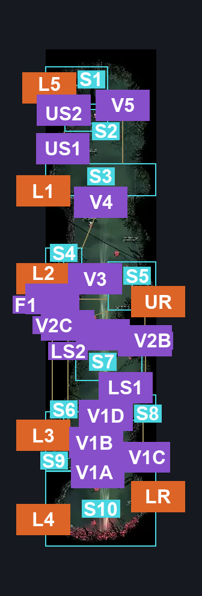
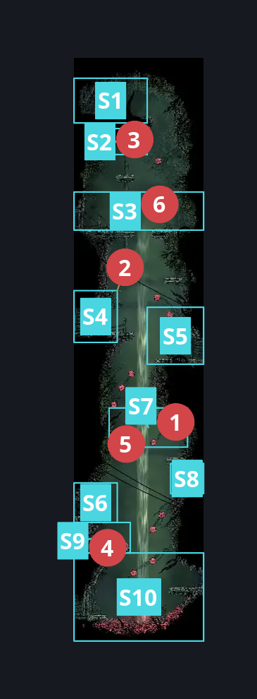
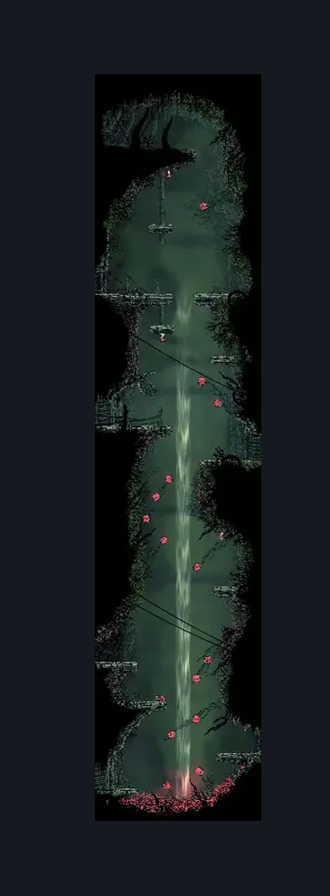

# Hunter's March Shaft (Ant_14)

**Game ID:** Ant_14

**Contributors:** herounit

## Subrooms

| No. | Subroom | Annotated |
| --- | --- | --- |
| S1 | the top | ✓ |
| S2 | upper skarrwing | ✓ |
| S3 | L1 platform | ✓ |
| S4 | L2 platform | ✓ |
| S5 | UR platform | ✓ |
| S6 | L3 platform | ✓ |
| S7 | lower skarwings | ✓ |
| S8 | lower right niche | ✓ |
| S9 | below L3 | ✓ |
| S10 | the bottom | ✓ |

- **upper skarrwing:** enemy only subroom
- **lower skarwings:** enemy only subroom

## Room Transitions

| Alias | Name | From subroom | Destination | Destination alias | Requirements | TODO | Verification | Annotated | Notes |
| --- | --- | --- | --- | --- | --- | --- | --- | --- | --- |
| L5 | left5 | the top | [Hunter's March Treasure Vault (Ant_21)](hunter-s-march-treasure-vault.md) | R | none |  | Verified | ✓ |  |
| L1 | left1 | L1 platform | [Hunter's March Skarr Shop (Ant_Merchant)](hunter-s-march-skarr-shop.md) | R | none |  | Verified | ✓ |  |
| L2 | left2 | L2 platform | [Hunter's March Trapped Bench (Ant_17)](hunter-s-march-trapped-bench.md) | R | none |  | Verified | ✓ |  |
| L3 | left3 | L3 platform | [Hunter's March Early Pathway East (Ant_04)](hunter-s-march-early-pathway-east.md) | R | none |  | Verified | ✓ |  |
| L4 | left4 | the bottom | [Hunter's March Deep Docks Passage (Ant_05b)](hunter-s-march-deep-docks-passage.md) | R | none |  | Verified | ✓ |  |
| UR | right2 | UR platform | [Hunter's March Statue (Ant_05c)](hunter-s-march-statue.md) | L | none |  | Verified | ✓ |  |
| LR | right3 | the bottom | [Hunter's March Chapel Passage (Ant_20)](hunter-s-march-chapel-passage.md) | L | none |  | Verified | ✓ |  |

## Subroom Connections

| Alias | Name | Source | Destination | Requirements | TODO | Verification | Annotated | Notes |
| --- | --- | --- | --- | --- | --- | --- | --- | --- |
| V1A | vertical 1 part A | the bottom | below L3 | ledge grab left OR cling grip either OR dash left OR clawline left OR sharpdart OR silk soar  OR drifters OR faydown OR flea brew OR cloaked |  | Verified | ✓ | all crests but architect can get up here by basic pogo. architect can get up here with needle left, so I'm counting all crests as being able to make it free  naked, maybe with proficient movement? - hero, 11/7 |
| V1A | vertical 1 part A | below L3 | the bottom | none (falling) |  | Verified | ✓ |  |
| V1B | vertical 1 part B | below L3 | L3 platform | ledge grab left OR cling grip left OR clawline left OR sharpdart OR faydown OR drifters OR ( cloaked AND dash left ) |  | Verified | ✓ | architect struggles to get the vertical needed to make dash left work, but if you needle first, it works  naked, not so much - hero, 11/7  if you get to the upper right alcove, you can lure the skarrwing down far enough to |
| V1B | vertical 1 part B | L3 platform | below L3 | none (falling) |  | Verified | ✓ |  |
| V1C | vertical 1 part C | below L3 | lower right niche | cling grip right OR ledge grab right OR silk soar OR drifters OR faydown |  | Verified | ✓ |  |
| V1C | vertical 1 part C | lower right niche | below L3 | none (falling) |  | Verified | ✓ |  |
| V1D | vertical 1 part D | lower right niche | L3 platform | run  OR dash left OR drifters  OR easy pogo off skarrwing |  | Verified | ✓ | can activate the skarrwing from below the platform |
| F1 | fall 1 | UR platform | L3 platform | none (falling) |  | Verified | ✓ |  |
| V2B | vertical 2 part B | lower right niche | UR platform | ledge grab right OR drifters OR faydown OR easy pogo off skarrwing |  | Verified | ✓ | no cling grip - blue collisions  oops, missed the enemy pogo to get up above, teehee - hero, 11/8 |
| V2C | vertical 2 part C | below L3 | UR platform | silk soar |  | Verified | ✓ | can silk soar into the bottom of the platform and with a bit of persistent pogoing, you can make it to the ledge, even if cloakless |
| V3 | vertical 3 | UR platform | L2 platform | ledge grab left  OR cling grip left OR silk soar  OR drifters OR faydown |  | Verified | ✓ | got it with scuttlebrace exactly once LOL |
| V3 | vertical 3 | L2 platform | UR platform | none (falling) |  | Verified | ✓ |  |
| V4 | vertical 4 | L2 platform | L1 platform | ( ( ledge grab right OR cling grip right ) OR ( dash left OR ledge grab left OR cling grip left OR ( run AND proficient movement ) ) ) OR silk soar  OR drifters  OR faydown  OR easy beast pogo (no ledge grab needed) OR medium shaman pogo OR easy pogo off skarrwing OR ( easy [ hunter, wanderer, beast, reaper, witch, shaman ] pogo AND ( ( ledge grab left OR cling grip left ) OR ( run AND proficient movement AND ( ledge grab either OR cling grip either ) ) ) ) |  | Verified | ✓ | running from the right platform to the left platform works if you time it right then animation cancel out of the run with a needle attack |
| V4 | vertical 4 | L1 platform | L2 platform | none (falling) |  | Verified | ✓ |  |
| V5 | vertical 5 | L1 platform | the top | silk soar  OR cling grip both OR ( cling grip left AND ( faydown OR easy enemy pogo off skarrwing ) ) OR ( medium enemy pogo off skarrwing AND taunt ) |  | Verified | ✓ | saying that ledge grab is needed for convenience |
| V5 | vertical 5 | the top | L1 platform | none (falling) |  | Verified | ✓ |  |
| LS1 | lower skarrwing access 1 | lower right niche | lower skarwings | none (can aggro from below the platform) |  | Verified | ✓ |  |
| LS2 | lower skarrwing access 2 | UR platform | lower skarwings | none (falling) |  | Verified | ✓ |  |
| US1 | upper skarrwing access 1 | L1 platform | upper skarrwing | cling grip left |  | Verified | ✓ |  |
| US2 | upper skarrwing access 2 | the top | upper skarrwing | none (falling) |  | Verified | ✓ |  |

## Check Locations

| No. | Check | Subroom | Requirements | TODO | Verification | Location Type | Annotated | Notes |
| --- | --- | --- | --- | --- | --- | --- | --- | --- |
| 1 | Skarrwing 1 | lower skarwings | Normal World Spawn |  | Verified | enemy | ✓ |  |
| 2 | Skarrwing 2 | L2 platform | Normal World Spawn |  | Verified | enemy | ✓ |  |
| 3 | Skarrwing 3 | upper skarrwing | Normal World Spawn |  | Verified | enemy | ✓ |  |
| 4 | Skarrlid 1 | below L3 | Normal World Spawn |  | Verified | enemy | ✓ |  |
| 5 | Skarrwing 4 | lower skarwings | Black Thread World Spawn |  | Verified | enemy | ✓ |  |
| 6 | Skarrwing 5 | L1 platform | Black Thread World Spawn |  | Verified | enemy | ✓ |  |

## Room Images

### Connections

### Checks

### Scene

