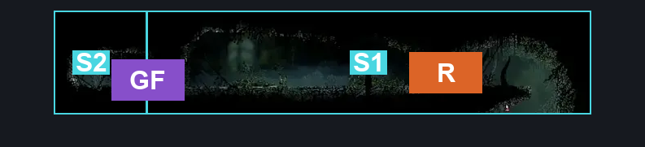
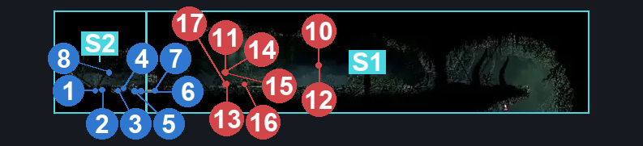
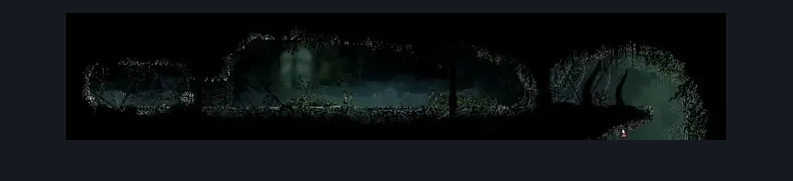

# Hunter's March Treasure Vault (Ant_21)

**Game ID:** Ant_21

**Contributors:** herounit

## Subrooms

| No. | Subroom | Annotated |
| --- | --- | --- |
| S1 | right of door | ✓ |
| S2 | left of door | ✓ |

## Room Transitions

| Alias | Name | From subroom | Destination | Destination alias | Requirements | TODO | Verification | Annotated | Notes |
| --- | --- | --- | --- | --- | --- | --- | --- | --- | --- |
| R | right1 | right of door | [Hunter's March Shaft (Ant_14)](hunter-s-march-shaft.md) | L5 | none |  | Verified | ✓ |  |

## Subroom Connections

| Alias | Name | Source | Destination | Requirements | TODO | Verification | Annotated | Notes |
| --- | --- | --- | --- | --- | --- | --- | --- | --- |
| GF | grunt fight | left of door | right of door | defeat grunt fight |  | Verified | ✓ |  |
| GF | grunt fight | right of door | left of door | defeat grunt fight |  | Verified | ✓ |  |

## Check Locations

| No. | Check | Subroom | Requirements | TODO | Verification | Location Type | Annotated | Notes |
| --- | --- | --- | --- | --- | --- | --- | --- | --- |
| 1 | rosary cache hunters march 4 | left of door | none |  | Verified | collectible | ✓ |  |
| 2 | rosary cache hunters march 5 | left of door | none |  | Verified | collectible | ✓ |  |
| 3 | rosary cache hunters march 6 | left of door | none |  | Verified | collectible | ✓ |  |
| 4 | rosary cache hunters march 7 | left of door | none |  | Verified | collectible | ✓ |  |
| 5 | rosary cache hunters march 8 | left of door | none |  | Verified | collectible | ✓ |  |
| 6 | rosary cache hunters march 9 | left of door | none |  | Verified | collectible | ✓ |  |
| 7 | rosary cache hunters march 10 | left of door | none |  | Verified | collectible | ✓ |  |
| 8 | curveclaw | left of door | none |  | Verified | collectible | ✓ | alt location for curveclaw if mottled skarr is dead |
| 9 | grunt fight | right of door | defeat Spear Skarr 1 AND defeat Skarrgard 1 |  | Verified | miniboss |  | pretty sure these two don't respawn |
| 10 | Spear Skarr 1 | right of door | none |  | Verified | miniboss | ✓ |  |
| 11 | Skarrgard 1 | right of door | none |  | Verified | miniboss | ✓ | FSM Boolean flags: hasDash |
| 12 | Spear Skarr 2 | right of door | invalid |  | Verified | enemy | ✓ | Spawn conditions: ant21_ExtraBattleAdded=true |
| 13 | Spear Skarr 3 | right of door | invalid |  | Verified | enemy | ✓ | Spawn conditions: ant21_ExtraBattleAdded=true |
| 14 | Skarrgard 2 | right of door | invalid |  | Verified | enemy | ✓ | Spawn conditions: ant21_guardDefeated=false, antMerchantKilled=false FSM Boolean flags: hasDash |
| 15 | Skarrgard 3 | right of door | invalid |  | Verified | enemy | ✓ | Spawn conditions: ant21_guardDefeated=false, antMerchantKilled=true FSM Boolean flags: hasDash |
| 16 | Spear Skarr 4 | right of door | invalid |  | Verified | enemy | ✓ | Spawn conditions: ant21_guardDefeated=false, antMerchantKilled=true |
| 17 | Spear Skarr 5 | right of door | invalid |  | Verified | enemy | ✓ | Spawn conditions: ant21_guardDefeated=true, antMerchantKilled=true |

## Room Images

### Connections

### Checks

### Scene

